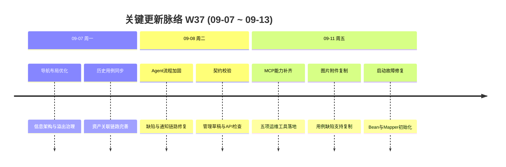

# 周报 2026-W37 (2026-09-07 ~ 2026-09-13)

> **总计 5 次提交 | 121 个文件变更 | +23,371 行 / -239 行 | 0 个 PR 合并（上期截止 #119）**
>
> **贡献者**：chenqifen-miduo（5 commits）
>
> **整体状态：部分完成** — 多项定向测试、构建、打包和组件浏览器验证已通过，但真实平台、数据库、Docker 容器和核心业务 E2E 仍缺少证据。

**本周趋势**：本周提交数量继续下降，但单次交付规模明显增大，工作重点从测试资产治理转向 MCP 能力补齐与运行稳定性。核心变化包括五项 MCP 运维工具、最后执行人读取、工具覆盖审计、启动故障修复，以及用例和缺陷图片附件复制。同时推进导航布局、历史用例同步、Agent 缺陷流程与企业微信通知加固。研发证据较上周更完整，已经包含 52 项 MCP 后端测试、30 项执行人读取测试、应用打包和独立组件浏览器验证；但这些仍不能替代真实部署环境的端到端验收。

> **统计口径**：提交、文件和行数统计 2026-09-07 至 2026-09-13 的当前分支历史。W36 截止 PR #119 后没有发现新的自研合并 PR，本期所有变更均以直接提交进入当前分支。

---

## 关键更新脉络

---

## 一、本周完成（按验收证据分级）

### 1. MCP 运维工具补齐 — 覆盖五项关键维护与执行闭环

> **价值**：让 Agent 不仅能读取测试资产，还能维护计划、恢复任务、流转缺陷并批量回写结果，减少人工切换平台操作。

- 新增 `functional.submit.batch`，支持 1～100 项结果批量回写、逐项幂等、部分失败和 `failFast`。
- 新增 `execution.checkpoint.resume`，复用一次性恢复令牌、快照哈希、预检和任务状态校验。
- 新增 `test_plan.update` 和 `test_plan.disassociate_cases`，支持版本校验及执行中禁止修改。
- 新增 `execution.search`，支持状态、时间、关键词和稳定分页，并限制个人 MCP 通道与项目范围。
- 新增 `bug.transitions` 和 `bug.transition`，复用既有缺陷工作流、权限、必填字段和并发版本校验。
- 同步更新原生 MCP、stdio 客户端、工具注册、参数 Schema 和安全错误映射。
- **验证证据**：后端新增 24 项并连同回归共 52 项通过；stdio TypeScript 编译和 4 项测试通过；应用打包 `BUILD SUCCESS`。
- **状态**：⚠️ 部分完成；真实 MySQL、在线 MCP、RBAC、并发幂等、平台写入和 Runner E2E 未验证。

### 2. MCP 最后执行人读取 — 补齐用例库与计划执行上下文

> **价值**：让 Agent 能判断用例最后由谁执行，并区分用例库记录与具体测试计划中的执行人。

- 在原生 `functional.search/get` 响应中增加最后执行人 ID 和姓名。
- stdio 的用例搜索和详情查询透传新增字段。
- 带计划上下文时优先使用计划关联记录，未执行时保留空值，不虚构用户姓名。
- `includeSteps=false` 时仍可读取执行人信息。
- **验证证据**：Maven 30 项测试通过；TypeScript 检查和 `git diff --check` 通过。
- **状态**：⚠️ 部分完成；真实数据库、在线 MCP、受限项目和计划上下文 E2E 未执行。

### 3. MCP 覆盖审计与差距清单 — 明确原生端和 stdio 的能力边界

> **价值**：避免将“工具已注册”误判为“业务已闭环”，为后续补齐评审、报告、日志和接口测试能力提供依据。

- 清点原生 MCP 84 项注册、4 项显式隔离触发器和 80 项潜在可见工具。
- 清点 stdio 30 项工具及两端 27 项同义交集。
- 识别用例评审、测试报告、执行日志、接口测试和计划维护等业务缺口。
- 明确附件挂载与上传、产物下载、诊断信息和人工确认入口之间的语义差异。
- 增加自动审计脚本和机器可读清单。
- **验证证据**：审计脚本、TypeScript 编译和 9 项 MCP 定向测试通过。
- **状态**：⚠️ 部分完成；静态扫描不能证明 Spring 运行时注册和真实账号可见性，仍需在线 `tools/list` 与实际调用。

### 4. MeterSphere 启动故障修复 — 修复 Bean 注入和 Mapper 初始化问题

> **价值**：降低服务持续重启风险，使 MCP 运维能力能够正常装配并随平台启动。

- 显式注入 `agentProjectService` 和 `agentBugWriteService`，消除同类型 Bean 冲突。
- 在应用配置中显式扫描 Mapper XML，避免共享 SQL 片段受 Bean 初始化顺序影响。
- 补充 Spring 实际装配、Mapper XML 和延迟 Statement 解析测试。
- **验证证据**：Maintenance 13 项、启动回归 2 项通过；后端应用打包通过；JAR 内容检查和 `git diff --check` 通过。
- **状态**：⚠️ 部分完成；现场 RestartCount=95 的服务器尚未部署新产物，容器恢复和健康状态未验证。

### 5. 图片附件复制 — 用例和缺陷页面支持复制真实图片

> **价值**：用户可以直接把测试证据复制到沟通工具或报告中，无需下载后再次上传。

- 在共享附件列表和大图预览工具栏增加“复制图片”操作。
- 覆盖测试用例、缺陷新增、编辑、详情、已保存和关联图片。
- 复用已有鉴权 Blob，不增加匿名下载路径或新的数据写入接口。
- 增加 loading、防重复、成功和安全失败提示。
- 将图片转换为 PNG，限制 4,000 万像素并设置 15 秒加载超时。
- **验证证据**：7 项定向测试、修改范围 Lint、前端生产构建通过；独立组件浏览器中真实读取剪贴板得到 32×24 PNG，并验证坏图错误提示。
- **状态**：⚠️ 部分完成；真实平台的附件权限、只读角色、待保存图片和完整用例/缺陷页面 E2E 未验证。

### 6. UI 导航与布局治理 — 改善信息架构和页面可用区域

> **价值**：减少重复导航和布局溢出，让用户在不同页面结构中保持一致的操作体验。

- 调整默认、全屏、分享、单 Logo 等布局组件。
- 优化项目管理和业务页面的信息架构。
- 增加路由页签与布局溢出校验脚本。
- 增加信息架构 Playwright E2E 脚本。
- **证据**：提交 `957ff5ef51`；相关前端布局、脚本和 E2E 文件进入版本历史。
- **状态**：⚠️ 部分完成；未发现该 E2E 脚本的实际运行结果，不能视为浏览器验收通过。

### 7. 历史用例同步 — 完善历史数据与测试资产关联

> **价值**：帮助旧用例平滑进入新的测试资产体系，避免升级后出现缺失或关联不完整。

- 增强历史功能用例同步服务和资产关联逻辑。
- 补充历史用例同步、资产服务和测试报告相关测试代码。
- 联动缺陷、测试报告及测试资产入口。
- **证据**：提交 `957ff5ef51`；相关后端服务与测试文件有变更。
- **状态**：⚠️ 部分完成；缺真实存量数据库迁移、数据数量对账和跨项目回归证据。

### 8. Agent 缺陷工作流加固 — 完善状态流转、权限和错误处理

> **价值**：让 Agent 在创建和维护缺陷时遵循与页面一致的流程和权限规则，并向用户返回安全错误。

- 加固 Agent 缺陷写入、状态流转和相关业务校验。
- 完善权限 Hook、路由、前端错误展示和 API 契约。
- 增加安全错误映射、业务流和契约测试代码。
- **证据**：提交 `1fe750b170`；43 个文件变更。
- **状态**：⚠️ 部分完成；缺真实项目、不同角色、非法流转和并发冲突 E2E。

### 9. 企业微信通知链路加固 — 完善测试报告事件和错误反馈

> **价值**：提高测试报告通知的可靠性，让配置或发送失败时能够得到明确、安全的反馈。

- 加固测试报告生成事件和企业微信通知监听。
- 修复通知服务校验和相关错误处理。
- 补充监听器、通知服务和测试报告服务测试代码。
- **证据**：提交 `1fe750b170`；前后端和测试文件均有变更。
- **状态**：⚠️ 部分完成；缺真实企业微信租户、回调、群消息和失败重试验收。

### 10. 管理草稿与接口契约校验 — 提前发现前后端协议漂移

> **价值**：在构建和发布前发现接口字段、管理草稿和权限入口不一致，减少联调阶段返工。

- 增加管理草稿契约检查脚本。
- 扩展 API 契约和路由校验范围。
- 完善前端错误类型和安全错误展示。
- **证据**：提交 `1fe750b170`；验证脚本已进入版本历史。
- **状态**：⚠️ 部分完成；缺完整运行日志，且前端全量 Lint 仍有 9 个错误和 379 个警告。

---

## 二、需求追踪结果

| 需求 | 前端入口 | 后端/API | 数据或配置 | 测试与验证 | 状态 |
|------|----------|----------|-----------|------------|------|
| MCP 批量结果回写 | 测试执行结果入口 | `functional.submit.batch` → 单项事务写回 | 复用现有表 | 52 项 MCP 集合测试覆盖 | 部分完成 |
| MCP 断点恢复 | Agent 任务与检查点 | `execution.checkpoint.resume` | 复用检查点和预检数据 | Checkpoint 测试通过 | 部分完成 |
| MCP 计划维护 | 测试计划详情 | `test_plan.update/disassociate_cases` | 复用计划关联表 | 版本和状态规则测试覆盖 | 部分完成 |
| MCP 执行历史 | Agent 执行任务列表 | `execution.search` | 新增分页查询 SQL | SQL 与服务测试通过 | 部分完成 |
| MCP 缺陷流转 | 缺陷详情 | `bug.transitions/transition` | 复用缺陷工作流 | Scope 和服务测试通过 | 部分完成 |
| 最后执行人读取 | 现有用例列表展示姓名 | 原生/stdio 用例 search/get | 复用执行人字段，无迁移 | 30 项测试通过 | 部分完成 |
| 图片复制 | 用例和缺陷附件列表、预览 | 复用鉴权预览接口，无新写接口 | 无迁移 | 7 项测试、构建及组件浏览器验证通过 | 部分完成 |
| 启动修复 | 无新增页面 | MCP 服务注入及 Mapper 初始化 | `commons.properties` | 15 项测试、打包、JAR 检查通过 | 部分完成 |
| 历史用例同步 | 测试资产和用例页面 | 历史同步与资产服务 | 复用现有资产结构 | 有测试代码，缺环境对账 | 部分完成 |
| UI 导航布局 | 多类页面布局和项目入口 | 无新增业务接口 | 前端脚本配置 | 有 E2E 脚本，缺运行证据 | 部分完成 |

### 错误与边界行为

- MCP 批量回写限制 1～100 项，支持逐项幂等、部分失败和 `failFast`，并校验项目、计划、任务快照和附件拥有者。
- 断点恢复沿用一次性令牌、快照哈希、预检、任务状态和执行主体校验。
- 缺陷流转先读取允许的 Transition，再按版本执行，不绕过工作流直接修改状态。
- 个人 MCP 历史查询固定限制授权项目和执行通道，避免读取平台托管任务。
- 图片复制复用已有读取权限，权限拒绝、不支持、加载失败和超大图均展示安全提示，不泄露原始异常。
- 启动修复未修改健康探针；健康状态不能替代 MCP 业务调用验收。

---

## 三、本周数据

### 每日提交分布

| 日期 | 提交数 | 重点方向 |
|------|--------:|----------|
| 09-07（周一） | 1 | UI 导航、布局治理和历史用例同步 |
| 09-08（周二） | 1 | Agent 缺陷与通知流程、权限和契约加固 |
| 09-11（周五） | 3 | MCP 运维工具、最后执行人、图片复制和启动修复 |
| **合计** | **5** | **MCP 能力补齐与运行稳定性** |

### 提交类型分布

| 类型 | 数量 | 占比 |
|------|-----:|-----:|
| feat（新功能） | 3 | 60.00% |
| fix（Bug 修复） | 2 | 40.00% |
| refactor（重构） | 0 | 0.00% |
| docs/chore/perf/ui/style | 0 | 0.00% |
| 中文 commit / 无前缀 | 0 | 0.00% |
| **合计** | **5** | **100.00%** |

### 代码变更概览

| 指标 | 数量 |
|------|-----:|
| 去重文件变更 | 121 |
| 新增行数 | 23,371 |
| 删除行数 | 239 |
| 净增行数 | 23,132 |
| 合并 PR | 0 |
| 贡献者 | 1 |

> 文件与行数采用本周首个提交父节点至最后提交的一次性 `git diff --shortstat` 统计，未累加逐提交数据。

---

## 四、与上周 (W36) 对比

| 指标 | W36 | W37 | 变化 |
|------|----:|----:|------|
| 提交数 | 9 | 5 | -44.44% |
| 合并 PR 数 | 6 | 0 | -6 个 |
| 文件变更 | 80 | 121 | +51.25% |
| 净增行数 | 3,074 | 23,132 | +652.50% |

> 本周提交次数下降，但 MCP 工具与审计清单集中进入单次大提交，导致净新增规模显著增长。W37 没有新增自研合并 PR，所有变更均为直接提交。

### 上周方向落地情况

| W36 建议方向 | W37 实际进展 |
|--------------|--------------|
| P0 测试资产治理 E2E | ⚠️ 历史用例同步继续完善；来源分类完整 E2E 未见新增证据 |
| P0 MySQL 迁移矩阵 | ❌ 本周无迁移变更，也未发现 V89～V90 环境验证记录 |
| P0 Agent 启动与执行回归 | ⚠️ 启动定向测试和应用打包通过；真实 Runner 与 MCP E2E 未验证 |
| P0 容器交付验证 | ❌ Docker Engine 仍不可用，镜像构建、启动和健康检查未执行 |
| P1 权限与数据隔离 | ⚠️ MCP Scope、项目隔离和安全错误测试加强；真实多角色 E2E 未验证 |
| P1 内联编辑集成测试 | ❌ 本周未发现执行结果、执行人与计划同步的数据库集成测试记录 |
| P1 企业微信真实联调 | ⚠️ 通知链路和测试报告事件加固；真实企业微信环境未验收 |
| P1 文档预览回归 | ❌ 未发现移除旧 DOC 转换后的完整预览回归记录 |
| P2 性能与并发 | ⚠️ MCP 批量、版本和幂等规则有测试覆盖；真实数据库并发未取证 |
| P2 发布证据归档 | ✅ 新增多份 MCP、启动和图片复制的验证记录及机器可读结果 |

---

## 五、里程碑完成情况

### 里程碑总览

| 里程碑 | 目标日期 | 当前判断 | 进度说明 |
|--------|----------|----------|----------|
| M1：测试资产统一沉淀、复用与追溯 | 2026-08-30 | ⚠️ 部分完成，已逾期 | 统一资产目录、项目空间、文档与用例、版本、关系、来源和分类治理已形成主要实现；存量归档、迁移对账、检索时效和跨项目零越权尚无完整验收证据 |
| M2：测试任务、执行、缺陷和改进闭环 | 2026-09-20 | ⚠️ 部分完成，进入收口期 | 任务中心、执行状态、结果证据、缺陷工作流、用例关联和 MCP 维护能力已推进；责任人、证据完整率、缺陷关联率和回归补充率尚未形成 100% 指标证明 |
| M3：Agent 辅助个人测试任务执行 | 2026-11-30 | 🔄 建设中 | 个人 MCP、双通道执行、检查点、人工接管、结果回写、证据和缺陷草稿等基础能力已实现或补齐；智能营销、防窜物流和月度项目覆盖率尚无实测数据 |
| M4：AI 定时巡检与主动质量预警 | 2027-02-20 | 🟡 前期建设 | 已具备 Cron、通知规则、企业微信投递、执行调度、告警和缺陷草稿等基础模块；智能营销后台定时巡检及稳定运行一周尚未验证 |

### M1：测试资产统一沉淀、复用与追溯

> **目标价值**：将个人文件和项目附件转变为组织级可搜索、可复用、可维护、可追溯的测试资产。

**本期累计落地：**

- 已建设统一资产目录、项目空间、文档与用例管理、资产版本和关联追溯。
- 已增加组织级分类、建立方式标识、AI 来源追溯、单个/批量归类和权限审计。
- 已覆盖用例、文档、版本、关系和缺陷等主要资产类型，并推进历史用例同步。
- 已有资产定向测试、目录测试、后端编译和前端构建证据。

**与验收指标的差距：**

| 验收指标 | 当前证据 | 判断 |
|----------|----------|------|
| 存量资产归档覆盖率 100% | 已有幂等治理和历史同步实现，缺全量存量资产统计 | 未证明 |
| 关联准确率 100% | 有服务测试，缺真实环境全量关系对账 | 未证明 |
| 目标资产 30 秒内找到 | 有搜索与筛选能力，缺检索时效测试 | 未证明 |
| 迁移前后数量及关系一致 | 缺干净库、存量库迁移及数量关系报告 | 未证明 |
| 跨项目越权为 0 | 已增加项目隔离和权限裁剪，缺多角色 E2E | 未证明 |

**里程碑状态：部分完成，已超过 2026-08-30 目标日期。** 当前应优先补齐存量归档清单、迁移对账、多项目权限和检索时效验收，再决定是否关闭 M1。

### M2：测试任务、执行、缺陷和改进闭环

> **目标价值**：形成从任务分配、执行、缺陷处理到用例持续改进的质量闭环。

**本期累计落地：**

- 已建设 Agent 任务中心、Runner 租约、执行状态、步骤结果、证据、检查点和人工接管能力。
- 已推进缺陷集中管理、标准工作流、状态流转、预计解决时间和企业微信提醒。
- 已补齐 MCP 批量结果回写、执行历史、缺陷流转和测试计划维护。
- 已支持用例执行结果、执行人内联编辑及关联计划同步。

**与验收指标的差距：**

| 验收指标 | 当前证据 | 判断 |
|----------|----------|------|
| 任务责任人明确率 100% | 已有任务和执行人模型，缺全量任务统计 | 未证明 |
| 执行进度实时可见 | 已有状态和事件能力，缺真实任务时效验收 | 部分具备 |
| 失败证据完整率 100% | 已有证据、附件和产物链路，缺失败任务全量核对 | 未证明 |
| 测试缺陷与用例关联率 100% | 已有双向关联能力，缺业务数据对账 | 未证明 |
| 缺陷遗漏分析覆盖率 100% | 未发现完整遗漏分析报表与执行记录 | 未达成 |
| 应补回归用例完成率 100% | 未发现缺陷到回归用例补充的全量闭环报告 | 未达成 |

**里程碑状态：部分完成，距 2026-09-20 目标日期不足一周。** 需以真实项目跑通“任务—执行—失败证据—缺陷—修复复验—回归用例”并输出指标对账。

### M3：Agent 辅助个人测试任务执行

> **目标价值**：让测试人员从机械执行者转变为任务负责人和异常判断者，在相同周期内覆盖更多场景。

**本期累计落地：**

- 已实现个人 MCP 任务隔离、执行历史、任务认领、预检、双通道策略和检查点恢复。
- 已实现受控 Web 执行相关契约、确定性结果回写、截图/产物、人工接管和缺陷草稿基础能力。
- 已补齐批量回写、测试计划维护、最后执行人读取和安全错误映射。
- 多项单元、契约和打包检查通过，但 Browser/Desktop 真实执行仍未完成验收。

**目标指标基线：**

| 指标 | 目标 | 当前证据 | 判断 |
|------|------|----------|------|
| 智能营销后台自动化覆盖率 | ≥85% | 未发现模块用例总数、已自动化数和执行报告 | 尚无基线 |
| 防窜物流后台自动化覆盖率 | ≥55% | 未发现覆盖清单和执行报告 | 尚无基线 |
| 月度计划项目人机协同比例 | ≥60% | 未发现月度项目总数与人机协同项目统计 | 尚无基线 |
| 米多星球与 IMP 试点 | 持续提升 Agent 执行质量 | 已有通用 Agent 能力，未发现两个试点的专项验收数据 | 尚未证明 |

**里程碑状态：建设中，目标日期为 2026-11-30。** 下一阶段应先建立三项覆盖率的统计口径和初始基线，再以智能营销后台形成首个可复现的端到端样板。

### M4：AI 定时巡检与主动质量预警

> **目标价值**：让平台持续主动检查核心功能，提前发现问题、自动保存证据并推动恢复。

**本期累计落地：**

- 已具备 Cron/周期通知、企业微信规则与投递、测试报告事件和缺陷时效提醒。
- 已有 Agent 任务调度、检查点、重试、证据、错误分类、告警和缺陷草稿等基础组件。
- 已推进通知可靠性、幂等、安全配置和审计能力。

**与阶段目标的差距：**

| 阶段目标 | 当前证据 | 判断 |
|----------|----------|------|
| 智能营销后台定时巡检 | 未发现巡检计划、用例清单和定时执行记录 | 未开始验收 |
| 稳定运行一周 | 无连续七天任务成功率、告警和恢复数据 | 未证明 |
| 每 2～4 周新增一个模块 | 尚未形成首个稳定模块，无法计算扩展节奏 | 未进入扩展阶段 |
| 主动预警闭环 | 有通知和缺陷草稿基础能力，缺巡检故障到恢复通知的真实闭环 | 部分具备 |

**里程碑状态：前期建设，目标日期为 2027-02-20。** 应先以智能营销后台定义核心巡检路径、确定性断言、证据规范和告警分级，完成连续一周稳定性验证后再扩展模块。

---

## 六、验证情况

### 已执行并有证据

| 验证范围 | 结果 |
|----------|------|
| MCP 五项缺口后端测试 | 52 项通过，0 失败、0 错误、0 跳过 |
| MCP stdio TypeScript 与测试 | 编译通过；4 项测试通过 |
| MCP 覆盖审计 | Python 清点脚本通过；9 项定向测试通过 |
| 最后执行人读取 | 30 项 Maven 测试通过；TypeScript 检查通过 |
| 启动故障修复 | Maintenance 13 项、启动回归 2 项通过；应用打包成功 |
| JAR 内容检查 | 配置、共享 SQL 片段及 Bean 字节码断言通过 |
| 图片复制 | 7 项定向测试、修改范围 Lint、前端生产构建通过 |
| 图片复制组件浏览器验证 | 成功读取 32×24 PNG；坏图错误提示符合预期 |
| Git 差异检查 | 相关专项记录显示 `git diff --check` 通过 |

### 未执行或未通过

| 验证项 | 原因 | 剩余风险 |
|--------|------|----------|
| 在线 MCP `tools/list` 与真实调用 | 未连接目标平台或使用测试账号 | 部署版本、Scope、RBAC 和工具真实可见性未知 |
| 全量后端单测/数据库集成 | 仅运行定向集合，无真实数据库环境 | SQL、行锁、逐项事务和并发幂等未取证 |
| Docker 构建、启动和健康检查 | Docker Desktop Linux Engine 不可用 | 镜像、运行时依赖和现场启动修复均未验证 |
| MeterSphere 服务器恢复 | 新构建产物尚未部署 | RestartCount=95 的现场问题可能仍存在 |
| 核心业务 E2E | 功能尚未部署或无目标账号/Runner | MCP、图片复制、权限和历史同步未完成用户级验收 |
| 图片复制平台 E2E | 独立组件测试不含平台鉴权链路 | 已保存、关联、待保存图片及只读角色未知 |
| 前端全量 Lint | 已执行但未通过 | 仍有 9 个错误和 379 个警告；修改范围 Lint 通过不代表全仓通过 |
| CNB/制品发布 | 本周记录未提供完整发布成功证据 | 构建产物尚未形成可部署闭环 |

---

## 七、下周优先级建议

| 优先级 | 方向 | 建议动作 |
|--------|------|----------|
| P0 | 现场启动恢复 | 部署新后端产物，持续观察 RestartCount，验证健康端点、错误日志和 MCP 初始化 |
| P0 | MCP 真实环境验收 | 使用全授权与受限 Token 验证 tools/list、五项新工具、越权拒绝、幂等和错误脱敏 |
| P0 | 数据库集成与并发 | 对执行历史、批量回写、计划行锁、缺陷流转和检查点恢复执行真实 MySQL 测试 |
| P0 | 容器交付 | 恢复 Docker 后构建镜像、启动完整环境并检查依赖、迁移和健康状态 |
| P1 | 图片复制平台 E2E | 在用例和缺陷新增、编辑、详情中验证本地/关联图片、预览切换和只读权限 |
| P1 | 测试资产治理回归 | 验证历史用例同步、来源分类、内联编辑、分页和跨项目权限 |
| P1 | 企业微信真实联调 | 验证报告事件、群通知、回调、失败重试和错误反馈 |
| P1 | 前端质量债务 | 修复全量 Lint 的 9 个错误，并评估 379 个警告的分批治理方案 |
| P2 | MCP 剩余缺口 | 优先补齐用例评审、测试报告和执行日志，再评估接口测试管理工具 |
| P2 | PR 交付治理 | 将后续大规模直接提交拆分为可审查 PR，并关联需求、测试和发布证据 |

---

## 附录：Pull Requests

W36 报告截止于 PR **#119**。截至本报告生成时，Git 历史中没有发现 #120 之后的新自研合并 PR；W37 的 5 次变更均为直接提交。

### 本周提交清单

| 日期 | Commit | 摘要 | 分类 | 状态 |
|------|--------|------|------|------|
| 09-07 | `957ff5ef51` | 优化 UI 导航与历史用例同步 | ✨ 新功能 | 部分完成 |
| 09-08 | `1fe750b170` | 加固 Agent 缺陷与通知流程 | 🐛 Bug 修复 | 部分完成 |
| 09-11 | `d70b0db246` | 补齐 MCP 运维工具与执行人读取 | ✨ 新功能 | 部分完成 |
| 09-11 | `ca0562066f` | 支持复制用例和缺陷图片附件 | ✨ 新功能 | 部分完成 |
| 09-11 | `89f0d2f0c8` | 修复启动 Bean 与 Mapper 初始化失败 | 🐛 Bug 修复 | 部分完成 |

---

## 功能状态结论

**本周整体状态：部分完成。**

MCP 工具、执行人读取、启动修复和图片复制均已获得较强的定向测试或构建证据，其中图片复制还完成独立组件浏览器验证；但没有一条主线同时满足真实平台、数据库、容器、健康检查和核心 E2E 的全部完成条件。完整验收前不得宣称本周功能已经全部完成或可以在生产环境正常运行。
