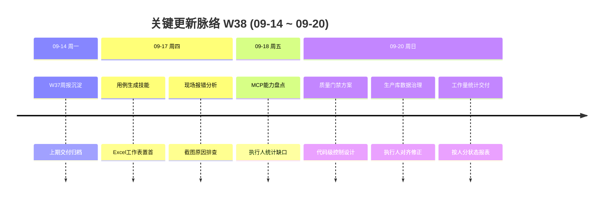

# 周报 2026-W38 (2026-09-14 ~ 2026-09-20)

> **总计 0 次提交 | 0 个文件变更（已入库） | +0 行 / -0 行 | 0 个 PR 合并（上期截止 #119）**
>
> **贡献者**：无新提交；本周产出以方案文档、生产库数据治理与统计交付为主（尚未入库）
>
> **整体状态：方案与数据侧部分完成，工程实现未推进** — 完成 AI 质量门禁代码级控制方案；完成生产库执行人口径盘点、数据对齐修正与工作量统计；确认 MCP 尚不具备正式考核所需的跨项目按人聚合能力。W37 规划的现场部署、真实 MCP、数据库集成与容器交付本周未见推进证据。

**本周趋势**：研发提交停摆，工作重心从功能交付转向两类“底座能力”：一是为 AI 自动化测试建立**系统强制执行的质量门禁**（方案级），二是为团队工作量与数据可信度建立**生产库执行人口径与修正闭环**。M2 目标日期恰为本周日（2026-09-20），闭环指标仍未形成 100% 对账证明。

> **统计口径**：提交、文件和行数统计 2026-09-14 至 2026-09-20 的当前分支 Git 历史，结果为 0。本周实质产出为未提交工作区文件与对话交付物，下文按证据分级单独列出，不与 Git 净变更混计。PR 范围仍截止于 #119，无 #120 及之后合并。

---

## 关键更新脉络

---

## 一、本周完成（按验收证据分级）

### 1. AI 自动化测试质量门禁方案 — 从“要求 AI 遵守”升级为“系统强制执行”

> **价值**：避免 AI 漏步骤、缺证据、伪通过或绕过验收出口；正式报告发布、结果回写和 CI 放行必须以服务端裁决为准，而不是以 Agent 自述为准。

- 输出方案文档：`docs/ai-testing-quality-gates-code-control-solution.md`（2026-09-20）。
- 明确三类状态分离：**上传状态**、**报告验收状态**、**产品测试状态**；产品失败不等于报告质量失败。
- 总体架构：冻结测试计划 → 受控执行器 → 上传硬校验 → 代码规则 → 独立 AI 语义审核 → 服务端裁决 → 正式出口控制 / 结构化反馈修正。
- 核心设计覆盖：计划冻结、受控执行与证据绑定、上传硬门禁、确定性规则校验、独立语义审核、服务端裁决状态机、正式出口（报告发布 / 回写 / CI / 缺陷关闭 / 看板）、修正闭环与权限隔离。
- 分阶段落地规划：
  1. **第一阶段**：上传与裁决硬门禁（堵住少传步骤、缺证据、直接写通过）。
  2. **第二阶段**：受控执行与可信证据（证明“确实执行过”）。
  3. **第三阶段**：独立语义审核与人工复核闭环。
- **验证证据**：方案文档已落盘，含架构图、数据模型、接口建议、前端入口、验收测试矩阵与风险表。
- **状态**：⚠️ **方案已完成，工程实现未开始**（文档第 13 节自述）；前端、后端、数据库、执行器与容器配置均未落地。

### 2. 生产库执行人数据治理 — 对齐指派执行人与最后执行人，并修正报告项目状态

> **价值**：让“谁负责 / 谁执行 / 结果是什么”在生产库中可对账，为工作量考核和质量看板提供可信分子分母。

- 数据源：`metersphere_prod@10.0.1.144`；范围 `functional_case` 且 `deleted=0 AND latest=1`。
- 剔除默认与测试一体化项目（100001、100011）后活跃用例 **2960**（剔除前 6415）。
- 已对齐执行人与最后执行人；对「已出具测试报告」项目中 ERROR/BLOCKED 用例改为 SUCCESS。
- 产出修正备份：
  - `doc/metersphere_prod-执行人修正备份-20260920_115335.tsv`
  - `doc/metersphere_prod-失败阻塞改通过备份-20260920_115631.tsv`
- **验证证据**：备份 TSV 与统计报告时间戳一致（2026-09-20 11:53～11:58）。
- **状态**：⚠️ 部分完成；属生产数据一次性修正与备份，平台侧防漂移规则、回写审计与长期对账任务尚未工程化。

### 3. 执行人工作量统计交付 — 按人、按状态、按项目出具可复核报表

> **价值**：用统一口径汇总全员执行用例数与状态分布，支撑工作量判断，而不是凭感觉估工作量。

- 交付物：
  - `doc/metersphere_prod-测试用例执行人维度统计-2026-09-20.md` / `.xlsx` / 统计图 `.html`
  - `doc/metersphere_prod-执行人与最后执行人不一致-2026-09-20.md` / `.xlsx`
- 全库状态分布（剔除后）：SUCCESS 2293 / PENDING 368 / SKIP 167 / BLOCKED 111 / ERROR 21。
- 不一致明细命中 **1310** 条（SUCCESS 1286 / ERROR 3 / BLOCKED 21），集中暴露“指派执行人 ≠ 最后执行人”的历史协作与代执行模式。
- 按最后执行人 Top：陈启芬 925、黄裕 484、蒋沅均 394、林泽曼 319、林志雄 254 等。
- **验证证据**：Markdown / Excel / HTML 同源生成；统计说明已写明剔除规则与修正前提。
- **状态**：⚠️ 部分完成；报表基于库内直查，尚未沉淀为平台只读统计接口或 MCP 工具；口径变更需人工重跑。

### 4. MCP 工作量统计能力缺口结论 — 明确“不能当考核入口”

> **价值**：避免用现有 MCP 硬扫拼出不可信的工作量数字，提前定义正式统计能力的边界与建设目标。

- 09-18 完成 MCP 契约盘点结论：**没有**跨全部项目、按执行人聚合的汇总接口。
- 现有能力仅支持：列项目、单项目分页搜索、返回 `lastExecuteUser` / `lastExecuteResult`；**不返回、不可过滤** 指派执行人 `executeUser`。
- `execution.search` 仅覆盖个人 MCP/Agent 执行历史，不是全员用例工作量。
- 客户端硬扫受项目分页、限流与 `total` 语义限制，不适合作为正式考核口径。
- **验证证据**：对话级能力对照表（以仓库 MCP 契约为准；当时运行中服务鉴权超时，未做在线 `tools/list`）。
- **状态**：⚠️ 分析完成；统计接口 / MCP 工具尚未立项实现（可与质量门禁第一阶段的看板口径一并设计）。

### 5. 测试用例生成技能可导入性修复 — Excel「测试用例」工作表强制置首

> **价值**：生成结果可直接导入 MeterSphere，减少人工调整工作表顺序。

- 调整 `scripts/write_excel_cases.py` 强制排序，并同步技能文档约定。
- 冒烟校验通过。
- **状态**：⚠️ 部分完成；改动若未提交则仅本地生效；旧 V3 文件仍需重生或手动调整。

### 6. 其他过程性工作

- **W37 周报沉淀**（09-14）：`doc/report.2026-W37.md`。
- **现场/截图报错分析**（09-17）：完成原因分析对话；未形成独立缺陷单或代码修复入库。
- **Agent 测试文档示例索引**：`docs/templates/agent-testing/README.md` 补充 NO72-NO73 扫码二重礼联动示例入口（示例正文偏上周产出）。

---

## 二、需求追踪结果

| 需求 | 前端入口 | 后端/API | 数据或配置 | 测试与验证 | 状态 |
|------|----------|----------|-----------|------------|------|
| AI 质量门禁代码级控制 | 方案建议：执行列表/详情、质量分析、反馈、复核页 | 方案建议：submission / quality / feedback / evidence / review | TestRun、Submission、Evidence、QualityDecision 等 | 方案含验收矩阵；无实现测试 | 方案完成 / 未实现 |
| 执行人工作量统计（考核口径） | 无平台入口；本期为离线报表 | MCP 无 group-by；本期直查生产库 | 已剔除默认项目并修正执行人 | MD/XLSX/HTML 已生成 | 离线交付 / 未平台化 |
| 执行人与最后执行人对齐 | 无 | 无正式 API；本期库内修正 | 备份 TSV | 备份文件可追溯 | 一次性治理 |
| MCP 跨项目按人聚合 | — | 结论：能力缺口 | — | 契约盘点 | 未开始 |
| W37 遗留：现场启动恢复 / 真实 MCP / Docker / DB 集成 | — | — | — | 本周无新证据 | 未推进 |

### 错误与边界行为（质量门禁方案要点）

- 上传成功 ≠ 报告验收通过 ≠ 产品测试通过；三类状态必须拆分展示与统计。
- 覆盖率分母必须来自服务端冻结计划，不能来自 AI 上传内容。
- 最终 `ACCEPTED` 只能由裁决服务写入；执行 Agent 不能直接写最终通过。
- 模型超时、证据冲突、无法确认时不得默认通过，应进入 `ANALYSIS_ERROR` 或 `NEEDS_REVIEW`。
- 所有正式出口（报告发布、回写、CI、缺陷关闭）统一依赖裁决结果，否则门禁可被绕过。

---

## 三、本周数据

### 每日提交分布

| 日期 | 提交数 | 重点方向 |
|------|--------:|----------|
| 09-14（周一） | 0 | W37 周报归档（未提交） |
| 09-15～09-16 | 0 | — |
| 09-17（周四） | 0 | 用例生成技能、报错分析（本地/对话） |
| 09-18（周五） | 0 | MCP 执行人统计能力盘点 |
| 09-19（周六） | 0 | — |
| 09-20（周日） | 0 | 质量门禁方案、生产库治理与工作量报表 |
| **合计** | **0** | **方案与数据治理为主** |

### 提交类型分布

| 类型 | 数量 | 占比 |
|------|-----:|-----:|
| feat / fix / refactor / docs / chore 等 | 0 | — |
| **合计** | **0** | — |

### 代码变更概览（已入库）

| 指标 | 数量 |
|------|-----:|
| 去重文件变更 | 0 |
| 新增行数 | 0 |
| 删除行数 | 0 |
| 净增行数 | 0 |
| 合并 PR | 0 |
| 贡献者（新提交） | 0 |

### 未入库但有证据的本周产物

| 产物 | 类型 | 说明 |
|------|------|------|
| `docs/ai-testing-quality-gates-code-control-solution.md` | 方案 | AI 质量门禁三阶段落地设计 |
| `doc/metersphere_prod-测试用例执行人维度统计-2026-09-20.*` | 统计 | 按人/状态/项目工作量 |
| `doc/metersphere_prod-执行人与最后执行人不一致-2026-09-20.*` | 对账 | 1310 条不一致明细 |
| `doc/metersphere_prod-*-备份-20260920_*.tsv` | 备份 | 执行人对齐与状态修正前备份 |
| `doc/report.2026-W37.md` | 周报 | 上期周报 |
| `docs/templates/agent-testing/README.md`（工作区改动） | 文档 | 示例索引更新 |

---

## 四、与上周 (W37) 对比

| 指标 | W37 | W38 | 变化 |
|------|----:|----:|------|
| 提交数 | 5 | 0 | -100% |
| 合并 PR 数 | 0 | 0 | 0 |
| 文件变更（已入库） | 121 | 0 | -100% |
| 净增行数（已入库） | 23,132 | 0 | -100% |

> 本周 Git 活动归零，但完成了质量门禁顶层设计与生产数据口径治理。风险在于：方案与数据产物若持续不入库、不进入里程碑验收，会与平台能力脱节。

### 上周方向落地情况

| W37 建议方向 | W38 实际进展 |
|--------------|--------------|
| P0 现场启动恢复 | ❌ 未见部署新产物、RestartCount 观察或健康验证记录 |
| P0 MCP 真实环境验收 | ⚠️ 仅完成执行人统计相关能力缺口分析；未做 tools/list、五项新工具与越权联调 |
| P0 数据库集成与并发 | ❌ 未见真实 MySQL 集成/并发测试记录 |
| P0 容器交付 | ❌ Docker 构建/启动/健康检查仍无证据 |
| P1 图片复制平台 E2E | ❌ 未推进 |
| P1 测试资产治理回归 | ❌ 未推进 |
| P1 企业微信真实联调 | ❌ 未推进 |
| P1 前端质量债务 | ❌ 未推进 |
| P2 MCP 剩余缺口 | ⚠️ 额外明确“跨项目按人聚合/工作量统计”缺口；评审/报告/日志工具未补齐 |
| P2 PR 交付治理 | ❌ 本周仍无新 PR；方案与数据产物亦未拆 PR 入库 |
| （本周新增）质量门禁规划 | ✅ 完成代码级控制方案文档，明确三阶段与出口控制 |
| （本周新增）执行人口径与工作量 | ✅ 完成生产库修正、备份与统计交付 |

---

## 五、里程碑完成情况

### 里程碑总览

| 里程碑 | 目标日期 | 当前判断 | 进度说明 |
|--------|----------|----------|----------|
| M1：测试资产统一沉淀、复用与追溯 | 2026-08-30 | ⚠️ 部分完成，已逾期 | 本周无新实现；存量对账与权限 E2E 仍缺 |
| M2：测试任务、执行、缺陷和改进闭环 | 2026-09-20 | ⚠️ 部分完成，**已到目标日未关闭** | 能力建设延续上周；本周补了执行人数据可信度与质量门禁规划，但 100% 指标对账与端到端闭环仍未证明 |
| M3：Agent 辅助个人测试任务执行 | 2026-11-30 | 🔄 建设中 | 质量门禁方案为 M3/M4 可信执行提供约束框架；覆盖率基线仍无 |
| M4：AI 定时巡检与主动质量预警 | 2027-02-20 | 🟡 前期建设 | 门禁裁决与正式出口控制是巡检可信发布的前置；巡检本身未开始验收 |

### M2 收口日特写（2026-09-20）

> **目标价值**：形成从任务分配、执行、缺陷处理到用例持续改进的质量闭环。

**相对 W37 的新增：**

- 执行人/最后执行人生产库对齐与报告项目状态修正，提升责任人与结果字段可信度。
- 工作量与不一致明细报表，可作为责任人明确率、执行状态分布的离线基线材料。
- 质量门禁方案明确：失败证据完整率、结果回写与报告发布必须由服务端裁决，不能由 Agent 自写通过。

**仍未证明的验收指标：** 任务责任人 100%、失败证据完整率 100%、缺陷与用例关联率 100%、缺陷遗漏分析覆盖率 100%、应补回归用例完成率 100%。

**里程碑状态：目标日已到，仍为部分完成，不得关闭 M2。**

### M3 / M4 与质量门禁的衔接

- M3 的人机协同与 Agent 执行，必须以受控执行器 + 上传硬门禁 + 裁决出口为默认路径，否则覆盖率数字不可信。
- M4 的定时巡检与主动预警，应直接复用同一套 Submission / QualityDecision / 正式出口控制，避免巡检报告“自说自话”。

---

## 六、验证情况

### 已执行并有证据

| 验证范围 | 结果 |
|----------|------|
| 质量门禁方案完整性 | 文档含目标、架构、八项核心设计、权限边界、数据模型、接口、前端、验收矩阵、三阶段落地与风险 |
| 生产库执行人统计 | 剔除后 2960 条；按人/状态/项目报表与 HTML 图已生成 |
| 执行人不一致对账 | 1310 条明细；含按人流转与按项目汇总 |
| 数据修正备份 | 两份 TSV 备份落盘 |
| MCP 工作量能力盘点 | 结论：无跨项目按人聚合；不能作为考核入口 |
| 用例生成 Excel 置首 | 本地冒烟通过（若未提交则仅本机有效） |

### 未执行或未通过

| 验证项 | 原因 | 剩余风险 |
|--------|------|----------|
| 质量门禁任一工程阶段实现 | 本周仅方案 | 伪通过、缺证据、直接回写通过路径仍开放 |
| 在线 MCP tools/list 与五项工具联调 | 延续上周缺口；本周未联调 | 部署版本与真实可见性未知 |
| 现场启动恢复与 RestartCount | 未部署 | 现场稳定性风险仍在 |
| Docker / 全量集成 / 核心 E2E | 未执行 | 交付闭环仍缺 |
| 将离线统计固化为平台接口 | 未立项实现 | 口径依赖手工脚本，易漂移 |
| 方案与统计产物入库 / PR | 仍在工作区 | 知识与数据证据易丢失、难评审 |

---

## 七、下周优先级建议

| 优先级 | 方向 | 建议动作 |
|--------|------|----------|
| P0 | 质量门禁第一阶段开工 | 落地冻结计划版本、Submission 上传硬校验、服务端裁决状态；报告发布与结果回写接入裁决检查 |
| P0 | 执行人统计平台化 | 新增只读聚合接口（及可选 MCP 工具）：跨项目按 `executeUser` / `lastExecuteUser` 聚合，拆开负责数/已执行数/状态分布；禁止用客户端硬扫做考核 |
| P0 | M2 收口证据包 | 选 1 个真实项目跑通「任务—执行—失败证据—缺陷—复验—回归用例」，输出六项验收指标对账表 |
| P0 | 现场启动恢复 | 部署 W37 后端产物，观察 RestartCount、健康端点、错误日志与 MCP 初始化 |
| P1 | 数据治理工程化 | 将执行人对齐与报告项目状态规则沉淀为可审计运维任务或迁移脚本，保留备份与回滚 |
| P1 | MCP 真实环境验收 | 全授权与受限 Token 验证 tools/list、五项新工具、越权、幂等与错误脱敏 |
| P1 | 方案与报表入库 | 将质量门禁方案、W37/W38 周报、生产统计与备份按文档规范提交，便于评审追溯 |
| P2 | 质量门禁第二阶段预研 | 受控执行器与证据哈希绑定的接口草图、与现有 Agent Runner 的边界划分 |
| P2 | 容器与集成回归 | 恢复 Docker 后补镜像启动、健康检查与关键 MCP/计划行锁集成测试 |

---

## 附录：Pull Requests 与本周产物

W37 报告截止于 PR **#119**。截至本报告生成时，Git 历史中仍无 #120 之后的新自研合并 PR；W38 **0** 次提交。

### 本周关键文档与数据产物

| 日期 | 产物 | 摘要 | 分类 | 状态 |
|------|------|------|------|------|
| 09-14 | `doc/report.2026-W37.md` | 上期周报 | 📝 文档 | 已完成（未提交） |
| 09-17 | 用例生成技能 Excel 置首 | 便于 MeterSphere 导入 | 🔧 DevOps | 部分完成 |
| 09-18 | MCP 执行人统计能力盘点 | 明确考核口径缺口 | 🧠 AI 能力 | 分析完成 |
| 09-20 | `docs/ai-testing-quality-gates-code-control-solution.md` | 质量门禁三阶段方案 | 🏗️ 架构 | 方案完成 / 未实现 |
| 09-20 | 生产库执行人对齐与状态修正备份 | 数据可信度治理 | 🔧 DevOps | 一次性完成 |
| 09-20 | 执行人维度统计与不一致明细 | 工作量与对账报表 | 📝 文档 | 离线交付 |

---

## 功能状态结论

**本周整体状态：方案与数据侧部分完成；平台工程实现基本停摆。**

最大进展是两份“约束底座”：  
1）**质量门禁**把 AI 测试从软约束推进到可分阶段工程化的硬裁决设计；  
2）**执行人口径与生产库修正**为工作量和 M2 责任人指标提供了可复核离线基线。  

在质量门禁第一阶段落地、执行人统计平台化、以及至少一个真实项目的 M2 闭环对账完成之前，不得宣称 M2 已关闭，也不得宣称 AI 自动化测试结果可直接作为正式发布或考核依据。
