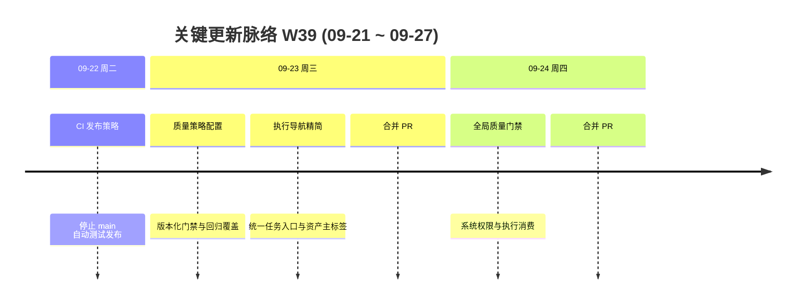

# 周报 2026-W39 (2026-09-21 ~ 2026-09-27)

> **总计 4 次提交 | 104 个文件变更 | +6,019 行 / -709 行 | 2 个 PR 合并 (#127 ~ #128)**
>
> **贡献者**：chenqifen-miduo（3 commits）、miduo-admin（1 commit）
>
> **整体状态：部分完成** — 平台统一质量策略与执行导航精简已有隔离环境、真实 MySQL、容器健康检查和浏览器 E2E 证据；Runner 容器联调、真实执行器全链路和生产切换尚未完成。

**本周趋势**：本周主线从前期资产治理与启动修复，收敛到「平台统一质量门禁」和「执行导航精简」两条产品交付线。相较 W38（几乎仅有构建发布时间与 CNB 兼容修补），本周提交规模与验证深度明显回升：隔离 compose 环境、Flyway 迁移、定向后端测试、真实浏览器验收和镜像构建均留下可核验记录。仓库内最近完整周报仍为 W36；W37/W38 周报文件未入库，环比同时对照 W38 可核验 Git 数据与 W36 最后可用基线。

> **统计口径**：提交、文件和行数仅统计 2026-09-21 至 2026-09-27 的 `origin/main` 历史；文件与行数采用本周首个提交父节点至最后提交的一次性 `git diff --shortstat`（104 files, +6019/-709），未累加逐提交数据。PR 范围按合并日期纳入 #127、#128。语雀参考文档需企微登录，本环境无法读取正文；结构沿用本仓库既有周报模板（`doc/report.2026-W3x.md`）。

---

## 关键更新脉络

---

## 一、本周完成（按验收证据分级）

### 1. 平台统一质量策略（全局门禁）— 系统级唯一版本与分权管理

> **价值**：将质量标准从「项目各自配置」收敛为平台唯一生效策略，由系统角色管理，避免项目权限越权发布门禁。

- 新增系统设置「平台质量门禁」入口，管理 API 走 `/system/quality`（兼容 `/api/system/quality`），拒绝项目选择参数。
- 建立 GLOBAL 单行生效指针与全局版本表；发布事务、并发竞争、乐观锁、已发布不可变均有 MySQL 验证。
- 系统分权：`SYSTEM_QUALITY:READ/MANAGE/PUBLISH`，项目权限不能提升为系统权限；禁用/撤权/Agent Token 拒绝有数据库测试。
- 迁移 V3.7.2_95～97：保留原项目策略表、来源映射、归档导入全局草稿；旧写端点明确拒绝。
- **验证证据**：后端相关打包测试 238 项通过；`GlobalQualityPolicyMySqlTests` 6/6；前端类型检查/生产构建通过；隔离 compose 应用与依赖 healthy；Playwright 质量策略 E2E 9 个浏览器场景通过；纯系统管理员登录与截图已归档。
- **状态**：⚠️ 部分完成；Runner 镜像因外部仓库阻断未构建；真实执行器端到端矩阵与生产克隆切换未验收。

### 2. 执行侧消费门禁 — attempt 快照、步骤断言与正式回写重校验

> **价值**：让 Runner/认领路径真正消费冻结策略，客户端不可伪造 passed/expected，回写不完整时不能报告成功。

- Runner 新接口 `POST /internal/ai-runner/v1/lease/{id}/step-result` 从有效租约取得身份；请求体不能覆盖身份。
- 步骤结果按冻结断言顺序校验 `actual` 与证据 ID；正式回写按 executionId 幂等并重新校验。
- 旧 Agent 用例结果直写单条/批量链路统一拒绝，防止绕过门禁。
- ai-browser-runner 补充真实 Chromium 断言取值与范围边界测试。
- **验证证据**：绑定/快照/哈希篡改/跨步骤证据等 MySQL 与单元测试通过；Runner 本地 `npm test` 8/8（含真实 Chromium）。
- **状态**：⚠️ 部分完成；新 Runner 容器构建与控制面联调未完成；模型规划/证据对象存储/在途发布等组合矩阵未跑通。

### 3. 项目级质量策略配置（过渡能力）— 版本化编辑、发布审计与回归

> **价值**：在全局门禁落地前，先补齐项目策略的严格校验、发布审计和隔离验收工具，并为后续导入全局草稿提供数据基础。

- 新增 `QualityPolicyService/Controller/Access/Validator` 与 `quality-policy.v1.json` schema。
- 迁移 V3.7.2_91～93：策略表、权限资源、追加式发布事件（前后 hash/actor/原因与指针同事务）。
- 前端质量策略页支持表单/JSON 草稿、延迟校验、会话隔离、停用项目只读。
- 配套 `deploy/quality-verify.compose.yml`、RBAC fixture 与环境验证脚本。
- **验证证据**：相关后端测试 27/27；浏览器 E2E（保存/发布/角色分权/字段路径/停用项目）通过；隔离环境迁移与健康检查通过。
- **状态**：⚠️ 部分完成；随后被全局策略替代为归档/导入路径，旧项目写接口拒绝；配置缺陷修复可视为本地验收通过，不等于生产切换完成。

### 4. 执行导航精简 — 统一任务入口、配置分责与资产主标签

> **价值**：减少 Agent/执行/资产多入口重叠，让普通用户先看到任务与资产主对象，敏感配置回到设置区的权限边界内。

- `/execution/tasks` 成为主要任务入口；旧 Agent 队列/评价 URL 白名单兼容跳转。
- 个人接入 Token 单入口；能力页拆为能力状态、运行告警、项目策略；运维配置迁入设置分组。
- 资产主导航收敛为文档、用例、数据三项；目录/版本/追溯保留上下文路径。
- 迁移 V3.7.2_94 仅调整权限资源元数据，不覆盖自定义 UI 授权、不增角色权限。
- **验证证据**：导航脚本 9/9；权限资源/路由 Tab/API 契约/布局溢出检查通过；隔离镜像启动后浏览器冒烟与普通账号无权限页验证通过；Flyway `3.7.2.94` success。
- **状态**：⚠️ 部分完成；环境详情内嵌配置（N08～N10）、完整详情业务标签、真实历史任务取消/重试与发布观察期未完成。

### 5. CI 发布策略调整 — 停止 main 自动测试发布

> **价值**：避免 main 分支在质量门禁与导航改造窗口内自动推送测试制品，降低未完成验收版本被误用的风险。

- 调整 `.github/workflows/cnb-build.yml`，停止 main 自动测试发布。
- **证据**：提交 `3598fa8230`（`[skip ci]`）。
- **状态**：✅ 已合入；属于发布流程变更，不替代功能验收。

---

## 二、需求追踪结果

| 需求 | 前端入口与实现 | 后端接口与规则 | 数据/配置 | 测试与验证 | 状态 |
|------|----------------|----------------|-----------|------------|------|
| 纯系统管理员访问全局门禁 | 系统设置→平台质量门禁 | 系统角色校验，不要求项目关系 | 系统角色关系 | 纯管理员 UI/API 本地验收通过 | 已验证（隔离） |
| 全平台唯一策略版本 | 全局策略管理页 | GLOBAL 指针 + 版本表；CAS/不可变 | V95 全局表 | MySQL 并发与发布事务通过 | 已验证（隔离） |
| 系统分权 READ/MANAGE/PUBLISH | 按钮按系统权限裁剪 | 即时查询有效系统角色 | V96 权限 | 三账号浏览器 + DB 拒绝测试通过 | 已验证（隔离） |
| 执行实际消费门禁 | Runner/任务认领链路 | attempt 快照、步骤断言、回写重校验 | V97 binding | 单元/MySQL/Chromium 通过；缺完整执行器联调 | 部分完成 |
| 历史项目策略迁移 | 归档页导入全局草稿 | 原表保留、来源映射、旧写拒绝 | V95～97 | 隔离样本 7/4 对账；缺生产克隆 | 部分完成 |
| 执行导航统一任务入口 | `/execution/tasks` | 复用既有执行 API | V94 资源元数据 | 冒烟/权限页通过；缺真实任务回归 | 部分完成 |
| 配置分责与 Token 单入口 | 设置/个人中心 | 原 Token API；adminOnly 边界 | 无新业务表 | 入口与无权限直达通过；Token 全生命周期未重测 | 部分完成 |
| 资产主标签精简 | 文档/用例/数据 | 原 catalog/version API | 无 | 主标签与上下文路径通过 | 部分完成 |
| main 自动测试发布关闭 | 无 | CNB workflow | workflow 配置 | 已合入 | 已完成 |

### 错误与边界行为

- 全局管理 API 拒绝项目选择参数；旧项目策略写/校验端点明确拒绝。
- 未发布全局策略时，新认领拒绝；不得自动选取旧项目标准。
- 步骤结果不信任客户端 `passed/expected`；回写不完整不报告 PASSED/SUCCEEDED。
- 导航白名单剔除 Token 与任意回跳 URL；未知回跳参数不传播；跨项目不兜底查询。
- 编辑会话隔离：忙碌禁关、旧回调失效；停用项目允许 READ、拒绝 MANAGE/PUBLISH。
- JSON 校验返回精确字段路径；编辑中撤权返回局部 403 并可保稿重试。

---

## 三、本周数据

### 每日提交分布

| 日期 | 提交数（不含 merge） | 重点方向 |
|------|---------------------:|----------|
| 09-22（周二） | 1 | 停止 main 自动测试发布 |
| 09-23（周三） | 2 | 版本化质量策略、执行导航精简；合并 PR #127 |
| 09-24（周四） | 1 | 平台统一质量策略与系统权限；合并 PR #128 |
| 09-21 / 09-25～09-27 | 0 | — |
| **合计** | **4** | **质量门禁 + 导航精简** |

### 提交类型分布

| 类型 | 数量 | 占比 |
|------|-----:|-----:|
| feat（新功能） | 3 | 75.00% |
| fix（Bug 修复） | 0 | 0.00% |
| refactor（重构） | 0 | 0.00% |
| docs（文档） | 0 | 0.00% |
| ci/chore（含 `[skip ci]`） | 1 | 25.00% |
| **合计** | **4** | **100.00%** |

### 代码变更概览

| 指标 | 数量 |
|------|-----:|
| 去重文件变更 | 104 |
| 新增行数 | 6,019 |
| 删除行数 | 709 |
| 净增行数 | 5,310 |
| PR 范围（本周合并） | #127～#128 |
| 合并 PR | 2 |
| 贡献者（作者） | 2 |

> 文件与行数采用本周首个提交父节点至最后提交的一次性 `git diff --shortstat` 统计，未累加逐提交数据。

---

## 四、与上周对比

### 4.1 对照 W38（上一自然周，可核验 Git）

| 指标 | W38 (09-14～09-20) | W39 (09-21～09-27) | 变化 |
|------|-------------------:|-------------------:|------|
| 提交数（不含 merge） | 2 | 4 | +100% |
| 合并 PR 数 | 0 | 2 | +2 个 |
| 文件变更 | 1 | 104 | +103 个 |
| 净增行数 | +2 | +5,310 | 显著回升 |

> W38 仅含构建发布时间与 CNB 镜像清单兼容修补，几乎无功能交付；W39 回到质量门禁与导航产品主线。

### 4.2 对照 W36（仓库内最近完整周报基线）

| 指标 | W36 | W39 | 变化 |
|------|----:|----:|------|
| 提交数 | 9 | 4 | -55.56% |
| 合并 PR 数 | 6 | 2 | -4 个 |
| 文件变更 | 80 | 104 | +30.00% |
| 净增行数 | 3,074 | 5,310 | +72.74% |

> 提交次数少于 W36，但单周变更更集中；验证证据从「定向单测 + 构建」提升到「隔离 compose + MySQL + 浏览器 E2E + 镜像 healthy」。W37/W38 周报文件未入库；期间已合并 PR #120～#126（启动修复、MCP 维护工具、附件复制、缺陷/通知加固、导航与历史同步等），不在本期展开。

### 上周方向落地情况（相对 W36 建议）

| W36 建议方向 | W39 实际进展 |
|--------------|--------------|
| P0 测试资产治理 E2E | ⚠️ 导航主标签与上下文入口有浏览器证据；完整来源/分类/批量归类 E2E 未作为本周主线重跑 |
| P0 MySQL 迁移矩阵 | ⚠️ 本周 V91～V97 在隔离库有成功与对账记录；代表性生产克隆仍未执行 |
| P0 Agent 启动与执行回归 | ⚠️ 启动相关问题在 W37 窗口已有 #126；本周侧重门禁消费，完整 Agent E2E 仍缺 |
| P0 容器交付验证 | ⚠️ 应用镜像构建与 compose healthy 已通过；Runner 镜像仍被外部仓库阻断 |
| P1 权限与数据隔离 | ✅ 系统质量分权与导航无权限页有真实账号证据（隔离环境） |
| P1 内联编辑集成测试 | ❌ 本周未作为主线推进 |
| P1 企业微信真实联调 | ❌ 本周未作为主线推进 |
| P1 文档预览回归 | ❌ 本周未作为主线推进 |
| P2 性能与并发 | ❌ 未发现大数据量/并发专项记录 |
| P2 发布证据归档 | ✅ 本周质量策略与导航实施文档已记录命令、镜像摘要、迁移与 E2E 结果 |

---

## 五、验证情况

### 已执行并有证据

| 验证项 | 结果 |
|--------|------|
| 全局质量相关后端打包测试 | 238 项通过，BUILD SUCCESS |
| GlobalQualityPolicy MySQL 集成 | 6/6 通过 |
| 项目质量策略相关后端测试 | 27/27 通过 |
| 导航相关后端定向测试 | 27 项通过（含 QualityPolicy/Exception/ChannelPolicy） |
| 前端类型检查 / 生产构建 | 通过 |
| 权限资源 / 路由 Tab / API 契约 / 布局溢出 | 通过（精确绑定 93，未绑定 0） |
| 导航脚本 `test-execution-navigation.mjs` | 9/9 通过 |
| 全局权限脚本 `test-global-quality-permissions.mjs` | 3/3 通过 |
| ai-browser-runner 本地测试 | 8/8 通过（含真实 Chromium） |
| 隔离 compose 启动与 `verify-quality-environment.ps1` | 应用及 MySQL/Redis/MinIO/Kafka healthy |
| 质量策略 Playwright E2E | 9 个浏览器场景通过（含编辑中撤权） |
| 导航浏览器冒烟与普通账号权限页 | 通过 |
| Flyway 3.7.2.91～97 | 隔离环境 success；94 checksum 已记录 |
| 应用镜像构建 | 成功（质量门禁与导航两轮均有镜像 ID 记录） |

### 未执行或未通过

| 验证项 | 原因 | 剩余风险 |
|--------|------|----------|
| Runner 容器构建与控制面联调 | 拉取 `node:22-bookworm-slim` 遇 Docker Hub EOF | 新步骤结果协议未在容器 Runner 验证 |
| 真实执行器端到端矩阵 | 未跑通模型规划/证据对象存储/在途发布/审批等组合 | 不能以现有自动化数量替代执行门禁全链路 |
| 生产克隆迁移与切换 | 仅隔离历史样本库 | 首次全局发布、多实例、备份恢复未演练 |
| 导航真实历史任务回归 | 隔离库任务/评价计数为 0 | 取消/重试/旧链接返回未验证 |
| Token 全生命周期重测 | 本批仅入口与权限边界 | 创建/轮换/吊销完整链路未重跑 |
| 全仓后端回归 | 未执行 `backend/app` 全量 test | 其他模块回归风险未知 |
| 生产部署观察 | 未部署 `msp.ebcone.net` | 旧链接观察期与生产行为未知 |

---

## 六、下周优先级建议

| 优先级 | 方向 | 建议动作 |
|--------|------|----------|
| P0 | Runner 容器与执行门禁联调 | 恢复外部镜像拉取后构建 Runner；注册隔离 Runner，验证 step-result、证据上传、成功/失败回写 |
| P0 | 全局策略生产切换预演 | 对代表性生产克隆跑迁移差异预检；演练导入草稿、首次发布、未发布拒认领、回滚预案 |
| P0 | 真实执行器矩阵 | 覆盖认领、在途发布、重试、无绑定历史任务、伪造 passed 拒绝 |
| P1 | 导航 S2/S3 收口 | 环境详情内嵌配置、详情业务标签、真实任务取消/重试与旧链接返回 |
| P1 | 发布观察期 | 部署后收集旧 Agent/资产 URL 访问与错误，再决定是否物理下线 |
| P1 | Token 与权限回归 | 重测 Token 全生命周期；复核系统质量权限在权限配置页的可管理性 |
| P2 | 全仓回归与性能 | 后端全量测试；分类/策略发布/租约并发与大数据量抽样 |
| P2 | 周报连续性 | 补写或归档 W37/W38 摘要，恢复连续 PR 编号与周环比口径 |

---

## 附录：已合并 Pull Requests (#127 ~ #128)

| PR | 实际提交主题 | 分类 | 状态 |
|----|--------------|------|------|
| #127 | 版本化质量策略配置 + 执行导航精简与资产入口收敛 | 🚪 导航 / 🔐 质量策略 | 部分完成：隔离 E2E 通过；缺真实任务与生产观察 |
| #128 | 平台统一质量策略与系统权限，执行侧消费门禁 | 🔐 质量门禁 | 部分完成：隔离验收充分；缺 Runner 容器联调与生产切换 |

---

## 功能状态结论

**整体状态：部分完成。**

本周已把「项目级质量策略 → 平台统一质量门禁」和「执行/Agent/资产导航精简」两条主线合入 main，并在隔离环境留下迁移、容器健康、定向后端测试和真实浏览器验收证据。但 Runner 容器联调、真实执行器全链路、生产克隆切换和导航后续批次仍未完成，不能将隔离通过表述为生产可用。

---

## 附录：语雀参考说明

- 参考链接：https://miduo1031.yuque.com/grxz85/uyf1iw/lg8d7ffmawku6ip0
- 本 Cloud Agent 环境访问该链接时跳转企微扫码登录页，无法读取正文。
- 本文结构对齐仓库既有周报（W32～W36）：完成项按证据分级、需求追踪表、每日/类型统计、周环比、验证清单与下周优先级。
