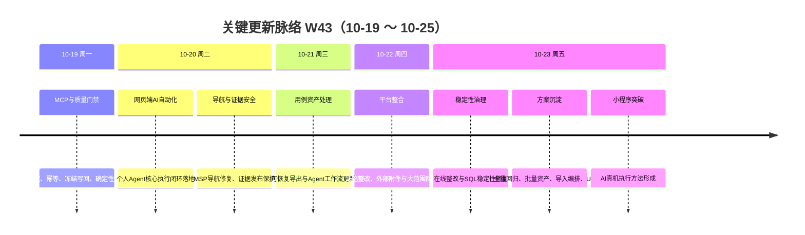

# 周报 2026-W43（2026-10-19 ～ 2026-10-25）

> **总计 6 次提交 | 586 个文件变更（已入库） | +35,294 行 / -2,650 行 | 净增 32,644 行 | 0 个 PR 合并**
>
> **贡献者**：chenqifen-miduo（6 次提交）
>
> **整体状态：部分完成** — 网页端 AI 自动化测试核心闭环已在隔离环境完成落地和端到端验证，达到阶段性里程碑；小程序 AI 测试形成可执行的方法突破，AI 已具备承担大部分可重复测试操作的能力，但规模化覆盖率与成功率仍待持续验证。本周同时完成多项平台能力建设，并形成 8 份尚未提交的回归、整改、交互和 UI 方案材料。

**本周趋势**：工作重点从“AI 测试方案设计”进入“网页端核心闭环可运行、小程序执行方法可落地”的阶段。工程侧集中完善个人 Agent MCP、用例库、质量门禁、证据回写、附件、导出与 SQL 稳定性；质量侧通过全量回归暴露 14 类问题，并为批量资产操作、导入编排和 UI 改造形成实施方案。

> **统计口径**：Git 数据统计当前分支 2026-10-19 00:00 至 2026-10-26 00:00，共 6 次提交。上一周报告 `report.2026-W42.md` 不存在，因此 PR 按日期范围退化统计；本周未发现合并 PR。未提交文件与方案单独列示，不计入 586 个文件及行数统计。

---

## 关键更新脉络

---

## 一、本周完成情况（按验收证据分级）

### 1. 网页端 AI 自动化测试核心闭环落地 — M3 阶段性里程碑

> **价值**：AI 不再停留在理解用例或生成脚本，而是能够从个人任务出发，完成读取、执行、取证、质量校验、结果回写和页面展示的完整闭环。

- 完成个人 Token 的创建、权限控制和失效校验。
- Agent 可通过 MCP 查询个人任务和用例，读取执行步骤及质量门禁要求。
- 支持逐步骤执行、PNG 证据上传、附件归属校验和结果回写。
- 服务端能够拒绝缺少证据、伪造成功或不满足质量事实的提交。
- 支持重复请求幂等处理，避免结果或附件重复写入。
- 前端可展示执行结果及证据文件，并能够识别 Token 禁用后的访问失败。
- **验收证据**：个人 Agent 回归 242 项通过；最终包验证 5 项通过；Node 与安装包验证 16 项通过；前端类型检查和生产构建通过；隔离应用健康检查、readiness、迁移 `3.7.2.102` 以及 Redis、MinIO、Kafka 事务检查通过；浏览器端到端场景 1 条通过（17.3 秒）。
- **状态**：✅ **核心范围完成（隔离环境）**。远程生产部署、真实第三方 AI 的规模化业务执行、完整用例库扩展尚未完成，因此不能表述为全环境全面交付。

### 2. 小程序 AI 测试取得突破性进展 — 从人工专属转为 AI 可执行

> **价值**：突破微信小程序难以由 AI 稳定操作的限制，使测试人员可以把大量重复点击、页面检查、流程回归和证据采集交给 AI，集中处理业务判断与异常分析。

- 已形成以 Android AccessibilityService 为主的真机操作方法，优先识别和操作可访问控件节点，减少纯坐标点击的不稳定性。
- 建立“控件节点识别 + 页面状态等待 + 截图确认 + 可复用流程脚本”的执行方式，可覆盖大部分规则明确、路径稳定的小程序测试步骤。
- 方法覆盖体验版与正式版、测试/生产/灰度环境识别，支持微信分身、扫码入口和业务链接进入。
- 支持新经销助手、万能零售助手、金牌导购员、业务帮帮、会员和云店等小程序的日常真机测试场景。
- 建立执行证据、环境信息、入口信息和异常现场的记录规范，便于回放与人工接管。
- **当前判断**：AI 已具备执行大部分可重复小程序测试工作的技术方法，属于突破性进展；复杂视觉判断、系统权限弹窗、跨应用异常链路和弱可访问性页面仍需人工辅助。
- **状态**：🔄 **方法突破已形成，规模化验证中**。本周尚无覆盖率、稳定执行成功率和完整代表性用例集的量化验收记录，暂不宣称小程序自动化覆盖目标已经完成。

### 3. 个人 Agent MCP 执行与用例库流程完善

- 完成个人任务搜索、用例详情读取、执行上下文获取、步骤结果回写和附件管理链路。
- 完善用例库工作流，使 Agent 执行与测试资产管理能够使用统一的数据和权限边界。
- 增加执行过程中的错误协议和安全提示，避免将原始异常或数据库信息直接暴露给使用者。
- **状态**：✅ 核心链路已实现并纳入网页端 AI 自动化里程碑；扩展业务场景仍需继续验收。

### 4. AI 执行质量门禁与证据可信度加强

- 增加前置质量事实、冻结写回、确定性断言和附件所有权校验。
- 对失败步骤要求有效证据，禁止缺证据提交和伪成功回写。
- 统一正式结果发布出口，使 Agent 自述不能替代服务端裁决。
- 增加 Node `0.4.0` 适配器、技能包 `1.1.0` 和对应验证记录。
- **验证证据**：223 项 Agent 测试、7 项依赖回归、7 项 MySQL 重叠场景、10 项 Node/安装包场景以及真实 MCP/HTTP 评审重放冒烟通过；类型检查、定向 lint、后端打包、镜像、迁移和健康检查有通过记录。
- **状态**：⚠️ 部分完成；评审决策、异步 Excel 导入、删除预览、鉴权契约迁移和完整工作流验收仍待补齐。

### 5. MCP 操作安全性与幂等能力强化

- 对评审、用例更新、评论等写操作增加当前状态鉴权与事务幂等控制。
- 收紧附件所有权规则，避免跨任务、跨用户错误引用证据。
- 逐步退出历史结果写入路径，降低新旧协议并存造成的数据不一致。
- 对重放、重试和重复提交场景补充保护，减少 AI 执行过程中的重复副作用。
- **状态**：⚠️ 主体能力已实现，v2 契约与完整生命周期验收仍未收口。

### 6. 测试用例导出与异步任务恢复能力建设

- 新增可恢复的用例导出能力，强化长任务中断后的状态恢复和结果获取。
- 更新 Agent 工作流，使导出、任务状态与后续动作可以形成连续链路。
- 对导出任务补充失败状态、恢复行为和结果文件处理。
- **状态**：⚠️ 功能已实现并有针对性验证；大数据量、并发、权限和生产环境稳定性仍需专项验收。

### 7. 测试平台缺陷修复与外部附件能力整合

- 对测试平台进行了较大范围的功能整改与依赖整合。
- 完善外部附件支持以及附件在执行、报告和 MCP 链路中的映射。
- 补充前端构建/类型检查、后端与 MySQL 定向测试、MCP 测试、镜像构建和 45 项轻量检查记录。
- **状态**：⚠️ 部分完成；受内存限制，完整迁移、readiness、UI、在线 MCP 和全链路验收未全部执行。

### 8. SQL 稳定性与在线问题修复

- 修复 MSP 在线运行中发现的部分问题，并调整相关 SQL 与数据访问逻辑。
- 对导航、页面数据、执行数据和资产关系涉及的查询稳定性进行了集中治理。
- **状态**：⚠️ 部分完成；完整前端类型检查受 1 GiB 堆限制中断，最终生产构建、容器启动和核心 E2E 仍待补齐。

### 9. 全量回归测试与问题盘点（未提交）

- 在真实平台 `https://msp.ebcone.net` 完成 55 个实际检查点。
- 结果：39 个通过、16 个失败，归并为 14 个问题和 2 个范围待确认事项。
- 已识别资产操作通用错误、导出 ID 为空、路由监听状态陈旧等问题。
- 形成 `docs/summary/msp-full-regression-20261023.md`。
- **状态**：❌ 回归未通过；问题清单和证据已形成但尚未提交，不能据此声明平台整体已完成。

### 10. 测试资产批量处理与缺陷整改方案（未提交）

- 为 14 类回归问题形成整改拆解，覆盖原因、处理策略、验证入口和交付边界。
- 规划资产跨页选择、批量更新、批量删除、批量导出及项目关系同步。
- 对批量操作的权限、选择状态、失败回滚、导出任务和危险操作确认提出约束。
- 形成 `docs/summary/msp-remediation-assets-batch-ui-review-plan-20261023.md`。
- **状态**：📝 方案已出具，尚未作为正式生产实现验收。

### 11. 测试计划、评审与导入编排方案（未提交）

- 形成目录移动、跨页全选、名称链接、导入后进入计划/评审、源用例删除关系更新、资产项目同步和置顶等完整方案。
- 明确前端入口、交互状态、后端能力、数据关系和交付顺序。
- 形成 `docs/summary/msp-integrated-delivery-plan-20261023.md`。
- **状态**：📝 方案与原型完成，生产代码、接口、迁移、构建和 E2E 均未完成。

### 12. UI 风格与交互原型验证（未提交）

- 完成第二版真实前端风格评审、用例计划 UI Demo 和交互实验。
- 已通过浏览器检查原型中的布局、筛选、批量操作、状态反馈和主要交互路径。
- 形成 3 个 Demo 文件及 2 份验证/评审文档。
- **状态**：🧪 原型验证完成；不代表业务接口、权限、并发、任务恢复和 XLSX 处理已经落地。

---

## 二、需求追踪结果

| 需求 | 前端入口/实现 | 后端接口与规则 | 数据或配置 | 测试与验收证据 | 状态 |
|------|---------------|----------------|------------|------------------|------|
| 网页端 AI 自动化闭环 | Token、任务/用例读取、执行结果及附件展示 | 个人 Agent MCP、步骤回写、证据门禁、幂等、权限校验 | 迁移 `3.7.2.102`；Redis/MinIO/Kafka 检查 | 242+5+16 项验证；浏览器 E2E 1 条通过 | 核心范围完成（隔离环境） |
| 小程序 AI 测试 | 真机微信、小程序入口、流程执行与截图留证 | 本期为设备自动化方法，不涉及 MeterSphere 新增 API | AccessibilityService、设备/微信实例、环境与入口配置 | 方法和执行规范已形成；无量化覆盖率/成功率报告 | 方法突破 / 规模验证中 |
| MCP 操作安全 | 前端安全提示与状态展示 | 当前状态鉴权、事务幂等、附件归属、统一错误 | 新旧写入路径收敛 | Agent、MySQL、Node、MCP/HTTP 冒烟 | 部分完成 |
| AI 质量门禁 | 质量事实、证据和裁决状态展示 | 冻结写回、确定性断言、发布出口控制 | 技能包与适配器更新 | 223+7+7+10 项相关验证 | 部分完成 |
| 可恢复导出 | 导出入口、任务状态和结果获取 | 异步导出、恢复和失败处理 | 导出任务及结果文件 | 针对性测试 | 部分完成 |
| 外部附件整合 | 执行/报告中的附件展示 | 上传、归属、结果映射 | 附件存储与关联 | 定向后端、MCP、镜像检查 | 部分完成 |
| 资产批量操作 | 已有 Demo；正式页面待实现 | 批量更新/删除/导出接口待实施 | 跨页选择、关系同步、审计待实施 | 原型检查，不是生产验收 | 方案完成 / 未实现 |
| 导入—计划—评审编排 | 已有方案与原型 | 正式编排 API 待实施 | 用例、计划、评审关系待迁移/验证 | 无生产构建和 E2E | 方案完成 / 未实现 |
| 全量回归问题整改 | 真实页面已检查 | 14 类问题待逐项修复 | 2 项范围待确认 | 55 点：39 通过、16 失败 | 回归未通过 |

### 完整链路与失败行为检查

- 网页端 AI 核心路径已覆盖“入口 → 权限 → MCP/API → 业务校验 → 数据/附件 → 响应展示 → 错误处理”，但证据限定在隔离环境。
- Token 禁用、证据缺失、伪成功、重复请求和附件归属错误均有拒绝或保护机制。
- 未知错误应继续使用统一安全提示和 `traceId`，技术细节只进入日志；全量页面对 loading、empty、validation-error、permission-denied、network-error 和 server-error 的覆盖尚未完成对账。
- 小程序执行遇到权限弹窗、控件树缺失、跨应用跳转或页面状态不确定时，应停止自动判断并转人工接管，不得直接回写成功。
- 原型和方案没有真实接口、数据库迁移与生产测试支撑，均不得按功能完成统计。

---

## 三、本周工程数据

### 每日提交分布

| 日期 | 提交数 | 重点方向 |
|------|--------:|----------|
| 10-19（周一） | 1 | MCP 操作加固、质量门禁、依赖适配 |
| 10-20（周二） | 2 | 个人 Agent 核心闭环、用例库、导航及证据发布保护 |
| 10-21（周三） | 1 | 可恢复用例导出、Agent 工作流 |
| 10-22（周四） | 1 | 平台综合整改、外部附件支持 |
| 10-23（周五） | 1 | 在线整改与 SQL 稳定性 |
| 10-24～10-25 | 0 | — |
| **合计** | **6** | **AI 执行闭环与平台稳定性** |

### 提交类型分布

| 类型 | 数量 | 占比 |
|------|-----:|-----:|
| feat | 3 | 50% |
| fix | 3 | 50% |
| **合计** | **6** | **100%** |

### 代码变更概览（已入库）

| 指标 | 数量 |
|------|-----:|
| 去重文件变更 | 586 |
| 新增行数 | 35,294 |
| 删除行数 | 2,650 |
| 净增行数 | 32,644 |
| 合并 PR | 0 |
| 贡献者 | 1 |

### 本周提交明细

| 日期 | Commit | 摘要 | 状态备注 |
|------|--------|------|----------|
| 10-19 | `cdce56ab2e` | 强化 MCP 操作与质量门禁执行 | 部分工作流仍待验收 |
| 10-20 | `f1bd305c6a` | 完成个人 Agent MCP 执行与用例库核心流程 | 核心范围隔离环境完成 |
| 10-20 | `2b67852f73` | 修复 MSP 导航与 MCP 证据发布保护 | v2 契约与生命周期待补 |
| 10-21 | `19037ddb30` | 增加可恢复用例导出和 Agent 工作流更新 | 需补规模与生产验证 |
| 10-22 | `413325302f` | 整合平台整改与附件支持 | 完整迁移/UI/在线 MCP 待补 |
| 10-23 | `104fb6be26` | 整合在线整改与 SQL 稳定性修复 | 构建/容器/E2E 待补 |

### 未提交但已有证据的产物

| 产物 | 类型 | 说明 | 当前状态 |
|------|------|------|----------|
| `docs/demo/msp-case-plan-ui-demo-20261023.html` | 原型 | 用例计划 UI Demo | 未提交 / 非生产实现 |
| `docs/demo/msp-interaction-lab-20261023.js` | 原型 | 交互实验脚本 | 未提交 / 非生产实现 |
| `docs/demo/msp-real-frontend-style-review-20261023.html` | 原型 | 真实前端风格评审 Demo | 未提交 / 非生产实现 |
| `docs/summary/msp-full-regression-20261023.md` | 回归 | 55 点检查与 14 类问题 | 未提交 / 回归未通过 |
| `docs/summary/msp-integrated-delivery-plan-20261023.md` | 方案 | 缺陷、功能与 UI 综合交付方案 | 未提交 / 待实施 |
| `docs/summary/msp-real-frontend-style-review-20261023.md` | 评审 | 第二版 UI 风格评审 | 未提交 / 待评审确认 |
| `docs/summary/msp-remediation-assets-batch-ui-review-plan-20261023.md` | 方案 | 整改、资产批量操作与 UI 试点 | 未提交 / 待实施 |
| `docs/summary/msp-ui-demo-verification-20261023.md` | 验证 | UI Demo 浏览器验证记录 | 未提交 / 仅原型验证 |

---

## 四、12 条重大工作主线状态汇总

| # | 工作主线 | 结果 | 状态 |
|---:|----------|------|------|
| 1 | 网页端 AI 自动化核心闭环 | 隔离环境完成全链路落地与 E2E | ✅ 阶段性里程碑完成 |
| 2 | 小程序 AI 测试方法 | AI 可执行大部分可重复测试工作 | 🔄 方法突破 / 规模验证中 |
| 3 | 个人 Agent MCP 与用例库 | 核心执行链路实现 | ✅ 核心完成 |
| 4 | 质量门禁与证据可信度 | 冻结写回、断言、附件与出口控制 | ⚠️ 部分完成 |
| 5 | MCP 安全与幂等 | 鉴权、幂等、归属控制强化 | ⚠️ 部分完成 |
| 6 | 可恢复导出 | 导出与任务恢复实现 | ⚠️ 部分完成 |
| 7 | 平台整改与附件整合 | 大范围整合并完成定向验证 | ⚠️ 部分完成 |
| 8 | SQL 与在线稳定性 | 部分在线问题和 SQL 已修复 | ⚠️ 部分完成 |
| 9 | 全量回归 | 55 点执行，16 点失败 | ❌ 未通过 |
| 10 | 资产批量操作与整改 | 方案已形成 | 📝 待实施 |
| 11 | 导入、计划与评审编排 | 方案与原型已形成 | 📝 待实施 |
| 12 | UI 风格与交互原型 | 原型浏览器验证完成 | 🧪 非生产实现 |

---

## 五、里程碑完成情况

### 里程碑总览

| 里程碑 | 目标日期 | 当前判断 | 本周进展与差距 |
|--------|----------|----------|----------------|
| M1：测试资产统一沉淀、复用与追溯 | 2026-08-30 | ⚠️ 部分完成，已逾期 | 本周补充用例库、附件、导出及批量资产方案；但存量归档 100%、关联准确率 100%、30 秒检索、迁移一致性和跨项目越权为 0 尚无完整对账证据 |
| M2：测试任务、执行、缺陷和改进闭环 | 2026-09-20 | ⚠️ 部分完成，已逾期 | 个人任务执行、证据与结果回写明显加强；缺陷—用例双向闭环、遗漏分析和回归用例补充的 100% 指标仍未证明 |
| M3：Agent 辅助个人测试任务执行 | 2026-11-30 | 🟢 阶段性里程碑完成 / 总目标建设中 | **网页端 AI 自动化核心闭环已经落地**；小程序测试取得方法突破。智能营销后台 85%、防窜物流后台 55%、月度计划项目 60% 人机协同目标仍需量化验收 |
| M4：AI 定时巡检与主动质量预警 | 2027-02-20 | 🟡 前期能力具备，巡检主体未验收 | 质量门禁、受控执行、证据和回写可复用；智能营销定时巡检稳定运行一周及每 2～4 周扩模块尚无执行证据 |

### M3 本周里程碑特写

**已经达成的阶段性成果：**

1. 网页端已从“AI 辅助理解”推进到“AI 可实际执行并回写”的完整核心链路。
2. 核心闭环具备权限、证据、质量门禁、幂等和页面展示，不是单纯 UI、固定成功返回或 Mock 演示。
3. 隔离环境完成依赖、迁移、健康检查、前后端构建和浏览器 E2E 验证。
4. 小程序端已经形成 AI 真机操作方法，可承担大部分规则明确、重复性高的测试步骤，并保留人工接管出口。

**尚未完成的总目标：**

- 智能营销后台自动化覆盖率达到 85% 以上。
- 防窜物流后台自动化覆盖率达到 55% 以上。
- 月度计划项目 60% 以上实现人机协同测试。
- 米多星球与 IMP 平台的规模化执行质量、成功率和稳定性对账。
- 小程序代表性用例集、覆盖率、自动执行成功率、人工接管率和缺陷发现有效率的持续统计。

因此，本周可以确认“网页端 AI 自动化落地”的阶段性里程碑完成，但 M3 总里程碑仍处于建设中。

---

## 六、验证情况

### 已执行并有证据

| 验证命令/范围 | 结果 |
|---------------|------|
| Agent 回归 | 个人 Agent 相关 242 项通过；质量门禁相关 223 项通过 |
| 依赖与数据库回归 | 7 项依赖回归、7 项 MySQL 重叠场景通过 |
| Node 与安装包 | 10 项及另一组 16 项验证通过 |
| 前端检查 | 个人 Agent 核心交付记录中类型检查、生产构建通过；另有定向 lint 通过 |
| 后端与镜像 | 后端打包、镜像构建、迁移和健康检查存在通过记录 |
| 中间件 | Redis、MinIO、Kafka 事务检查通过 |
| 浏览器 E2E | 个人 Agent 核心流程 1 条通过，耗时 17.3 秒 |
| 真实 MCP/HTTP | 评审重放冒烟通过 |
| 平台全量回归 | 55 个检查点：39 通过、16 失败；结论为未通过 |
| UI 原型检查 | 第二版 UI 与交互 Demo 完成浏览器验证，仅证明原型行为 |

> 上述验证结果来自各提交说明和本周验证记录。本次周报生成仅复核 Git 统计、工作区状态及现有证据文档，没有重新执行全部产品测试。

### 未执行或未通过

| 验证项 | 未执行/未通过原因 | 剩余风险 | 建议命令或动作 |
|--------|-------------------|----------|----------------|
| 当前 HEAD 全量前端类型检查 | 1 GiB 堆限制导致部分检查未完成 | 跨模块类型问题可能遗漏 | 在提高 Node 堆内存后执行项目既有前端 typecheck 命令 |
| 当前 HEAD 最终生产构建 | 最新一轮集成后未形成完整通过记录 | 打包集成风险 | 按项目既有前端 production build 命令执行 |
| 完整后端单元/集成测试 | 本周以定向测试为主 | 非目标模块回归未知 | 执行仓库既有 Maven 全量测试/打包命令 |
| 数据库完整迁移验证 | 部分提交后未重新跑全链路 | 升级顺序与存量数据风险 | 在干净库与升级库分别运行项目迁移流程 |
| Docker 容器启动与健康检查 | 最新集成版本未完成全套验证 | 镜像可构建不等于服务可运行 | 使用项目 Docker Compose 启动并检查 readiness/health |
| 核心流程完整 E2E | 仅个人 Agent 核心场景有一条通过 | 资产、导出、评审、批量操作风险 | 补充真实权限和真实数据的 Playwright/浏览器冒烟 |
| 小程序规模化回归 | 方法刚形成，尚无量化样本 | 可执行不等于稳定覆盖 | 建立代表性用例集，统计覆盖率、成功率、接管率和缺陷有效率 |
| 14 类回归问题复验 | 仍有 16 个检查点失败 | 平台不可判定为回归通过 | 逐项修复后重跑 55 点清单 |

---

## 七、下周优先级建议

| 优先级 | 方向 | 建议动作 | 验收标准 |
|--------|------|----------|----------|
| P0 | 网页端 AI 自动化生产化 | 在真实部署环境跑通任务查询、执行、证据、门禁和回写 | 核心 E2E 全通过；无 Mock；权限和失败场景可复现 |
| P0 | 小程序代表性回归 | 选择新经销助手、会员或云店建立第一批真实用例集 | 输出覆盖率、成功率、人工接管率、证据完整率 |
| P0 | 14 类问题整改 | 按全量回归清单完成修复和复验 | 55 个检查点全部重跑并形成关闭证据 |
| P0 | 最新集成版本质量收口 | 完成前端 typecheck/build、后端测试/打包、迁移、Docker、健康检查 | 所有必须检查通过或明确阻塞项 |
| P1 | 资产批量操作实施 | 落地跨页选择、批量更新/删除/导出和权限审计 | 前后端、数据库、错误处理与 E2E 完整 |
| P1 | 导入编排落地 | 实现导入到计划/评审的可恢复编排 | 中断恢复、幂等、失败提示、关系一致性通过 |
| P1 | M3 指标看板 | 建立后台覆盖率、人机协同率和 Agent 执行质量基线 | 智能营销、防窜物流、米多星球、IMP 可按周对账 |
| P1 | 小程序方法产品化 | 将设备、环境、入口、步骤与证据模板标准化 | 新任务可复用，异常可人工接管，结果可追溯 |
| P2 | M4 巡检试点 | 复用网页端闭环启动智能营销定时巡检 | 连续稳定运行一周，告警、证据、复验与恢复通知可用 |
| P2 | 方案与原型入库 | 评审并提交 8 份未入库材料 | 文档可追溯，方案与实现任务建立映射 |

---

## 八、本周修改文件与前后端对应关系

### 本周工程修改范围

- Git 提交累计涉及 586 个去重文件，覆盖前端、后端、数据库迁移、MCP、Node 适配器、技能包、测试、容器与文档。
- 本周未提交材料共 8 个文件，详见“未提交但已有证据的产物”。
- 本次周报生成新增：`doc/report.2026-W43.md`。

### 前后端对应关系

| 用户能力 | 前端 | 后端/MCP | 数据/依赖 | 当前结论 |
|----------|------|----------|-----------|----------|
| 个人 Agent 执行 | Token、任务/用例、结果、附件页面 | 任务查询、用例读取、执行回写、证据门禁 | 迁移、中间件、附件存储 | 核心闭环完成（隔离环境） |
| 质量门禁 | 质量状态与安全错误展示 | 冻结写回、断言、裁决、发布限制 | 适配器与技能包版本 | 部分完成 |
| 用例导出 | 导出入口与任务状态 | 异步任务、恢复与文件生成 | 任务记录和导出文件 | 部分完成 |
| 外部附件 | 上传与报告展示 | 所有权、存储和结果映射 | MinIO/附件关系 | 部分完成 |
| 资产批量操作 | 原型已有，生产页面待实现 | 批量接口待实现 | 关系同步、审计待实现 | 方案完成 |
| 小程序执行 | Android 真机与微信小程序 UI | 设备自动化方法；结果可对接现有执行回写 | AccessibilityService、设备与环境配置 | 方法突破 / 规模验证中 |

---

## 九、已知风险和遗留问题

1. 当前工作区的 8 份方案、回归和原型材料尚未提交，存在丢失、未评审和与实现脱节的风险。
2. 本周 586 个文件的大范围变更没有通过 PR 合并，代码审查和变更边界追溯不足。
3. 最新集成版本尚缺完整前端构建、全量后端测试、双路径迁移、容器启动和全核心 E2E 证据。
4. 全量回归仍有 16 个失败点，平台整体不能标记为回归通过。
5. 网页端里程碑证据主要来自隔离环境，真实生产部署、第三方 AI 和高并发场景仍有不确定性。
6. 小程序测试已经解决“AI 如何执行”的核心方法问题，但“能稳定执行多少、成功率多高、哪些场景必须接管”尚无量化结论。
7. M1、M2 已超过目标日期，关键 100% 指标仍缺系统性对账。
8. M3 的覆盖率和月度项目人机协同比例尚未建立持续看板；阶段性里程碑完成不等于总目标完成。
9. M4 尚未形成智能营销定时巡检稳定运行一周的验收证据。

---

## 十、功能状态结论

**本周功能状态：部分完成。**

本周最重要的成果是两项 AI 测试能力跃迁：

1. **网页端 AI 自动化测试核心闭环已经在隔离环境完成落地并通过端到端验证，可确认阶段性里程碑完成。**
2. **小程序 AI 测试取得突破性进展，已经形成让 AI 执行大部分可重复小程序测试工作的可行方法。**

同时，个人 Agent MCP、质量门禁、证据可信度、用例库、可恢复导出、外部附件和 SQL 稳定性均有实质推进。但由于全量回归仍有失败项，最新集成版本缺少完整构建/容器/E2E 证据，且多项资产批量操作、导入编排和 UI 能力仍处于方案或原型阶段，本周不能标记为“全部完成”。

---

## 附录：Pull Requests 与统计说明

- 上一周 `doc/report.2026-W42.md` 不存在，无法从上周最后一个 PR 顺延统计。
- 按 2026-10-19 至 2026-10-25 日期范围检查，本周没有合并 PR。
- 本周 6 次提交均由 `chenqifen-miduo` 完成。
- 本报告中的“完成”严格限定在已有实现与验证证据的范围内；未提交材料、方案和原型均单独标记，不计为正式生产功能完成。
