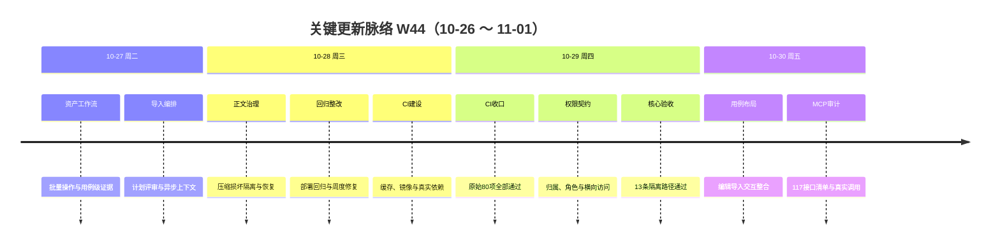

# 周报 2026-W44（2026-10-26 ～ 2026-11-01）

> **总计 55 次提交 | 796 个文件变更（已入库） | +145,122 行 / -2,405 行 | 净增 142,717 行 | 0 个编号 PR 合并**
>
> **贡献者**：chenqifen-miduo（55 次提交）
>
> **整体状态：部分完成** — 测试资产、导入编排、个人执行证据、权限契约和持续集成取得大范围实质进展；原始 CI 80 项失败已修复，前端构建及 13 条隔离核心路径取得通过证据。真实部署、历史数据、完整客户端矩阵仍有缺口；工作区另有 5 个未提交代码改动及 18 个未跟踪报告/证据文件，MCP 全接口审计也发现了尚未闭环的真实缺陷。

**本周趋势**：工作重心从上周的 AI 自动化核心闭环，转向平台生产化整改与严格验收。资产批量操作、导入后计划/评审联动、用例级证据和正文压缩进入工程实现；同时通过 CI、真实浏览器和 MCP 在线调用持续暴露权限、数据契约、部署版本及客户端一致性问题。本周代码量较大，其中包含大量可审计测试证据，不能仅以新增行数判断功能完成度。

> **统计口径**：统计当前分支 `codex/weekly-remediation-20261028` 在 2026-10-26 00:00 至 2026-11-02 00:00 的 Git 历史。去重变更使用首个提交 `fd09cbc8e1` 的父提交至最新提交 `834c0954cf` 的单次差分。两次内部验证分支合并不属于编号 PR，故 PR 数为 0。工作区未提交内容单独列账，不计入上述 Git 数字。

---

## 关键更新脉络

---

## 一、本周完成情况（按验收证据分级）

### 1. 测试资产工作流与批量操作落地

> **价值**：让测试资产能够被集中维护、跨页批量处理和持续追溯，减少逐条修改与关系错乱。

- 前端新增测试资产批量操作入口，覆盖批量编辑、删除、导出、标签、优先级、分类及组织置顶。
- 后端新增 `CaseAssetBatchController`、批量服务、导出访问控制和历史同步处理。
- 增加批量任务、来源编辑审计、同步失败明细、组织置顶等数据库迁移。
- 修复全页选择、排除项、目录移动、项目权限和存储错误保留等边界。
- 补充真实 XLSX、选择状态、删除确认、同步补偿和权限相关证据。
- **状态**：⚠️ 部分完成。主体实现已入库，真实跨项目权限矩阵、大数据量并发、失败恢复及完整生产 E2E 尚未全部证明。

### 2. 用例导入后的计划与评审编排

> **价值**：导入用例后可直接进入计划和评审流程，避免导入完成后再人工重复组织任务。

- 支持仅导入、新建计划、关联既有计划或评审等跟进选项。
- 增加导入跟进协调器、评审上下文捕获、任务阶段提交和失败独立重试。
- 处理带辅助工作表的 Excel，仅选取标准测试用例工作表，避免报告表干扰。
- 前端补充导入双入口、跟进选择和任务状态交互。
- 数据层新增导入跟进、提交阶段和请求身份迁移。
- **状态**：⚠️ 部分完成。代码和定向测试已有；真实环境原 V4 Excel 验证曾出现旧版本行为，最新布局验收中的完整 Excel 上传又受浏览器扩展文件权限阻塞。

### 3. 个人执行与用例级证据协议完善

> **价值**：降低 AI 执行取证成本，同时保留完整步骤事实、证据真实性和服务端质量裁决。

- 支持一张用例级图片覆盖多步骤执行，不强制每步截图。
- 执行提交仍要求全部步骤事实完整；缺步骤或无图片会被质量门禁拒绝。
- 增加用例级执行证据迁移、图片附件读取、结果发布和幂等重放保护。
- Node MCP、原生 MCP 和服务端补充执行证据协议及身份一致性测试。
- 在线定向验证确认：三步骤加一张 JPEG 可 `ACCEPTED/PUBLISHED`，附件字节可读回，重复提交不产生重复记录。
- **状态**：✅ 个人三步单图核心链路已验证；Runner 通道、客户端矩阵和长期稳定性仍未完成，不能扩展为 MCP 整体全部可用。

### 4. 用例正文压缩、损坏隔离与恢复

> **价值**：避免历史损坏或多层压缩数据拖垮用例查询，并为存量问题提供可诊断、可恢复的处理路径。

- 新增 `FunctionalCaseBlobCodec`，支持单层 ZIP、有限兼容解包、严格 UTF-8、CRC、条目和大小校验。
- 对新增、编辑、导入等正文写入路径增加 JSON 结构与字段校验。
- 明确损坏正文返回安全业务错误和 `traceId`，不暴露内部异常。
- 新增离线诊断脚本、修复说明和真实损坏样本测试资源。
- 32 项 Maven 定向测试通过，其中包含真实 MySQL 往返和迁移/补偿测试。
- **状态**：⚠️ 部分完成。编解码和防护已实现；历史损坏数据来源、真实存量恢复和所有直接 mapper 写入口仍需审计。

### 5. CI 80 项失败整改与质量门禁恢复

> **价值**：将原先被环境、夹具和真实缺陷混杂的失败拆开处理，使构建结果重新具备可信度。

- 对初始 541 项测试中的 70 个 failure、10 个 error 逐项归因。
- 修复真实成员重复写、权限定义、工作流参数、项目归属表达式、弹窗失败处理等问题。
- 修复测试夹具污染、静态状态、权限探针、SQL/MockServer 泄漏和错误断言。
- 原始 80 项最终全部实际执行并通过；SDK 11 项、system-setting 543 项通过且零跳过。
- 前端运行时测试、scoped lint、完整类型检查和 Vite 生产构建取得通过证据。
- 后续首次进入下游模块时又暴露项目、API、缺陷、计划等契约问题，并继续整改至 13 条隔离核心路径通过。
- **状态**：⚠️ CI 核心整改阶段完成，完整业务交付仍为部分完成。真实部署、历史数据、完整客户端矩阵及最新未提交修复尚未纳入最终门禁。

### 6. 权限、归属和横向越权防护加强

- 修复组织/项目角色重复写、真实新增才审计及回放不重复记录。
- 修复文件移动、模板、项目切换、API资源、缺陷附件/评论和测试计划的范围校验。
- 增加完整权限定义覆盖、Token 实际控制和横向访问验证。
- 保留 401、403、404、409、422 等业务语义，不以宽泛成功或吞异常绕过失败。
- **状态**：⚠️ 主要契约已修复并有定向证据；全角色、全模块、撤权后缓存刷新和生产横向越权矩阵仍需持续验证。

### 7. 测试计划、用例布局与编辑交互整合

- 将个人进度、计划选择、计划进度调整到统一概览区域。
- 新建、导入与导出进入同一工具栏；执行结果和执行人合并到原批量编辑入口。
- 分页条数选项完整展示，并保留全选所有页/取消全选能力。
- 隔离脚本验证 13 个 SFC 语法/模板、11 项选择/弹窗契约和 5 项布局编辑逻辑。
- 最新真实浏览器验收共 12 个检查点：10 通过、0 失败、1 阻塞、1 未执行，覆盖率 83.3%。
- **状态**：⚠️ 核心布局、新建、批量编辑、持久化、详情、全选和分页已验证；完整 Excel 导入受文件权限阻塞，资产真实提交未执行。

### 8. 资产、计划与执行事实一致性治理

- 增加资产执行投影补偿、来源编辑审计、同步失败详情和评审重算队列。
- 完善源用例、计划用例、测试资产之间的结果、执行人、附件和字段同步。
- 修复计划切换、列表刷新、来源缺陷传播和排序范围问题。
- **状态**：⚠️ 部分完成。核心同步与补偿代码已有；缺陷、解绑、删除恢复、全字段投影和历史存量对账仍未形成 100% 验收证据。

### 9. MCP 全接口真实审计

> **价值**：用真实调用替代“工具已注册即代表可用”的假设，明确每个接口的可用性、前置条件和失败原因。

- 对当前 MCP 的 117 个接口建立完整清单并逐项分类。
- 在测试环境执行 93 次真实调用，记录参数、结果、耗时和 `traceId`，敏感字段已脱敏。
- 导出下载结果完成 Base64 解码、ZIP CRC、13 个条目及目标用例名检查，文件为 5,460 字节。
- 部分任务、租约、页面对象、数据集和业务流接口因缺少真实前置数据而阻塞。
- **状态**：⚠️ 全清单审计完成，但真实正向覆盖不完整；发现缺陷尚未全部修复，不得称 117 个接口全部可用。

### 10. MCP 创建与执行契约缺陷定位

- 19 项定向检查中 15 项符合预期、4 项失败。
- 已确认四类真实问题：
  1. 创建接口接受项目名称/编号，但执行接口只接受内部 ID。
  2. 原生 MCP 可绕过 DTO 的非空名称校验。
  3. 非法等级 `P9` 可写入仅允许 P0～P3 的项目。
  4. 显式无效模板被静默回落为默认模板。
- 同时确认截图 MIME、搜索命中目录、旧策略提示及文档工具表存在易用性问题。
- **状态**：❌ MCP 整体不能判定全部可用；缺陷已定位，部分修复仍在工作区。

### 11. MCP 缺陷整改正在进行（未提交）

- 当前已修改但未提交：
  - `AgentGenericMcpWriteService.java`
  - `AgentSafeErrorMapper.java`
  - `BuiltinAgentMcpToolConfig.java`
  - `BugWorkflowRuntimeService.java`
  - `FunctionalCaseExportTaskService.java`
- 涉及通用写操作校验、错误映射、工具注册、缺陷状态刷新和导出重试错误。
- **状态**：🔄 处理中。尚未进入 Git 提交，也没有完整构建、迁移、容器和在线复验，不能计为已完成。

### 12. 真实回归与证据体系扩充

- 新增部署回归、周度回归、CI失败、导入计划、压缩修复、权限和布局验收证据。
- `docs/testing/msp-weekly-regression-20261028/` 包含 162 个证据文件，覆盖截图、接口结果、XLSX、DOM和配置清单。
- 10月28日部署回归主基准 8 点中 0 通过、5 失败、3 阻塞，证明当时线上前端并未表现出当日改动。
- 10月30日最新布局真实验收改善为 10 通过、0 失败、1 阻塞、1 未执行。
- **状态**：⚠️ 证据体系明显增强，但不同时间点对应不同部署版本，必须按受验版本解释，不能混合成“全部通过”。

### 13. 上周遗留方向推进

- ✅ 资产批量操作：已从方案推进到前后端和数据库实现。
- ✅ 导入编排：已实现计划/评审跟进和异步阶段控制。
- ⚠️ 网页端 AI 生产化：真实 MCP 审计有进展，但暴露 4 类缺陷和前置阻塞。
- ⚠️ 最新集成质量收口：CI 和隔离验收进展显著，真实部署与完整 E2E 未全部关闭。
- ❌ 小程序代表性回归、M3 指标看板、智能营销定时巡检：本周未发现新增验收证据。

---

## 二、需求追踪结果

| 需求 | 前端入口/实现 | 后端/API | 数据或配置 | 测试与验收 | 状态 |
|------|---------------|----------|------------|------------|------|
| 资产批量操作 | 资产页批量动作、全页选择 | 批量控制器、服务、导出访问 | 批量任务、审计、同步失败、置顶迁移 | 定向测试及回归证据 | 部分完成 |
| 导入后计划/评审 | 导入双入口、跟进选择、任务状态 | 导入协调器、计划/评审服务 | 跟进、请求身份、提交阶段迁移 | 定向测试；真实完整上传阻塞 | 部分完成 |
| 用例级执行证据 | 执行结果及附件展示 | contract/upload/submit/get | 用例级证据迁移 | 三步单图在线验证通过 | 核心链路完成 |
| 正文压缩与恢复 | 安全错误提示 | Codec、写入校验、诊断处理 | 历史正文与修复脚本 | 32 项定向测试通过 | 部分完成 |
| 权限与归属 | 角色、文件、计划、缺陷入口 | RBAC、所有权、横向访问校验 | 权限定义与审计 | CI、Token及定向权限测试 | 部分完成 |
| 用例布局与编辑 | 概览、工具栏、编辑、分页 | 复用批量编辑/执行人接口 | 无新增布局数据结构 | 12点中10通过、1阻塞、1未执行 | 部分完成 |
| MCP 全接口可用性 | MCP 为直接用户入口 | 117个工具处理链 | 测试环境前置数据 | 93次调用；正向覆盖不完整 | 部分完成 |
| MCP 四类契约缺陷 | 工具Schema和错误提示 | 创建、执行、模板、等级校验 | 现有用例/模板/项目数据 | 19项中15通过、4失败 | 修复中 |

### 异常、权限与失败行为

- 批量操作必须保留行级失败、`failFast`、幂等、权限和事务边界，不得吞异常后返回成功。
- 导入成功与计划/评审跟进成功必须分别展示；跟进失败允许独立重试，不能把已导入数据回滚成未知状态。
- 损坏正文只返回安全业务错误和 `traceId`，原始压缩、SQL及异常栈只进入日志。
- MCP 显式非法名称、等级、模板和项目标识必须在服务边界校验；不能只依赖 REST Controller 注解或客户端 Schema。
- Token 撤销、跨项目资源、附件归属和幂等重放必须重新进行当前状态鉴权。
- 当前工作区修复未完成验证，未知错误路径仍存在回归风险。

---

## 三、本周工程数据

### 每日提交分布

| 日期 | 提交数 | 重点方向 |
|------|--------:|----------|
| 10-26（周一） | 0 | — |
| 10-27（周二） | 4 | 资产工作流、导入编排、MCP证据 |
| 10-28（周三） | 15 | 正文压缩、部署回归、CI与依赖治理 |
| 10-29（周四） | 34 | CI失败整改、权限契约、下游模块与核心验收 |
| 10-30（周五） | 2 | 用例布局与编辑/导入交互整合 |
| 10-31～11-01 | 0 | 截至报告生成时无提交 |
| **合计** | **55** | **平台整改与验证收口** |

### 提交类型分布

| 类型 | 数量 | 占比 |
|------|-----:|-----:|
| fix | 26 | 47.3% |
| test | 14 | 25.5% |
| ci | 11 | 20.0% |
| feat | 2 | 3.6% |
| docs | 2 | 3.6% |
| **合计** | **55** | **100%** |

### 代码变更概览（已入库）

| 指标 | 数量 |
|------|-----:|
| 去重文件变更 | 796 |
| 新增行数 | 145,122 |
| 删除行数 | 2,405 |
| 净增行数 | 142,717 |
| 编号 PR | 0 |
| 贡献者 | 1 |

### 未提交工作区内容

| 类型 | 数量 | 说明 |
|------|-----:|------|
| 已修改产品代码 | 5 | MCP通用写操作、错误映射、工具配置、缺陷状态、导出重试 |
| 未跟踪汇总文档 | 4 | 布局真实验收、MCP全接口审计、整改追踪、在线诊断 |
| 未跟踪布局证据 | 11 | 10张PNG及1份metrics.json |
| 未跟踪MCP证据 | 3 | 全接口 evidence/inventory 及在线审计 evidence |
| **合计** | **23** | **不计入已完成提交统计** |

---

## 四、与上周 W43 对比

| 指标 | W43 | W44 | 变化 |
|------|----:|----:|------|
| 提交数 | 6 | 55 | +816.7% |
| 编号 PR | 0 | 0 | 持平 |
| 文件变更 | 586 | 796 | +35.8% |
| 净增行数 | 32,644 | 142,717 | +337.2% |

> 本周增量显著扩大，主要由平台整改、测试代码、CI工作流和大量证据文件共同构成。较大的代码量同时提高了回归风险，必须依赖严格质量门禁，不能按提交数量判断完成度。

### 上周方向落地情况

| W43 建议方向 | W44 实际进展 |
|--------------|--------------|
| P0 网页端 AI 自动化生产化 | ⚠️ 完成 MCP 真实环境定向与全接口审计，但发现4类契约缺陷，生产化未关闭 |
| P0 小程序代表性回归 | ❌ 未发现新增用例集、覆盖率或成功率证据 |
| P0 14类问题整改 | ✅ 多项问题进入实现并补充周度回归；仍有部署版本和前置阻塞 |
| P0 最新集成版本质量收口 | ⚠️ 原始80项、前端构建及13条隔离路径通过；完整部署/历史库/客户端矩阵未完成 |
| P1 资产批量操作实施 | ✅ 前后端、数据库和验证证据均有实质实现 |
| P1 导入编排落地 | ✅ 计划/评审跟进、阶段门禁和失败重试已实现；真实完整导入待补 |
| P1 M3指标看板 | ❌ 未发现覆盖率、人机协同率持续对账证据 |
| P1 小程序方法产品化 | ❌ 本周无新增工程或验收证据 |
| P2 M4巡检试点 | ❌ 未发现智能营销连续一周定时巡检证据 |
| P2 方案与原型入库 | ✅ W43多份方案、原型及回归材料已进入本周提交范围 |

---

## 五、里程碑完成情况

| 里程碑 | 目标日期 | 当前判断 | 本周进展与差距 |
|--------|----------|----------|----------------|
| M1：测试资产统一沉淀、复用与追溯 | 2026-08-30 | ⚠️ 部分完成，已逾期 | 资产批量操作、导出、置顶、来源审计和同步补偿显著推进；存量归档100%、关联准确率100%、30秒检索和跨项目越权为0仍缺完整对账 |
| M2：测试任务、执行、缺陷和改进闭环 | 2026-09-20 | ⚠️ 部分完成，已逾期 | 计划、执行事实、缺陷附件/评论和评审链路继续完善；缺陷遗漏分析及应补回归用例100%仍未证明 |
| M3：Agent辅助个人测试任务执行 | 2026-11-30 | 🟢 阶段里程碑完成 / 总目标建设中 | 三步单图个人执行在线验证通过，MCP真实审计启动；后台覆盖率、小程序规模化回归、月度项目60%人机协同仍无量化关闭证据 |
| M4：AI定时巡检与主动质量预警 | 2027-02-20 | 🟡 前期能力建设 | CI门禁、真实执行、证据和错误追踪可作为基础；智能营销定时巡检稳定运行一周尚未开始验收 |

---

## 六、验证情况

### 已执行并有证据

| 验证范围 | 结果 |
|----------|------|
| 原始CI失败集 | 原始70 failure、10 error 全部实际执行并通过 |
| SDK/system-setting | 11 + 543 项通过，零跳过 |
| 前端完整门禁 | 运行时测试、scoped lint、完整类型检查、Vite生产构建通过 |
| 正文压缩与整改 | 32项Maven定向测试通过，含真实MySQL往返及迁移/补偿 |
| 隔离核心验收 | 13条核心路径通过 |
| 布局隔离检查 | 13个SFC检查、11项选择/弹窗、5项编辑逻辑通过 |
| 布局真实浏览器验收 | 12点中10通过、0失败、1阻塞、1未执行 |
| MCP定向在线检查 | 19项中15符合预期、4失败 |
| MCP全接口审计 | 117接口建立清单，执行93次真实调用；部分正向路径受前置阻塞 |
| 导出文件检查 | Base64解码、ZIP CRC、13条目及目标用例名检查通过 |

### 未执行、阻塞或未通过

| 验证项 | 原因 | 剩余风险 |
|--------|------|----------|
| 最新未提交MCP修复的全量构建与测试 | 改动仍在工作区 | 可能引入编译、契约或行为回归 |
| 最新版本Docker构建、启动与健康检查 | 尚无覆盖当前工作区的最终记录 | 镜像通过不等于服务可启动 |
| 真实历史数据库迁移与损坏数据恢复 | 需受控存量环境 | 迁移顺序、历史脏数据和恢复正确性未知 |
| 完整Excel上传、预检与提交 | 浏览器扩展未授权本地文件上传 | 导入主路径未完成真实闭环 |
| 资产真实复制/覆盖 | 最新布局验收未执行 | 重名、权限、关联和失败恢复未知 |
| MCP真实任务、租约、页面对象与业务流 | 缺少有效前置资产或环境停用 | 部分接口仅完成空结果或阻塞判断 |
| MCP四类缺陷修复复验 | 修复未提交、未部署 | 空名称、非法等级、模板回落和标识不一致风险仍在 |
| 小程序规模化回归 | 本周无新增证据 | M3移动端能力无法量化 |
| 智能营销定时巡检 | 本周无运行证据 | M4尚未进入稳定性观察 |

---

## 七、下周优先级建议

| 优先级 | 方向 | 建议动作 |
|--------|------|----------|
| P0 | MCP四类缺陷闭环 | 完成当前5个文件整改，补单元/集成/构建/迁移/容器验证并部署复测19项定向清单 |
| P0 | 全量质量门禁 | 将最新工作区纳入完整前端、后端reactor、镜像、健康检查和核心E2E，保留失败报告 |
| P0 | 导入真实闭环 | 在用户授权文件上传后完成Excel预检、提交、计划/评审跟进、失败重试和持久化核对 |
| P0 | 资产批量生产验收 | 覆盖跨页、跨项目权限、重名、部分失败、回滚、导出内容和历史关系一致性 |
| P1 | MCP前置数据矩阵 | 创建隔离任务、租约、页面对象、数据集和业务流，补齐117接口正向路径 |
| P1 | 历史正文恢复 | 在只读扫描、备份、预览和回滚机制下验证真实损坏数据修复 |
| P1 | M1/M2指标对账 | 输出归档率、关联准确率、越权、责任人、证据、缺陷关联和回归补充指标表 |
| P1 | 小程序规模化验证 | 建立首批代表性用例，统计覆盖率、成功率、人工接管率和证据完整率 |
| P1 | M3指标看板 | 按智能营销、防窜物流、米多星球和IMP持续统计自动化覆盖与人机协同比例 |
| P2 | M4智能营销巡检 | 启动最小巡检集，连续运行一周并验证告警、证据、复验和恢复通知 |
| P2 | 文档与证据入库 | 评审并提交本周18个未跟踪材料，建立报告与受验SHA映射 |

---

## 八、修改文件与前后端对应关系

### 修改范围

- 本周已入库：796个去重文件，覆盖前端、后端、数据库迁移、MCP客户端、CI、测试、维护脚本与文档证据。
- 当前未提交：5个Java产品文件及18个文档/证据文件。
- 本次周报生成新增：`doc/report.2026-W44.md`。

### 前后端完整链路

| 用户能力 | 前端 | 后端/API | 数据/配置 | 状态 |
|----------|------|----------|-----------|------|
| 资产批量治理 | 资产页批量入口、全页选择 | CaseAssetBatchController/Service | 批量任务、审计、同步、置顶迁移 | 部分完成 |
| 导入跟进 | 导入双入口、跟进选择 | ImportFollowupCoordinator及计划/评审服务 | 跟进、请求身份、提交阶段迁移 | 部分完成 |
| 个人执行证据 | 执行结果与附件展示 | contract/upload/submit/get | 用例级执行证据 | 核心链路完成 |
| 正文恢复 | 安全错误展示 | BlobCodec、写入校验、诊断 | 历史正文、修复脚本 | 部分完成 |
| 布局与编辑 | 概览、工具栏、批量编辑、分页 | 原批量编辑及执行人接口 | 无新增布局迁移 | 部分完成 |
| MCP接口 | MCP Schema、错误提示 | 117工具及服务链 | 测试环境前置资产 | 审计完成/整改中 |

---

## 九、已知风险和遗留问题

1. 55次提交、796个文件且无编号PR，变更边界大，独立代码审查不足。
2. 工作区仍有5个产品代码文件未提交，周报后的实际状态可能继续变化。
3. MCP审计发现的四类真实契约缺陷尚未部署复验。
4. 18个未跟踪报告和证据文件存在丢失、未评审及与受验版本脱节风险。
5. 10月28日部署回归和10月30日布局验收对应不同版本，不能相互覆盖结论。
6. 完整Excel上传及资产真实提交未闭环，导入交付仍不能判定全部完成。
7. 正文压缩保护已实现，但历史损坏数据恢复与全部写入口审计仍有风险。
8. M1、M2已逾期，关键100%指标仍缺统一对账。
9. M3后台覆盖率、小程序量化回归及月度60%人机协同缺本周新增证据。
10. M4智能营销巡检尚无连续一周运行证据。

---

## 十、功能状态结论

**本周功能状态：部分完成。**

本周已取得三项可确认的阶段成果：资产与导入编排由方案进入正式实现；原始CI 80项失败完成整改并取得严格执行证据；个人三步单图执行链路在真实MCP环境验证通过。用例布局、新建、编辑、持久化、详情、全选及分页也取得10个真实检查点通过证据。

但MCP全接口审计仍发现4类真实缺陷，当前修复尚未提交；完整Excel导入、资产提交、历史数据恢复、最新容器和全业务E2E尚未关闭。因此不得使用“全面完成”“全部接口可用”或“可以正常运行全部功能”等结论。

---

## 附录：Pull Requests 与内部合并

- 本周没有 `Merge pull request #...` 形式的编号PR。
- 10月29日和10月30日存在内部验证分支合并，用于将已验证整改及用例布局变更合入主线，但不计为编号PR。
- 上周已确认的最新历史编号PR仍为 #126；本周没有新增 #127 及以后编号PR。
