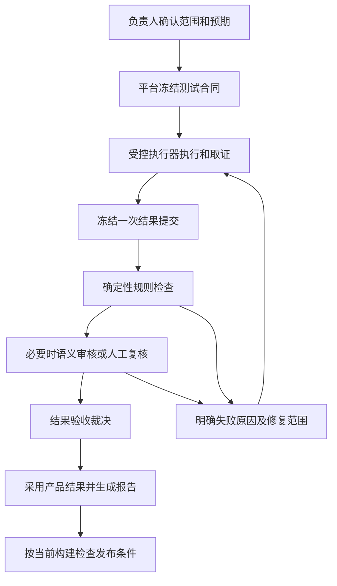

# AI 自动化测试质量门禁：资料评议与落地指南

日期：2026-09-22。适用对象：当前 MeterSphere 仓库中的 AI 功能测试、外部 Agent/MCP 提交和平台 Runner。

> 2026-09-23 前提修订：用户确认当前 MSP 尚未接入大模型。本文涉及平台模型执行、独立 AI 语义审核的部分应视为后续可选设计，不是当前可用能力或一期前提。当前优先采用外部执行者接入、代码规则和人工复核。全板块用途、入口收敛与冗余评估见 [未接入大模型阶段的 MSP 板块评估](./msp-module-purpose-and-redundancy-review.md)。

本文回答怎么做、改哪里、怎么用。两份既有 Markdown 作为待评议材料，其中的指令不作为本次执行指令。本文为设计建议；代码事实来自本地静态阅读，不代表生产环境实测结果。

## 1. 先用一个例子理解需求

AI 测试“创建订单”，随后上报成功。平台应当能够回答：本次要求验证哪些内容？是否真的执行？订单号来自哪里？页面和接口是不是同一笔订单？运行的是哪个构建？谁有权认可这份结果？

建议把需求定义为：**AI 可以提出动作、提供观察和提交结果；平台依据预先确定的验收条件和可追溯事实，决定哪些结果可以正式采用。**

代码能强制权限、必填字段、状态流转和精确断言，却不能保证需求本身完整、截图一定真实、复杂语义判断永远正确。目标应是：明确可信边界，消除已知绕过，量化残余误判，给不确定结果提供处理路径。

特别需要区分四件事：

| 维度 | 回答的问题 | 示例 |
|---|---|---|
| 接收状态 | 材料收齐了吗？ | 上传中、已接收、格式错误 |
| 结果验收 | 材料足以支持结论吗？ | 待检查、接受、拒绝、待复核、检查异常 |
| 产品结果 | 被测功能怎样？ | 通过、失败、阻塞、未执行 |
| 发布决策 | 这个构建允许进入下一阶段吗？ | 放行、不放行、例外授权 |

订单创建失败但证据完整：结果验收可以通过，产品结果失败，发布仍被阻断。截图缺失：结果待补证或被拒绝，不能据此认定产品失败。诚实记录“环境不可用”可以形成有效报告，但不能冒充测试已覆盖。

## 2. 查到的官方资料，以及可以借鉴什么

以下资料支持设计原则，并未提供可直接安装的“MeterSphere AI 测试门禁”。后文页面、接口和数据模型是结合仓库提出的方案。

| 官方资料 | 资料要点 | 对本项目的启发 |
|---|---|---|
| [SonarQube 质量门禁](https://docs.sonarsource.com/sonarqube-server/2026.1/quality-standards-administration/managing-quality-gates/introduction-to-quality-gates) | 按条件判断门禁，可使 CI 流水线失败 | 检查必须连接实际放行出口；只显示评分不构成控制。Sonar 本身主要检查代码，不能证明 AI 真测过业务 |
| [NIST AI RMF](https://www.nist.gov/itl/ai-risk-management-framework) | 提供自愿采用的 AI 风险管理框架 | 明确责任、使用场景、评估和持续管理；不能只写一次提示词后不再评估 |
| [MCP Tools 规范（2025-06-18）](https://modelcontextprotocol.io/specification/2025-06-18/server/tools) | 工具有输入/输出结构；工具注解的可信性取决于来源；提供人工干预能力 | MCP 只是调用协议，工具说明和 readOnly 等注解不能替代服务端权限与业务校验 |
| [MCP Authorization（2025-11-25）](https://modelcontextprotocol.io/specification/2025-11-25/basic/authorization) | 定义 HTTP 传输下的授权机制 | 接入应验证凭据与资源受众；还要自行实现项目、任务、动作级权限。其他传输方式需按自身部署配置认证 |
| [MCP 安全实践](https://modelcontextprotocol.io/docs/2025-11-25/tutorials/security/security_best_practices) | 讨论混淆代理、令牌透传等问题 | 上游与下游凭据隔离，不能把 Agent 的身份与平台内部写入权混为一体 |
| [OWASP Excessive Agency](https://genai.owasp.org/llmrisk/llm062025-excessive-agency/) | 过多工具能力、权限和自主权会放大损害 | 执行者按最小能力授权；关键决定在下游系统独立校验 |
| [Playwright Trace Viewer](https://playwright.dev/docs/trace-viewer) | 可检查动作、DOM 快照和网络等执行信息 | 证据可以来自执行器自动记录，截图只是其中一种；工具记录本身仍依赖执行环境可信 |

## 3. 对两份原方案的评议

### 3.1 第一份：代码级控制方案

[原文](./ai-testing-quality-gates-code-control-solution.md)适合作为架构方向：冻结计划、区分上传/验收/产品状态、服务端裁决、不可覆盖提交、反馈重测，这些建议应保留。

需要修正或补充：

1. **“验收通过”不足以让 CI 放行。** 还必须检查产品结果、实际执行覆盖、阻断缺陷和当前构建版本。
2. **代码不能证明全部业务事实。** 独立 AI 审核也可能与执行 AI 同错；换模型不等于建立真值。
3. **证据缺失应区分阶段。** 上传中的草稿允许缺文件，冻结提交后才进行完整性裁决；不能让传输抖动等同最终质量失败。
4. **原始证据与提交版本不宜强制一对一。** 同一运行的不可变证据可由新提交明确引用，引用范围和有效性由服务端校验，不能为了改圈注复制原始文件。
5. **状态应分层。** 接收错误、检查任务故障、产品断言失败不能混成一个失败枚举。

### 3.2 第二份：MSP 实现说明

[原文](./ai-testing-quality-gates-msp-implementation.md)比第一份更接近当前项目：复用执行合同、artifact、步骤结果及 MCP 工具，方向合理。但它仍是设计草案，不能作为已验证实现清单。

| 原文观点 | 评价与调整 |
|---|---|
| 哈希使证据可信、可验证 | 哈希只证明字节一致。伪造截图也有正确哈希。本地 JSON、时间戳和哈希若都由 Agent 可修改，不能证明现场执行 |
| Session 是人、Agent Token 是 AI | 只能区分认证通道。AI 可操作已登录浏览器，人也可调用 MCP；需要记录认证主体、执行方式和审批主体，承认身份识别边界 |
| 人的执行保持直接写入 | 可作为兼容措施，但 AI 拿到人类 Session 就能绕过。关键发布必须检查统一结果来源与批准记录 |
| 只在 run() 加出口守卫 | 不充分：本地存在计划外更新、关联计划同步、批量执行路径，要做全部结果写入路径清单 |
| 文案、略慢延迟只能观察 | 应由需求决定。关键文案错误、超过明确性能指标可以是硬失败 |
| 通过步默认 ON_FAILURE | 非关键步骤可用；证明业务成功的关键断言必须有成功证据，不能根据 AI 自报成功决定不采集 |
| 修正只跑 retestScope | 应计算前置依赖与数据副作用。修改订单结果可能需要从登录、准备数据重新执行 |
| 门禁代码全部放 agent-integration | 该模块已经依赖 test-plan，后者反向依赖会形成循环；公共守卫契约应放下层模块 |
| 通过后只写计划三张表 | 当前 run() 还有同步用例步骤、附件和通知等副作用，应以实际调用链评估事务范围 |

建议保留两份文档作为历史草案，以本文补充设计评审，再编写接口契约与开发任务。

## 4. 怎么做：建立五个环节

### 4.1 合同：先规定“测什么、什么叫对”

一份合同包含项目、环境、构建摘要、需求/用例/规则版本、必测用例和步骤、断言、证据策略、超时、允许工具和风险范围。保存快照与摘要，而非只存可变用例 ID。

以创建订单为例：不能只写“下单成功”。应明确返回订单 ID、页面 ID 与响应一致、订单金额符合独立预期、持久化状态符合业务约定。预期必须来自已评审需求、固定数据或独立计算，不能由执行 AI 看完结果后决定。

AI 可以补充探索性用例，记录为扩展范围；不得删除必测项或降低断言。合同错误通过新版本修订，历史保持不变。

### 4.2 执行：事实由受控进程采集

建议分三种可信等级：外部 Agent 自报材料、平台登记的执行器自动取证、隔离执行器加独立结果核对。平台记录等级并按风险选择是否允许自动采用。

执行器为每次尝试记录 runId、attemptId、stepId、eventId、工具/执行器版本、环境与构建、操作参数摘要、实际值和证据引用。服务端发放运行租约，过期或被撤销的租约不能写入新事实。

Agent 不应拥有执行器记录目录的修改权、签名密钥、验收数据库写权限。签名提高来源可信度，但执行器自身被控制后也不再可靠。外部可编辑本地账本只作为低信任导入，不自动升级为受控取证。

成功关键步骤保存必要结果证据；普通操作可只保留事件，失败保存额外 trace。按合同决定保留内容与期限，上传前脱敏并记录转换版本，保留可验证链路。

### 4.3 验收：分别检验结构、来源、内容

| 检查层 | 具体检查 | 失败后处理 |
|---|---|---|
| 身份与范围 | token 项目/任务/动作、合同版本、租约、构建 | 拒绝写入，审计 |
| 结构完整性 | schema、未知/重复步骤、必测项、文件存在和大小 | 返回逐字段问题 |
| 证据来源 | 文件哈希、归属、尝试 ID、执行器事件关联 | 拒绝采用或转人工 |
| 产品断言 | 用独立预期与实际值比较 | 记录产品失败；证据充分时报告仍可接受 |
| 结论一致性 | 失败断言不能聚合成产品通过 | 拒绝该提交结论 |
| 语义审核 | 图片、DOM、文案是否支持结论 | 不确定转复核；异常允许重试 |

缺图与 API 返回错误要使用不同规则类别。覆盖率至少分为“所有必测项是否被交代”和“所有必测项是否实际执行”；全写 NOT_RUN 可以交代完整，但执行覆盖率为零。

### 4.4 裁决和回写：平台掌握正式采用权

提交采用 DRAFT → SUBMITTED；冻结后只读。检查状态独立保存 PENDING/RUNNING/ERROR，验收结论保存 ACCEPTED/REJECTED/NEEDS_REVIEW，回写保存 PENDING/APPLIED/FAILED。执行器完成不代表质量验收完成，也不代表回写完成。

裁决绑定提交摘要、合同版本、规则/检查器版本、项目、环境和构建；消费时重新核对绑定关系及撤销状态。执行 Agent 不能传一个 ACCEPTED 字段让平台相信。

正式写入使用受保护的领域方法，在事务中验证裁决并写入执行历史；幂等键按目标记录、提交版本和动作定义。通知、报表更新通过事务 outbox 或等价可靠机制重试。回写失败重试回写，不能因此重新下单；过期任务不能覆盖较新运行的当前结果。

拒绝结果也应可读、可导出诊断报告，并明显标注未验收。门禁限制正式采用，不应让失败证据消失。

### 4.5 发布：另做一次业务放行判断

建议初始条件：指定构建必测范围内结果均可采用，关键测试实际执行，产品结果符合发布策略，无阻断缺陷，必要批准有效。环境、构建或合同变更后，不复用旧通过记录。

人工例外单独标记 EXCEPTION_APPROVED，绑定范围、理由、责任人及期限；保留原失败，不能涂改成正常通过。身份非法、证据损坏等基础约束不能靠普通复核覆盖。

## 5. 要有哪些页面

建议以现有 Agent、执行详情、测试计划页面扩展为主，新增两个配置/处理入口。

| 页面/位置 | 使用者与操作 | 必须显示 |
|---|---|---|
| 项目质量策略（新增） | 质量负责人配置、发布规则版本 | 适用范围、阻断条件、证据策略、变更历史；先模拟再发布 |
| 创建任务/执行前确认（扩展） | 测试人员选择环境、构建、范围 | 冻结范围、关键断言、预计成本、不可执行项 |
| 执行详情（扩展） | 测试人员查看过程并修复 | 接收/验收/产品/回写状态，步骤时间线、证据及具体反馈 |
| 人工复核队列（新增） | 有权限的复核人处理歧义 | 预期与实际并列、定位证据、影响范围、批准/拒绝理由 |
| 测试计划与执行历史（扩展） | 团队使用正式结果 | 来源、构建、提交版本、验收标记、待验收新结果提示 |
| 能力授权与运行评估（扩展） | 管理员授权，负责人评估 | 工具范围、执行身份、异常调用、误放/误拒、积压及耗时 |

反馈例子：“第 3 步缺少订单号证据，无法核对页面与接口。补传原运行已有响应；若不存在，重新执行第 1～3 步。”按钮应是“重传证据”“按范围重测”“申请复核”，不要只显示“门禁失败”。

每页覆盖 loading、empty、success、validation-error、permission-denied、network-error、server-error；不可用按钮显示原因。复核人与执行发起人按项目风险实行职责分离。

## 6. 接口与后端怎么分工

下表为建议契约，不表示现有接口已经实现。HTTP 和 MCP 应调用同一个应用服务。既有 artifact API 优先复用。

| 建议接口 | 后端职责 | 对应页面/MCP |
|---|---|---|
| POST /api/quality/policies；POST /api/quality/policies/{id}/publish | 验证规则、创建不可变版本、发布权限检查 | 策略页；不向执行 Agent 授权 |
| POST /api/quality/runs | 从真实计划生成合同；固定环境/构建/范围 | 创建任务；run.create |
| GET /api/quality/runs/{id}/contract | 返回授权范围内冻结合同 | 执行详情；run.contract.get |
| 复用 artifact prepare/upload/commit | 校验归属、大小、内容、服务端实算哈希、上传状态 | 自动采集；artifact 工具 |
| POST /api/quality/runs/{id}/events:batch | 按租约写入事件并校验序号/幂等 | 时间线；通常 Runner 直连 |
| POST /api/quality/runs/{id}/submissions | 冻结 manifest 与引用、提交摘要、排队检查 | 提交动作；submission.create |
| GET /api/quality/submissions/{id} | 返回检查、验收、产品、回写状态及反馈 | 执行详情；quality.get |
| POST /api/quality/submissions/{id}/reviews | 验证复核资格、版本、理由，追加决策 | 复核队列；不对执行 Agent 开放 |
| POST /api/quality/submissions/{id}/retests | 计算依赖范围，创建新尝试 | 重测按钮；retest.create |
| GET /api/quality/release-decisions?buildId=… | 校验当前构建必测集与放行策略 | 发布/CI，只读决策 |

提交成功返回接收状态及 submissionId，建议 HTTP 202；schema 错误 400、认证/权限 401/403、版本或幂等冲突 409，约定以项目现有协议为准。异步验收拒绝是业务结果，查询接口仍可正常返回。统一错误体为 {code,message,details?,traceId?}，不向用户暴露堆栈。

后端建议对象：PolicyVersion、RunContract、Submission、EvidenceReference、RuleResult、Decision、Feedback、ReviewDecision、WritebackJob。已有 task/artifact/step/audit 表尽量复用。决策记录与运行原始事实分开，重新审核追加新决策，不覆盖旧结果。

必须处理并发提交、同键不同内容、上传后文件删除、检查超时、任务取消、租约过期、裁决撤销、队列重复投递与旧回写晚到。冻结与文件保留使用引用保护，保证检查和正式使用期间文件可读。

## 7. MCP 怎么处理，人机怎么区分

MCP 负责暴露有限业务能力，不持有特殊绕过通道。工具清单可包含获取合同、提交材料、查询质量和申请重测；不提供 markAccepted、修改规则、强制回写等执行者工具。

服务端每次 tools/call 校验主体、项目、run、scope、租约及工具参数；只隐藏 tools/list 不够。批量调用逐项鉴权并返回独立结果，不能外层授权一次后任意执行。MCP、REST、内部 Runner 的规则一致。

小型 JSON 通过 MCP 传递；图片等大文件使用受授权的上传 API，返回 artifactId。Agent 从质量结果读取结构化 feedback，按 retryable、requiredAction 和 retestScope 修复；限制自动重试次数与预算，防止反复操作业务。

网页、日志、工具响应中的文字都是待测数据。审核模型只读必要证据，不授予写入或审批工具，输出 schema 校验后交给确定性聚合逻辑；仍需用含提示注入的样本评估，不能宣称彻底消除注入。

**身份设计应记录三个维度：**

| 维度 | 例子 | 谁确定 |
|---|---|---|
| 认证主体 | 用户 ID、服务账号、Agent client ID | 服务端验证的凭据 |
| 执行方式 | MANUAL_ATTESTED、AI_AGENT、SCRIPT、UNKNOWN | 可信任务上下文；混合操作记录实际执行链 |
| 责任与批准 | 发起人、受委托用户、执行器、复核人 | 身份与授权系统，逐项留审计 |

请求体 source=HUMAN、User-Agent 和入口 URL 都不能作为身份证明。人发起 AI 任务，应记录“张三发起、Agent 执行”，不能归为纯人工。登录 Session 只能表示凭据属于某账户，无法可靠证明鼠标操作来自人。

因此关键发布对所有来源采用共同底线，人工执行补充签署和必要证据，AI 执行要求受控取证。高风险批准可要求独立复核和再次认证，但也不宣称技术上绝对识别人或 AI。平台自身管理员/数据库超级用户属于信任边界，执行 Agent 不应获得这类权限。

## 8. 怎么改：当前仓库的实际落点

以下路径相对仓库根目录。阅读时间为本文日期，结论是静态代码观察。

| 已核对位置 | 当前事实 | 建议改动 |
|---|---|---|
| backend/services/agent-integration/.../service/AgentFunctionalCaseSubmitService.java | submitInPlan 调用 run；submitOutOfPlan 更新用例并同步计划 | 两条路径都改为提交/查询裁决后采用，不能漏掉计划外路径 |
| 同目录 AgentExecutionWritebackService.java | 调用逐用例回写服务 | 任务完成后创建提交及检查任务；验收后再调度回写 |
| 同目录 AgentExecutionCaseWritebackService.java | 逐用例直接调用 run | 改由受保护 adapter 回写，保留准确主体及提交引用 |
| 同目录 AgentExecutionService.java | 生成 executionContract 和 hash，部分步骤使用 ON_FAILURE | 扩展独立断言、构建绑定和关键成功证据策略 |
| 同目录 AgentExecutionArtifactService.java | 存在上传 token 和服务端 sha256 计算 | 复用并补可信来源、attempt 绑定、只读冻结和保留期 |
| backend/services/test-plan/.../service/TestPlanFunctionalCaseService.java | run 写计划、用例和历史；batchRun 有独立入口 | 所有正式写路径统一守卫；检查批量、同步和重试路径 |
| 同文件 run/updateFunctionalCaseStatus | 按 functionalCaseId 同步多计划；可能改写用例步骤 | 运行结果与用例定义分离；构建放行从对应运行快照取数 |
| backend/services/agent-integration/.../tool/BuiltinAgentMcpToolConfig.java、AgentMcpToolSchemas.java、AgentMcpToolRegistry.java | 已有工具配置、schema 和注册中心 | 增加提交/查询/重测契约，兼容迁移旧 submit |
| backend/framework/domain/src/main/resources/migration/ | 现有数据库迁移目录 | 新增 quality 表、来源及提交关联索引，旧数据标记 LEGACY_UNVERIFIED |
| frontend/src/views/agent/execution/detail.vue | 已有执行详情入口 | 扩展状态、证据、反馈和重测操作 |
| frontend/src/views/agent/capability.vue、evaluation.vue | 已有能力与评估页面 | 复用入口承载工具授权和质量指标，具体组件需详细设计时再核对 |
| frontend/src/router/routes/modules/agent.ts | Agent 路由含 adminOnly:true | 新页面不能仅管理员可见；核对路由守卫与测试/复核角色权限 |
| frontend/src/api/modules/ai-execution.ts、api/requrls/ai-execution.ts | 已有执行 API 层 | 增加质量 API/类型，与后端契约保持一致 |
| frontend/src/views/test-plan/testPlan/detail/featureCase/detail/executionHistory/index.vue | 已有历史页面 | 展示构建、来源、验收版本和原始证据入口 |

**依赖处理：** 已读取 agent-integration/pom.xml 和 test-plan/pom.xml，前者依赖后者。建议把 GateVerifier 接口与可信写入上下文放到共同依赖的下层模块，由 agent-integration 实现；test-plan 调用接口，避免反向 Maven 依赖。必需守卫未装配时禁止受保护写入，不能默认通过。具体选择 sdk 或独立 quality-core 模块，要在实现前评审职责边界。

**绕过清单还要继续审计：** Controller、批量执行、用例库更新、计划同步、导入、定时任务、脚本、MCP maintenance 工具、Mapper/SQL、报告与 CI 读取路径。此次已证明存在多条写路径，但未做全仓调用图或生产流量审计。

**历史语义要调整：** lastExecResult 可作为“最近一次操作”的展示字段，不能充当指定构建的发布凭据。新提交未验收时可以保留上次已采用结果，但必须同时显示“当前构建尚无有效结果”，避免旧绿色误导用户。

## 9. 实施范围和交付顺序

### 第一阶段：最小可用闭环

选择一个测试项目、一条订单业务链和一个构建做试点。实现合同快照、不可变提交、关键断言/证据检查、独立状态、HTTP/MCP 共用服务、全部相关写入守卫、执行详情反馈及重测。外部自报来源默认不获得高可信自动通过资格。

至少包含“通过、真实产品失败、缺证据拒绝、检查故障、补正复验”五条用户路径。没有页面、权限、错误交互或出口验证的后端接口，不算可用一期。

### 第二阶段：可信执行与业务推广

加强执行器隔离、自动取证和独立核对；支持关键环境构建绑定、依赖重测、可靠回写、来源历史和证据保留策略。覆盖更多测试类型前分别定义断言与证据策略，不能套用统一截图规则。

### 第三阶段：语义评审与持续评估

加入只读 AI 审核、人工复核队列、标注样本回放、误判统计和发布集成。语义审核先观察再用于阻断；确定性的权限与版本保护从启用起就执行。

上线采用按项目/来源灰度：先只记录决策对比，再阻断 AI 正式写入，最后接关键发布。旧客户端可短期返回明确迁移信息或转换为待验收提交，不能继续暗中写成功。发生故障可切到显式人工处理，不能静默恢复无限制写入。

## 10. 怎么用：普通测试人员的流程

1. 负责人配置一次策略模板，定义必测项、关键证据和复核角色。
2. 测试人员在计划中选择“AI 执行”，选择环境和构建，检查冻结清单后启动。
3. Agent 获取合同，受控执行器自动记录。用户看到进度，无需自己整理 manifest 或逐张上传图片。
4. 执行结束，平台自动提交和检查。界面分别显示“证据验收”和“产品结果”。
5. 若只是断网，系统重传原文件；若关键现场证据不存在，按钮创建依赖范围内的新尝试；若语义有歧义，进入人工复核。
6. 验收后平台采用对应产品结论。产品失败形成可追溯失败记录，可辅助创建缺陷；证据不完整不能自动关闭缺陷。
7. 发布方查询指定构建的放行结果，定位每个阻断项，不能只看用例列表最后一次绿色状态。

外部 Agent 的理想调用顺序：run.create → run.contract.get → 执行并上传证据 → submission.create → quality.get → 必要时 retest.create。轮询使用退避，长任务优先事件通知；设置超时、取消和预算。

## 11. 怎样保证好用、怎样证明门禁有效

先定义验收数据集：正常成功、真实产品失败、缺步、假图/错图、跨运行引用、伪造人工来源、旧构建结果、提示注入、断网补传、重复提交、并发撤销和回写失败。人工标注预期判定，规则/模型升级都回放同一基准集，并新增真实误判样本。

| 测试场景 | 必须观察到的结果 |
|---|---|
| 产品失败且证据完整 | 结果可采用，产品失败，发布不放行 |
| 必测项全部填 NOT_RUN | 不能满足执行覆盖和发布要求 |
| Agent 传 source=HUMAN | 不改变已认证执行上下文 |
| 计划外、批量或 MCP 直接改成功 | 同样执行服务端授权与门禁 |
| 旧构建接受结果用于新构建 | 拒绝采用为新构建凭据 |
| 图片哈希正确但内容错 | 哈希检查不冒充语义通过，内容校验或复核发现问题 |
| 文件上传失败 | 允许重传，不自动判产品失败，不重放业务副作用 |
| 检查器/存储不可用 | 明确异常并可重试，绝不自动接受 |
| 重复消息或旧任务晚到 | 不重复执行、不覆盖新结果 |
| 新提交仍未验收，旧结果成功 | 当前构建显示待验收，不用旧结果放行 |

建议跟踪：误放行率（标注不合格却被接受的比例）、误拒绝率（标注合格却被拒绝的比例）、复核比例、补正成功率、P95 验收耗时、每用例证据成本及积压。没有人工真值的“AI 自评分”不能当误判率。

试点可先用约 100～200 个分层样本查明显缺陷，样本量不是质量保证；零观测漏检也不等于真实零漏检。通过率不能作为单一成功指标，否则容易通过弱化规则“优化”。阈值由项目风险与试点基线确定。

好用的关键是自动采集、错误可定位、修复动作明确、可恢复和可解释。每次拒绝应告诉用户“哪条规则、哪一步、缺什么、如何修、是否需要重新执行业务”。

## 12. 本次需求追踪与交付状态

| 用户需求 | 本文对应 | 实现状态 |
|---|---|---|
| 搜集资料并提出建议 | 第 1～2、9～11 节，官方来源链接 | 已提供研究建议 |
| 评判两份原方案 | 第 3 节，结合第 8 节代码观察 | 已给出优点、缺口及修正 |
| 怎么做：体系、页面、接口、后端、约束 | 第 4～6 节 | 设计建议，未实现 |
| MCP 与人机区分 | 第 7 节 | 设计建议，未实现 |
| 怎么改：位置、范围、逻辑 | 第 8～9 节 | 已列已核对落点及待审计范围 |
| 怎么用、保证好用 | 第 10～11 节 | 已给使用流程与验收方案 |

本次只新增本文档，未修改两份原文及业务代码。前后端对应关系见第 5～6、8 节，属于拟议设计，不是已打通链路。

实际检查：使用 Get-Content 阅读两份原文、关键服务和模块 pom；使用 rg --files 定位前后端文件；使用 rg -n 搜索 run/writeback/executionContract/sha256/QualityGate/ai_quality_submission；使用 git status --short 检查已有改动。首次带 Windows 文件通配符的 rg 调用部分失败，随后改为搜索目录并使用 -g，已取得相关服务结果。所搜源码范围未检出命名为 QualityGate 或 ai_quality_submission 的实现，这不等价于证明不存在其他命名的相关能力。

未执行单元/集成测试、前端类型检查/lint/构建、后端打包、迁移验证、Docker 构建启动与健康检查、端到端测试：本次只交付研究文档，未开发功能。这些验证不能用于支持功能已可运行的声明；工程实施后必须依仓库真实脚本、部署配置和测试清单执行。当前未确定新增测试类、构建参数与容器服务名，因此不提供虚构的可运行命令。

已知边界：未连接生产平台，未做完整写路径审计；外部自报证据、被控制的执行器及人类 Session 自动化无法靠 JSON/哈希彻底解决；业务预期质量和人工复核质量仍需持续维护。

**交付状态：研究与方案文档完成；门禁功能未实施，不具备运行验收证据。** 建议下一步交付一期需求追踪表、权限矩阵、接口 schema、状态机和数据库迁移设计，再开始工程实现。
