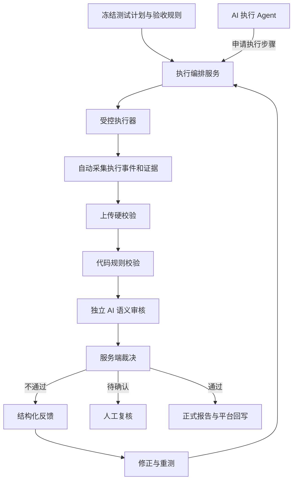

# AI 自动化测试质量门禁代码级控制方案

## 1. 需求理解

AI 自动化测试的质量门禁，不能只依赖提示词、规则说明、编码规范或 Agent 自觉执行。软约束可以指导 AI 行为，但无法彻底防止漏步骤、缺证据、伪通过、误判定和绕过验收出口。

本需求的核心是：把质量要求从“要求 AI 遵守”升级为“系统强制执行”。当必要条件不满足时，系统应阻止提交、阻止验收通过、阻止正式报告发布和下游状态回写。

换句话说，AI 可以参与执行、观察、分析和修正，但不能成为最终质量裁决的唯一来源。最终通过与否必须由服务端门禁规则、独立验收流程和可追溯证据共同决定。

需要重点区分三个状态：

| 状态 | 含义 | 示例 |
| --- | --- | --- |
| 上传状态 | 系统是否接收了结构合法的执行结果 | 上传成功、字段缺失、证据损坏 |
| 报告验收状态 | 测试执行过程和证据是否可信、完整、符合标准 | 验收通过、验收失败、待复核、分析异常 |
| 产品测试状态 | 被测产品功能是否符合预期 | 产品通过、产品失败、阻塞、未执行 |

产品功能失败不等于报告质量失败。只要执行真实、证据充分、结论准确，报告可以验收通过，同时产品测试状态为失败。

反过来，如果 AI 声称产品正常，但缺少必要截图、接口响应、数据库证据或断言依据，报告验收不能通过。

## 2. 总体目标

代码级质量门禁要达成以下目标：

1. 测试范围由服务端冻结，AI 不能自行减少用例、步骤和断言。
2. 执行记录由受控执行器产生，不能只依赖 AI 自述。
3. 证据自动采集并绑定运行、步骤、会话和时间，防止串用和补造。
4. 每条结论必须能追溯到可验证证据。
5. 验收结论由独立服务裁决，AI 不能直接写最终通过状态。
6. 未知、超时、模型异常、证据冲突等情况不能默认通过。
7. 报告发布、结果回写、CI 放行等出口统一检查门禁裁决。
8. 不通过后生成结构化反馈，修正必须形成新版本并重新验收。

## 3. 总体架构



架构原则是：AI 负责执行建议、观察描述和语义辅助判断；系统负责执行约束、证据采集、规则校验、状态流转和最终裁决。

## 4. 核心设计

### 4.1 冻结测试计划

执行开始前，服务端需要冻结本次测试计划，形成不可变版本。

冻结内容包括：

| 内容 | 说明 |
| --- | --- |
| requirementsVersion | 需求版本 |
| testPlanVersion | 测试计划版本 |
| rulesetVersion | 质量规则版本 |
| environmentId | 被测环境 |
| buildVersion | 被测构建版本 |
| cases | 应执行用例全集 |
| steps | 应执行步骤全集 |
| assertions | 每步需要验证的断言 |
| evidencePolicy | 每类步骤需要提供的证据 |

覆盖率分母必须来自服务端冻结计划，不能来自 AI 上传内容。否则 AI 可以通过少传步骤来制造“全部通过”的假象。

### 4.2 受控执行器

AI 不应直接拥有全部底层执行能力，而是通过受控执行器完成关键动作。

受控执行器负责：

1. 接收 AI 的步骤执行请求。
2. 校验当前步骤是否允许执行。
3. 自动采集操作前状态。
4. 执行浏览器、接口、数据库或脚本动作。
5. 自动采集操作后状态。
6. 记录工具调用、时间、会话和返回结果。
7. 生成证据哈希和证据归属关系。
8. 将执行事件写入不可变日志。

对于 UI 步骤，执行器应自动生成截图，并绑定 runId、caseId、stepId、sessionId、eventId 和采集时间。

对于 API、数据库或后台任务步骤，执行器应记录请求、响应、查询结果或任务状态，并按测试计划中的证据策略判断是否可替代截图。

### 4.3 上传硬门禁

上传接口只能接收结构合法、引用合法、权限合法的数据。

硬校验包括：

| 校验项 | 要求 |
| --- | --- |
| 运行归属 | runId、projectId、environmentId 必须匹配 |
| 版本一致 | requirementsVersion、testPlanVersion、rulesetVersion 必须匹配冻结版本 |
| 用例覆盖 | 必需用例不能缺失 |
| 步骤覆盖 | 必需步骤必须有状态 |
| 证据引用 | evidenceId 必须存在且属于同一运行 |
| 截图有效性 | 图片可解码、尺寸合法、哈希一致 |
| 圈注合法性 | bbox 在 0 到 1 范围内，宽高大于 0，引用断言存在 |
| 状态合法性 | PASSED、FAILED、BLOCKED、SKIPPED、NOT_RUN 必须符合状态机 |
| 权限合法 | 提交者只能提交自己被授权运行的数据 |
| 幂等控制 | 同一 submissionId 和版本重复提交不能产生冲突裁决 |

上传成功只代表“数据已接收”，不代表“报告验收通过”。

### 4.4 代码规则校验

确定性规则应优先用代码校验。

典型规则包括：

| 规则 | 代码校验方式 |
| --- | --- |
| 必需步骤未执行 | 对比冻结计划和提交步骤 |
| UI 步骤缺少操作后截图 | 检查 evidenceManifest 和 step evidence refs |
| 状态变化缺少操作前证据 | 检查 beforeEvidenceIds 或合法继承关系 |
| 圈注坐标越界 | 校验 bbox 数值范围 |
| 证据串用 | 校验 evidenceId 的 runId、stepId、sessionId |
| 重复截图异常 | 哈希比对和上下文白名单 |
| API 断言失败 | 对响应状态码、字段和值做精确比较 |
| 数据库断言失败 | 对独立查询结果做精确比较 |
| 错误协议不一致 | 检查 code、message、details、traceId 结构 |

只要确定性规则失败，就不能进入自动通过状态。

### 4.5 独立 AI 语义审核

有些规则无法完全靠传统代码判断，例如：

1. 圈注区域是否确实对应目标元素。
2. 截图中的状态文案是否支持断言。
3. 页面显示与 AI 描述是否冲突。
4. 图像、DOM、接口响应之间是否语义一致。

这类规则可以使用独立 AI 审核，但要遵守以下原则：

1. 审核 AI 与执行 AI 分离。
2. 审核输入由服务端组装，不能由执行 AI 自行选择证据。
3. 审核输出必须是结构化结果。
4. 模型输出必须经过 schema 校验。
5. AI 置信度不能作为单独通过依据。
6. 模型超时、输出异常、证据读取失败时，状态为 ANALYSIS_ERROR，不能默认通过。
7. 无法稳定判断的规则进入 NEEDS_REVIEW，由人工复核。

### 4.6 服务端裁决

服务端将上传校验、代码规则、AI 审核和人工复核结果聚合为最终验收状态。

建议状态如下：

| 状态 | 含义 |
| --- | --- |
| SUBMITTED | 已提交，等待分析 |
| VALIDATION_FAILED | 上传硬校验失败 |
| ANALYZING | 正在分析 |
| REJECTED | 报告验收不通过 |
| NEEDS_REVIEW | 需要人工复核 |
| ANALYSIS_ERROR | 分析异常，不能判定 |
| ACCEPTED | 报告验收通过 |

聚合规则建议：

1. 任一必需硬规则失败，结果为 REJECTED。
2. 任一必需语义规则无法确认，结果为 NEEDS_REVIEW。
3. 模型、存储、任务系统异常，结果为 ANALYSIS_ERROR。
4. 所有必需规则通过或合法不适用，结果为 ACCEPTED。

最终状态只能由裁决服务写入，执行 Agent 不能直接写入 ACCEPTED。

### 4.7 正式出口控制

门禁真正生效的关键在于控制所有正式出口。

需要接入门禁的出口包括：

| 出口 | 门禁要求 |
| --- | --- |
| 正式报告发布 | submissionId 对应 ACCEPTED |
| 测试结果回写 | 只能回写服务端裁决后的产品测试状态 |
| CI/CD 放行 | 当前 buildVersion 对应验收通过 |
| 缺陷关闭 | 缺陷验证记录必须有验收通过的执行证据 |
| 质量看板统计 | 区分上传成功、报告验收和产品测试状态 |
| 人工复核通过 | 记录复核人、理由、时间和证据 |

如果只做上传接口校验，但下游仍允许直接写通过状态，质量门禁就可以被绕过。

### 4.8 修正闭环

验收不通过后，系统应生成结构化反馈，而不是只给一段自然语言。

反馈字段建议包括：

```json
{
  "feedbackId": "FB-001",
  "submissionId": "SUB-001",
  "ruleId": "QA-003",
  "caseId": "ORDER-001",
  "stepId": "S3",
  "assertionId": "A-order-id",
  "severity": "BLOCKER",
  "category": "EVIDENCE_MISMATCH",
  "reason": "圈注区域只有成功提示，没有可核对的订单号。",
  "evidenceRefs": ["EV-S3-AFTER"],
  "requiredChanges": [
    "采集显示本次订单号的页面截图并圈出订单号。",
    "提供同次创建订单响应，核对响应订单号与页面订单号一致。"
  ],
  "retestScope": ["S3"],
  "acceptanceCriteria": [
    "订单号清晰可读且格式合法。",
    "截图订单号与同次接口响应一致。"
  ],
  "status": "OPEN"
}
```

修正必须形成新 submission 版本，并关联 parentSubmissionId 和 feedbackId。

如果原始证据完整，只是圈注错误，可以允许重新圈注。如果缺少现场证据、截图来自其他运行、步骤没有执行，必须重新执行对应步骤及必要依赖，不能用补写文字替代。

## 5. 权限与可信边界

代码级门禁必须建立清晰的权限隔离。

| 角色 | 可以做什么 | 不能做什么 |
| --- | --- | --- |
| AI 执行 Agent | 请求执行步骤、提交观察、读取反馈、发起修正 | 修改冻结计划、写最终验收状态、关闭反馈 |
| 受控执行器 | 执行动作、采集证据、记录事件 | 修改规则、人工批准 |
| 验收服务 | 校验数据、聚合规则、写裁决 | 篡改原始证据 |
| 人工复核人 | 对待复核项做最终判断 | 修改原始规则失败记录 |
| 管理员 | 配置规则、权限、保留期 | 跳过审计直接改历史结果 |

尤其需要注意：执行 Agent 不能同时拥有以下权限：

1. 修改验收规则。
2. 修改门禁代码。
3. 修改数据库最终状态。
4. 读取证据签名密钥。
5. 人工批准自己的结果。

否则门禁仍然可以被绕过。

## 6. 数据模型建议

建议至少保存以下对象：

| 对象 | 说明 |
| --- | --- |
| TestRun | 一次测试运行 |
| Submission | 一次结果提交版本 |
| TestCaseResult | 用例结果 |
| TestStepResult | 步骤结果 |
| AssertionResult | 断言结果 |
| Evidence | 原始证据 |
| EvidenceAnnotation | 圈注和指查结果 |
| QualityRuleResult | 单条质量规则判定 |
| QualityDecision | 聚合裁决 |
| QualityFeedback | 结构化反馈 |
| ReviewDecision | 人工复核记录 |
| AuditLog | 审计日志 |

关键约束：

1. Submission 冻结后不可覆盖。
2. Evidence 必须绑定 runId、submissionId、caseId、stepId 和采集来源。
3. QualityDecision 必须绑定 rulesetVersion。
4. 异步任务按 submissionId 和 rulesetVersion 幂等写入。
5. 新版本不能复用旧版本裁决。

## 7. 接口建议

### 7.1 提交结果

```http
POST /api/test-runs/{runId}/submissions
```

职责：

1. 校验提交权限。
2. 校验冻结版本一致性。
3. 校验用例、步骤、证据和状态结构。
4. 创建不可变 submission。
5. 触发异步质量分析。
6. 返回上传状态，不返回最终验收通过。

### 7.2 查询质量分析

```http
GET /api/submissions/{submissionId}/quality
```

职责：

1. 返回当前验收状态。
2. 返回逐条规则结果。
3. 返回失败原因和证据引用。
4. 返回是否需要人工复核。

### 7.3 查询反馈

```http
GET /api/submissions/{submissionId}/feedback
```

职责：

1. 返回结构化反馈。
2. 返回修正范围。
3. 返回重新验收条件。

### 7.4 获取证据

```http
GET /api/evidence/{evidenceId}
```

职责：

1. 校验证据读取权限。
2. 返回原始截图、圈注图或机器证据。
3. 防止跨项目、跨运行读取。

### 7.5 人工复核

```http
POST /api/submissions/{submissionId}/review-decisions
```

职责：

1. 校验复核权限。
2. 记录复核人、理由、证据和时间。
3. 写入可审计复核结果。
4. 不改写原始规则失败记录。

## 8. 前端入口建议

前端需要展示三类状态，而不是只展示“成功/失败”。

| 页面 | 功能 |
| --- | --- |
| 执行列表 | 展示上传状态、报告验收状态、产品测试状态 |
| 执行详情 | 展示用例、步骤、状态、证据完整性 |
| 步骤详情 | 展示操作前截图、操作后截图、圈注图和机器证据 |
| 质量分析页 | 展示逐条规则结果、失败原因和证据定位 |
| 反馈页 | 展示修正要求、重测范围和关闭状态 |
| 人工复核页 | 支持查看证据、填写理由、做出复核结论 |

前端必须处理 loading、empty、success、validation-error、permission-denied、network-error 和 server-error 状态。

未知异常只展示用户可理解提示和 traceId，不能暴露堆栈、数据库错误或内部异常类名。

## 9. 验收测试矩阵

| 层级 | 必测场景 | 预期 |
| --- | --- | --- |
| 单元测试 | schema、状态聚合、坐标、覆盖分母、精确值比较 | 非法数据不能通过 |
| 后端集成 | 越权、文件缺失、事务回滚、幂等、重复任务 | 拒绝非法访问，不产生重复裁决 |
| 证据校验 | 截图损坏、哈希不符、跨运行引用、重复截图 | 识别异常证据 |
| AI 审核 | 圈错位置、文本与图冲突、页面提示词注入 | 不自动放行，可复核 |
| 前端 | 异步状态、失败状态、权限状态、圈注定位 | 展示与后端一致 |
| 端到端 | 缺证据拒收、合法上传、验收失败、反馈修正、复验通过 | 全流程可追溯 |
| 出口控制 | 直接回写通过、旧版本凭据、未验收报告发布 | 全部被拒绝 |
| 故障恢复 | 模型超时、存储故障、任务中断、并发重提 | 不静默通过，支持重试 |

## 10. 分阶段落地方案

### 第一阶段：上传与裁决硬门禁

目标是先堵住最明显的绕过路径。

实现内容：

1. 冻结测试计划和规则版本。
2. 实现结果提交接口。
3. 实现 schema、覆盖率、证据引用和权限校验。
4. 实现服务端质量裁决状态。
5. 报告发布和结果回写接入裁决检查。

第一阶段完成后，AI 不能通过少传步骤、缺证据或直接写状态来制造正式通过结果。

### 第二阶段：受控执行和可信证据

目标是减少 AI 事后拼装材料的空间。

实现内容：

1. 建设受控执行器。
2. 自动采集 UI 截图、接口响应和执行事件。
3. 证据绑定运行、步骤、会话和采集来源。
4. 增加证据哈希、重复检测和跨运行引用检查。
5. 将执行事件写入不可变日志。

第二阶段完成后，系统可以更强地证明“确实执行过”和“证据属于本次执行”。

### 第三阶段：独立语义审核与复核闭环

目标是处理图像、页面语义和复杂业务断言。

实现内容：

1. 引入独立 AI 审核服务。
2. 建立结构化审核输出和 schema 校验。
3. 建立人工复核工作台。
4. 建立结构化反馈和重测机制。
5. 用标注样本评估误放行率。

第三阶段完成后，复杂质量问题可以被发现、反馈、修正和复验。

## 11. 关键风险

| 风险 | 应对 |
| --- | --- |
| AI 仍可绕过系统入口 | 所有正式出口统一依赖裁决服务 |
| 执行 Agent 权限过大 | 执行、验收、管理权限隔离 |
| 语义审核误判 | 高风险规则进入人工复核，持续评估误放行率 |
| 证据采集影响隐私 | 上传前脱敏，脱敏后计算保存哈希 |
| 补截图导致副作用重放 | 有副作用步骤使用隔离数据、幂等键和重测审批 |
| 异步任务覆盖新结果 | submissionId、rulesetVersion 幂等写入 |
| 旧版本通过被复用 | 裁决绑定提交摘要、计划版本和构建版本 |

## 12. 结论

AI 自动化测试质量门禁的本质，不是让 AI 更听话，而是把 AI 放进一个受控的工程系统里。

软规则适合表达测试意图，代码门禁负责守住底线。确定性要求由代码强校验，语义判断由独立审核辅助，无法确认的情况进入人工复核，正式出口统一依赖服务端裁决。

只有这样，才能把“AI 说它测过了”变成“系统能够证明它测过、证据足够、结论可信”。

## 13. 当前状态

本文档为方案输出，尚未实现前端、后端、数据库、执行器或容器配置。

功能状态：方案已完成，工程实现未开始。
