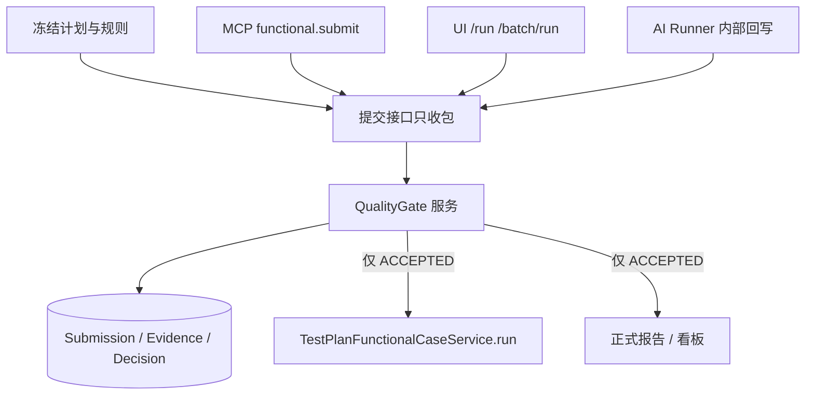

# AI 测试质量门禁：上传策略与 MSP 平台实现说明

本文把「如何让 AI 测试结果可信、可验证、有质量」落到 MeterSphere（MSP）上：上传物是什么、本地怎么记账、平台代码写在哪、怎么验、人和 AI 怎么分开、不通过怎么告诉 AI、通过后写到哪。

顶层方案见 [ai-testing-quality-gates-code-control-solution.md](./ai-testing-quality-gates-code-control-solution.md)。本文是实现口径，不替代那份架构方案。

**当前状态：** 方案与口径已明确；`QualityGate` 服务、Submission 表、出口守卫均未落地。在第一阶段完成前，AI 回写结果不能作为正式发布或考核依据。

---

## 1. 结论先说清

提示词不能当门禁。可信来自独立预期（冻结计划）与确定性校验；可验证来自绑定步骤的证据哈希；质量来自硬软分离与失败即关闭。正式通过只能由服务端裁决，不能由执行 AI 自写。

必须拆开三类状态：

| 状态 | 含义 | 注意 |
| --- | --- | --- |
| 上传状态 | 结构是否合法、数据是否收下 | 上传成功 ≠ 测过了 |
| 报告验收状态 | 过程与证据是否可信完整 | 缺证据即使产品看起来正常也不能验收通过 |
| 产品测试状态 | 被测功能是否符合预期 | 产品失败但证据充分时，报告仍可验收通过 |

硬门禁一票否决，不可被平均分、LLM 自评或置信度抵消。软指标（文案、略慢延迟）只能观察。

---

## 2. 代码门禁挂在哪（不是只挡一个接口）

门禁是领域写路径中间的**裁决服务**。Controller / MCP 只是入口；`TestPlanFunctionalCaseService.run()` 是受保护出口。



今日问题：Agent 一条 `submit` 就会直接改计划里的 `lastExecResult`。旁路至少三条：

- MCP `metersphere.functional.submit` → `AgentFunctionalCaseSubmitService`
- 页面 `POST /test-plan/functional/case/run`（及 batch）
- `AgentExecutionCaseWritebackService.writeback`

只在 MCP 上加校验、下游仍直接 `run()`，门禁等于没做。

---

## 3. 单次任务的上传物

AI 不该在全部跑完后写一份说明文档当唯一上传物。正确模型是：**本地逐步记账 + 结束提交结构化清单 + 按 ID/哈希对图**。

### 3.1 三层对象

| 层 | 是什么 | 谁生成 | 何时 |
| --- | --- | --- | --- |
| 证据 | 截图、接口 HAR/响应、SQL 结果等二进制 | 执行器采集 | 每步当时写本地；按策略上传 |
| 步骤事实 | 该步状态、实际值、文件哈希 | 执行器写本地 JSON，禁止模型事后润色 | 每步结束 |
| 任务清单 | 对照冻结计划的覆盖表 | 脚本拼接本地 JSON，或服务端从已落库记录组装 | 用例/任务结束冻结 |

覆盖率分母永远来自服务端冻结计划（任务上的 `execution_contract`），不能来自 AI 文档里出现过的步骤。

### 3.2 推荐的本地记账（执行过程）

每步当时落盘，同一 ID 绑 JSON 和图片：

```text
records/S3.json
records/S3.png
```

`S3.json` 示例：

```json
{
  "taskId": "TASK-1",
  "stepId": "平台冻结的步骤ID",
  "status": "PASSED",
  "actual": { "orderNo": "SO..." },
  "evidence": [
    { "role": "AFTER_STEP", "file": "S3.png", "sha256": "abc..." }
  ]
}
```

约束：

- `stepId` 必须是平台冻结 ID，不要另造业务 ID。
- 绑定用内容哈希，不只文件名。
- 汇总是 `concat`/`merge`，禁止再让模型整理润色。

### 3.3 汇总物必须是 JSON，不是 `.md`

Markdown 给人看可以，不能当门禁输入：无强制 schema、可漏步改写、无法与冻结计划逐项比对、「见截图 3」无法证明图属于该步该次运行。

可以接受：

| 做法 | 是否允许 |
| --- | --- |
| 逐步本地记账，结束提交一份 `manifest.json` + 图片 | 允许 |
| 逐步 `step.submit`，结束只 `complete`，平台组清单 | 允许 |
| zip：manifest.json + 按 step 目录放图，哈希写在 json 里 | 允许 |
| 结束上传一份 `.md`（即使内嵌 JSON 代码块）当唯一上传物 | 不允许 |
| 模型根据记忆写 md，再随便挂几张图 | 不允许 |

报告 `.md` 从验收后的 manifest 生成，不能倒过来。

### 3.4 上传顺序

更稳的顺序：

1. 传图片 → 平台返回 `artifactId` + 实算 sha256。
2. 上传 `manifest.json`（引用 sha256 或 artifactId）。
3. 平台：冻结合同覆盖 manifest、每条哈希能对上、缺步/缺图/哈希不符则拒绝验收。
4. 通过后才回写测试计划。

若先传清单再传图：清单停在「待齐证」，图片到齐并比对成功前不能 `ACCEPTED`。缺图是报告验收失败，不是产品失败。

### 3.5 逐步提交 vs 结束一次传 JSON

- **步骤 JSON：** 可以结束时一次性提交（更省 MCP 往返），但必须来自本地账本导出，不能来自模型回忆。
- **证据文件：** 失败步和关键步应在当时或结束前作为二进制上传；不要 embed 进 markdown。
- **正式回写：** 仍是用例/任务结束后、门禁通过才写计划。

「每步提交事实」是硬要求（至少写本地）。「每步都经对话 MCP 传原图」不是硬要求，失败率和上下文膨胀会很高。

### 3.6 证据策略与性能

现网合同已支持 `ALWAYS` / `ON_FAILURE` / `NONE`，单文件默认上限 5MB，事件有 batch 接口。默认不要步步全量原图。

| 动作 | 体量 | 说明 |
| --- | --- | --- |
| 步骤事实 JSON | 通常几 KB | 便宜；可本地队列 + `requestId` 幂等 |
| 证据文件 | 几百 KB～数 MB | 带宽和存储大头，按策略收 |
| 经 Cursor 对话 MCP 传图 | 每步多次工具往返 | 超时和上下文膨胀，应避免 |

建议：通过步默认 `ON_FAILURE`；登录后状态、订单号、支付结果等关键断言 `ALWAYS`；压缩视口图；元数据可批量；语义审核异步，不挡下一步。上传失败记报告验收/阻塞并重试该文件，不要把产品标红。

---

## 4. 现网能力与缺口

已有（任务通道更接近目标）：

- 任务冻结与 `execution_contract`
- `ai_execution_artifact`：prepare / 哈希 / 脱敏 / 绑定 task-step，目录 `ai/execution/artifacts/{taskId}/{executionId}/`
- `ai_execution_step_result`：逐步结果幂等
- 任务结束批量回写、失败且有附件时缺陷草稿

不够：

- Cursor 路径仍是逐条 `POST /api/agent/v1/functional/submit`（或 MCP `functional.submit`）直接改计划，附件只是评论文件，不参与能否通过。
- 任务路径回写同样不等待报告验收；证据充分度基本是「有没有附件」。
- 没有不可变 Submission，没有 `ACCEPTED` 才允许 `run()`。
- 清单若是对话里的 Markdown，平台接不住也验不了。

第一阶段目标形态：本地逐步记账 → 传图到 artifact → 提交 manifest → 平台校验并裁决 → 通过后平台自己 `run()`。

---

## 5. MSP 应该在什么地方写什么代码

模块：`backend/services/agent-integration`。不要把规则堆在 Controller，也不要在 `TestPlanFunctionalCaseService.run()` 里堆业务校验（它只加出口闸门）。

### 5.1 新增与必改

| 位置 | 职责 |
| --- | --- |
| 新包 `io.metersphere.agent.quality` | 门禁本体：收 manifest、对哈希、覆盖率、裁决、反馈 |
| `QualitySubmissionService` | 收清单、冻结版本、幂等、不可覆盖 |
| `QualityEvidenceService` | 薄封装现有 `AgentExecutionArtifactService` |
| `QualityRuleEngine` | 纯 Java 规则，第一阶段不调模型 |
| `QualityDecisionService` | 只有它能写 `ACCEPTED / REJECTED / ...` |
| `QualityFeedbackService` | 结构化失败原因 |
| `QualityWritebackAdapter` | 通过后调用 `TestPlanFunctionalCaseService.run` |
| `QualityGateController` | HTTP：提交清单、传图（或复用 artifact API）、查质量、查反馈 |
| `BuiltinAgentMcpToolConfig` | MCP：`submission.create`、`quality.get`、`feedback.get` |
| `AgentFunctionalCaseSubmitService.submit` | **必改：** Agent Token 禁止直接 `run()` |
| `AgentExecutionWritebackService.writeback` | **必改：** 未 `ACCEPTED` 禁止回写 |
| `TestPlanFunctionalCaseService.run` | **守卫：** `source=AI` 必须带已验收 `submissionId` |
| `TestPlanFunctionalCaseController` `/run` | 人手动执行先保持原样（`source=HUMAN`） |

DDL 放 `backend/framework/domain/src/main/resources/migration/`。建议新表：

- `ai_quality_submission`
- `ai_quality_rule_result`
- `ai_quality_decision`
- `ai_quality_feedback`

可复用、不必重写：`ai_execution_artifact`、`ai_execution_step_result`、`ai_execution_task.execution_contract`、`ai_execution_audit`；人的正式结果仍在 `test_plan_functional_case`、`functional_case`、`test_plan_case_execute_history`。

### 5.2 请求怎么走

```text
AI 传图 → AgentExecutionArtifactService → 文件 + ai_execution_artifact
AI 传 manifest → QualitySubmissionService → ai_quality_submission（不可改）
        → QualityRuleEngine（对照 execution_contract + sha256）
        → QualityDecisionService
              拒：写 feedback，return JSON，不调 run()
              过：QualityWritebackAdapter → TestPlanFunctionalCaseService.run()
                    → 计划行 + 用例库 + 执行历史（source=AI, submission_id）
```

人手动点执行：仍只走 `/test-plan/functional/case/run`，历史 `source=HUMAN`，不进 `ai_quality_submission`。

---

## 6. 怎么区分人与 AI 上传

不要靠 JSON 里的 `"executedBy": "cursor-agent"`，可伪造。用入口 + 令牌 + 落库 `source`。

| | 人 | AI |
| --- | --- | --- |
| 入口 | 登录 Session + `/test-plan/functional/case/run` | Agent Token / Runner 租约 + `/api/agent/...` 或 MCP |
| 权限 | `TEST_PLAN_READ_EXECUTE` | `FUNCTIONAL_SUBMIT` / `ARTIFACT_WRITE`，不能写裁决 |
| 落库 | `source=HUMAN`，直接写计划执行历史 | `source=AI`，先写 `ai_quality_*` + `ai_execution_*` |
| 身份 | `SessionUtils.getUserId()` | Token 主体，如 `executor:{leaseOwner}` |

计划执行历史上建议增加 `source`、`submission_id`，列表才能滤「仅人工 / 仅 AI」。必须切断 Agent Token 走原 `/functional/submit` 直接改 `lastExecResult`。

---

## 7. AI 上传如何校验

对照 `ai_execution_task.execution_contract`（无任务时对照计划冻结的用例步骤），全部代码校验：

1. schema、枚举、`stepId` 均来自合同。
2. 合同中每步在 manifest 里都有终态（含 `NOT_RUN` / `BLOCKED`）。
3. 策略要求有图的步：已有 artifact，平台重算 sha256 等于 manifest，且 `step_id` 一致。
4. 图不能跨 task，不能申领到别的 step。
5. `SUCCESS` 不能缺必证；失败必须有失败证据或合法阻塞码。
6. `execution_contract_hash` 必须等于任务上冻结的 hash。

接口形态（可挂 `/api/agent/v1/quality` 或 `/api/ai/execution`）：

1. `POST .../artifacts`：传图，返回 `artifactId` + 实算 sha256（可复用 prepare/upload/commit）。
2. `POST .../submissions`：传 manifest → `SUBMITTED`，此时不回写计划。
3. `GET .../submissions/{id}/quality`：验收状态与逐条规则。
4. `GET .../submissions/{id}/feedback`：修正要求。

独立 AI 语义审核（圈注是否对、图文是否冲突）放第三阶段：审核模型与执行模型分离，输入由服务端组证据，超时/异常不能默认通过。

---

## 8. 不通过：记录怎么写、怎么告诉 AI

不要用计划里的用例失败来表示「门禁没过」。

写入：

- `ai_quality_decision`：`REJECTED` / `VALIDATION_FAILED` / `NEEDS_REVIEW` / `ANALYSIS_ERROR`
- `ai_quality_rule_result`：每条规则 `PASS/FAIL`、`ruleId`、`stepId`
- `ai_quality_feedback`：给 AI 的结构化列表
- `ai_execution_audit`：谁在何时提交了哪一版

计划侧 `lastExecResult` 保持原值；最多在 AI 任务上显示「提交已拒收」。

告诉 AI 只通过接口/MCP 返回 JSON，例如：

```json
{
  "submissionId": "SUB-2",
  "acceptance": "REJECTED",
  "productWriteback": false,
  "feedback": [
    {
      "ruleId": "QA-EVIDENCE-HASH",
      "stepId": "平台步骤ID",
      "severity": "BLOCKER",
      "reason": "manifest.sha256 与已上传文件不一致",
      "requiredChanges": ["重新上传该步 AFTER_STEP 图片并核对本地 sha256"],
      "retestScope": ["该 stepId"]
    }
  ]
}
```

修正：只重跑 `retestScope`，本地新记录 → **新 submission**（`parentSubmissionId=SUB-2`），禁止改旧版。

---

## 9. 通过后写什么、写到哪

只有 `QualityDecisionService` 置 `ACCEPTED` 后，`QualityWritebackAdapter` 以平台身份调用：

`TestPlanFunctionalCaseService.run(TestPlanCaseRunRequest)`

写入的是 manifest 里的**产品结论**，不是「门禁通过」四个字。门禁通过 ≠ 功能通过。

| 写到哪 | 写什么 |
| --- | --- |
| `test_plan_functional_case.last_exec_result` | SUCCESS / ERROR / BLOCKED |
| `functional_case.last_execute_result` 及执行人/时间 | 同上；执行人用 Agent 主体 |
| `test_plan_case_execute_history` | `status`=产品结论，`steps`=验收通过的步骤 JSON，`content` 含 `[AI] submissionId=...` |
| 历史附件 | 已校验 artifact 的 `fileId` 挂 `planCommentFileIds` |
| `ai_quality_submission` | 保持 ACCEPTED 快照，不删 |

看板需要三列：上传状态、报告验收、产品结果。现有执行列表只有产品结果，需读 `ai_quality_decision`。

---

## 10. 第一阶段最小改动清单

1. 新表：submission / rule_result / decision / feedback。
2. 新 API + MCP：提交清单、查质量、查反馈；传图复用 artifact。
3. 切断 `AgentFunctionalCaseSubmitService` 与 `AgentExecutionWritebackService` 的直接 `run()`。
4. `run()` 增加 AI 出口守卫。
5. 通过后的 adapter 只写计划三张表（计划用例、用例库、执行历史）。
6. 单测：缺步、哈希不符、跨 task 用图、未验收调 submit、验收后产品失败仍写 ERROR。

执行 Agent 不能同时拥有：改验收规则、改门禁代码、写数据库最终状态、读证据签名密钥、批准自己的结果。

---

## 11. 相关代码与文档

| 路径 | 说明 |
| --- | --- |
| `docs/ai-testing-quality-gates-code-control-solution.md` | 三阶段架构、状态机、数据模型 |
| `backend/services/agent-integration/.../AgentFunctionalCaseSubmitService.java` | 当前直接回写入口 |
| `backend/services/test-plan/.../TestPlanFunctionalCaseService.java` 的 `run()` | 正式结果出口 |
| `backend/services/agent-integration/.../AgentExecutionArtifactService.java` | 证据哈希与存储 |
| `backend/services/agent-integration/.../AgentExecutionStepResultService.java` | 逐步结果幂等 |
| `ai_execution_task.execution_contract` | 冻结范围，覆盖率分母 |

公开实践对照（独立预言机、失败即关闭、出口统一拦截）见方案文档第 12 节结论：软规则表达意图，代码门禁守住底线。
