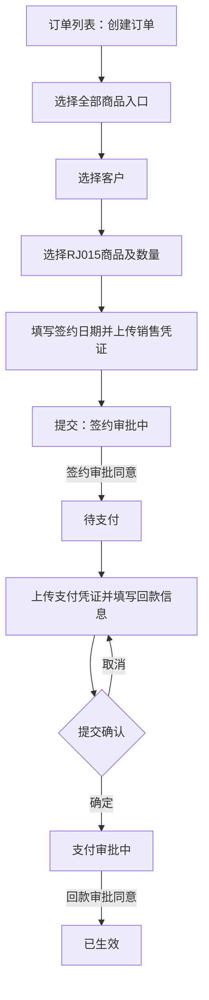

# 米多星球订单创建至生效：业务理解与认知

编制日期：2026-09-24。测试日期：2026-09-23。来源：真实页面探索、正式执行脚本、截图、平台回读及本次对话中的测试设计复核。

本文是测试形成的业务认知，不是产品正式需求说明。仅覆盖“全部商品入口、新购、RJ015系统商品、全款”路径，不外推至其他产品或支付方式。

## 1. 业务目的与完成边界

本次路径将客户、所购商品、签约凭证及支付凭证组织为订单，经过签约审批和回款审批后达到“已生效”。

“已生效”是用户指定的测试终态，并非完整商业履约终态。正式订单生效时仍显示“未交付”，已开票金额为0。因此订单生效、交付和开票是需要分别理解和验证的状态维度；本次没有验证后续交付或开票规则。

## 2. 业务对象及关系

| 对象 | 本次观察 | 认知边界 |
| --- | --- | --- |
| 客户 | 创建订单前选择客户；本次为MDC2026085213 | 未验证客户全部准入规则及客户/商户关系约束 |
| 商品 | RJ015米多大数据引擎Max版，数量1，金额29800 | 不代表所有产品定价、税费或折扣规则 |
| 订单 | 承载客户、商品、金额、付款条件及状态 | 数据库结构未验证 |
| 销售凭证 | 双方签约日期和上传附件 | 上传成功不等于合同真实性已核验 |
| 签约审批 | 提交订单后进入审批；同意后待支付 | 未验证拒绝、撤回、转交及审批人配置 |
| 支付凭证及回款 | 测试附件、收款账户、回款金额、付款账号、付款日期 | 未发生真实转账，未验证银行对账 |
| 回款审批 | 同意后本次订单生效 | 其他付款条件的生效规则待确认 |

## 3. 角色认知

实际使用的测试账号能创建订单，并能在待我审批中处理本次签约及回款审批。这只能证明该账号在本次数据上的操作能力，不能推断“下单人总能审批自己的订单”，也不能认定系统没有职责分离。

需补充确认销售人员、签约审批人、财务审批人之间的职责、审批人匹配机制和跨组织权限边界。

## 4. 已观察到的流程

未绘制拒绝、撤回、取消订单、分期或交付分支，因为本次未实际验证。

| 状态转换 | 操作入口 | 已有证据 |
| --- | --- | --- |
| 创建表单→签约审批中 | 订单→创建订单→提交 | TC01-sign-pending.png |
| 签约审批中→待支付 | 待办→待我审批→订单签约审批→同意 | TC01-payment-pending.png；replay-b.log |
| 待支付→支付审批中 | 订单操作→上传支付凭证→确定提交 | TC01-payment-approval.png；replay-c-resume.log |
| 支付审批中→已生效 | 待我审批→回款单审批→同意 | TC01-effective-list.png、TC01-effective-detail.png；replay-d.log |

证据均位于 `../output/playwright/msp-order-20260923/`。

## 5. 业务规则与可信程度

| 编号 | 认知 | 分类 | 证据及限制 |
| --- | --- | --- | --- |
| B01 | 未选择客户时不能进入下一步 | 实测确认 | TC02；仅当前创建路径 |
| B02 | 搜索不存在的客户不会产生可选客户 | 实测确认 | TC03 |
| B03 | 未选择商品不能保存并进入销售凭证步骤 | 实测确认 | TC04 |
| B04 | 本商品数量1/2对应29800/59600，恢复1后恢复29800 | 实测确认 | TC05；不能外推复杂计价 |
| B05 | 数量输入0并失焦被校正为1 | 实测确认 | TC06；小数、负数、最大值未测 |
| B06 | 填写签约日期但不上传销售凭证时仍不能提交；上传后可提交 | 实测确认 | TC07；未逐个隔离全部日期校验 |
| B07 | 支付附件上传前后，支付表单可用状态变化 | 实测确认 | TC08 |
| B08 | 取消支付提交确认会保留本次已填信息，未立即提交 | 实测确认 | TC10；随后单独确认以完成主流程 |
| B09 | 支付凭证预览可打开测试图片 | 实测确认 | TC11；缩略图曾遇ORB问题，不等于预览失败 |
| B10 | 本订单全款29800完成审批后显示已生效、已收29800、未收0、100% | 实测确认 | TC01；列表和详情交叉核对 |
| B11 | 全款回款完成且审批通过可能是这类订单生效的前置条件 | 业务推断 | 需产品规则及不足额、超额、分期分支进一步验证 |
| B12 | 页面提示回款金额需满足本次应回款要求 | 页面提示 | 金额上下界及服务端拦截未充分测试，不能写成已验证规则 |
| B13 | 生效不等于交付或开票完成 | 实测确认 | 本订单生效时仍未交付、已开票0；后续机制未知 |

## 6. 异常与缺陷对业务理解的影响

金额输入框原生属性允许输入，但 `aria-disabled=true`，阻止了Playwright语义填充。本次使用普通键盘Tab输入完成流程，未修改DOM。该现象是可访问性/交互状态不一致，不能解释为“业务禁止填写回款金额”。对应TC09及MSP缺陷100002。

一次取消弹窗断言因未等待关闭动画产生脚本失败，后续补充等待并恢复验证。这是测试脚本时序问题，不能转化为“取消操作失败”的业务规则。

## 7. 实际数据与副作用

- 探索订单：MDJS2026092264，已生效。
- 正式复测订单：MDJS2026090626，已生效。
- 使用标明TEST ONLY的测试图片，订单备注说明仅测试环境、无真实交易。
- 未进行真实资金转账；不将页面回款结果解释为外部资金到账证明。
- 两笔订单保留用于追溯，未执行清理；重复运行完整创建脚本可能继续产生订单，不能作为无副作用检查反复执行。

## 8. 业务测试与MSP治理验证的区别

订单业务用例为TC01–TC12；TC13–TC14是MSP结果回写门禁测试，不属于米多星球订单业务规则。

整体14条结果为11通过、3失败，不应把整体通过率直接作为订单模块完整质量评价。

门禁结论修正：TC13隔离了缺附件条件；TC14同时缺少步骤和附件，不能据此独立证明“仅缺步骤”时也不拦截。需补测附件完整、仅步骤为空的单因素场景。受管任务准入另有误判，不能把直接MCP上传成功视为受管任务通过。

## 9. 待确认与下一轮测试

| 优先级 | 待确认事项 | 建议验证方式 |
| --- | --- | --- |
| 高 | 生效的正式业务条件，以及全款、分期是否不同 | 获取产品规则；验证不足额、超额及分期组合 |
| 高 | 下单与审批角色边界 | 使用不同角色账号验证，不通过同一管理员会话推断 |
| 高 | 审批拒绝、撤回、重提后的状态及数据保留 | 建立专用订单逐分支执行 |
| 高 | 重复提交及重复审批是否产生重复数据 | 验证幂等及状态保护 |
| 中 | 客户、签约主体、商户、付款主体的匹配约束 | 正常及错配数据对照 |
| 中 | 金额精度、数量边界、日期和附件限制 | 按参数逐项隔离变量 |
| 中 | 生效后的交付、开票、作废及退款关系 | 新建后续业务范围，不沿用本次终态假设 |

## 10. 知识更新约定

后续测试应同时输出测试报告和业务理解文档。每项新认知标明“实测确认、页面/需求声明、推断、待确认”及证据。复测更新差异、日期、适用范围和已纠正结论，不静默覆盖旧认知；阻塞或未执行时也保留已确认知识并明确缺口。

本文状态：已基于本次留存证据整理；未新增业务操作或重新执行测试，不代表全量订单需求已确认。
