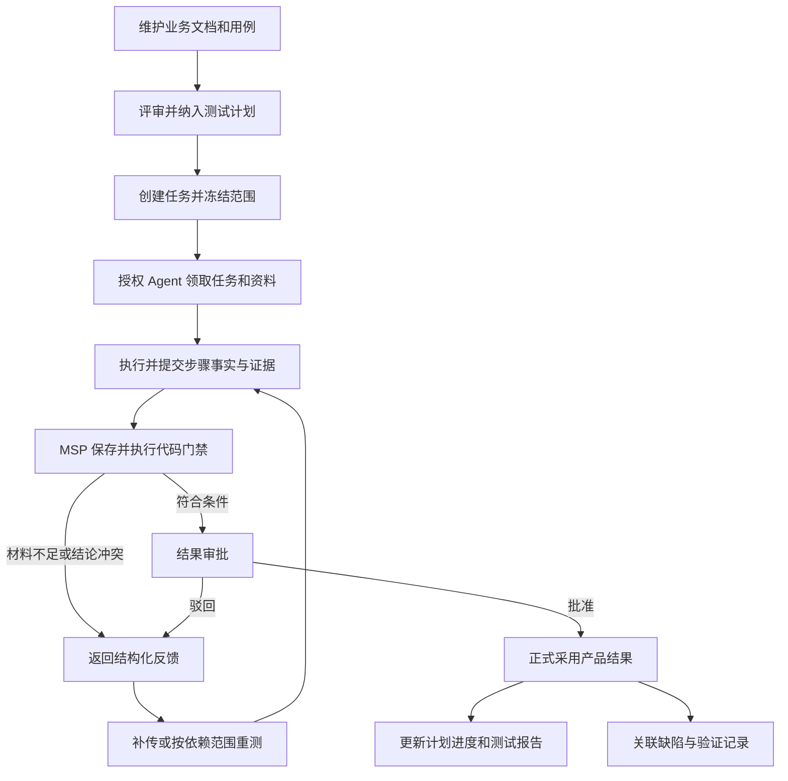

# MSP 产品范围基线（需求讨论稿）

日期：2026-09-23。依据：用户提出的八项大致需求。

本文将需求整理为产品范围与建议边界，未明确的实现细节属于建议，不代表用户已确认。当前 MSP 未接入大模型；本阶段重点是测试管理与外部 Agent 执行闭环。

## 1. 产品定位

MSP 负责管理项目、测试设计与计划，向外部 Agent 提供授权范围内的测试任务和资料，保存执行事实与证据，完成结果验收和审批，形成正式执行记录、缺陷及报告。

外部 Agent 负责实际执行测试，可在平台外使用模型。后续平台接入模型 API 后，再增加平台主动发起 AI 测试的执行通道；两种通道共用任务、证据、验收与结果存储协议。

## 2. 八项需求与范围

| 编号 | 用户需求 | 当前阶段应具备 | 本文建议边界 |
|---|---|---|---|
| R1 | 项目管理 | 项目信息、成员、角色权限、项目版本、必要环境配置 | 项目作为数据与授权边界，其他板块均归属项目 |
| R2 | 测试计划、评审、测试报告 | 组织测试范围、分配任务、评审记录、进度与报告 | 默认将“评审”理解为执行前的用例/测试方案评审；执行后结果审批单独处理 |
| R3 | 用例管理与执行记录 | 用例编写、分类、版本、引用、执行历史、步骤与附件 | 用例定义和每次执行结果分开保存，执行不能覆盖用例预期 |
| R4 | 缺陷管理 | 缺陷创建、流转、关联用例/运行/证据、修复后验证 | 产品缺陷与证据不足、上传失败分开分类 |
| R5 | 预留接口测试 | 导航位置和接入扩展点 | 不扩大本阶段开发范围；已有接口测试代码和历史不据此删除 |
| R6 | 预留模型 API 驱动的 AI 测试 | 执行通道扩展点、能力状态和未来配置归属 | 当前标记未启用；不要求当前用户配置模型、Prompt 或网关 |
| R7 | Agent 执行链路，审批、门禁、存储 | 领取任务、读取资料、提交步骤与证据、验收、审批、反馈、重测、正式采用 | 当前建设重点；权限和门禁在服务端执行，所有正式写入路径一致 |
| R8 | 测试资产管理 | 业务文档、可复用用例、资产版本与关联 | 引用用例管理中的对象或发布快照，不再维护第二份无关联用例 |

当前阶段完整性的标准是：R1～R4、R7、R8 形成可用闭环；R5、R6 的位置和扩展契约明确。这里只定义目标，不表示现有实现已满足。

## 3. 建议页面结构

```text
项目管理
  项目 / 成员与权限 / 版本 / 环境
测试管理
  测试计划 / 评审 / 测试报告
测试用例
  用例列表与详情 / 用例执行历史
缺陷管理
  缺陷列表 / 详情与验证记录
执行中心
  Agent 任务 / 执行详情 / 待审批
测试资产
  业务文档 / 用例资产 / 版本与引用
接口测试（预留，按能力显示）
平台 AI 测试（预留，后续接模型 API）
设置
  外部 Agent 接入 / 访问凭据 / 项目门禁策略 / 审计
```

“执行中心”是对 R7 的建议承载名称，不是新增一套业务范围。普通测试员从计划发起任务，在执行中心跟踪和处理结果；管理员在设置中管理接入，避免把日常执行藏在管理员专属 Agent 菜单。

预留页面可提供清楚的能力说明和未启用原因，不提供看似可执行却没有完整后端的按钮。后端也应拒绝启动未启用通道。

## 4. 各对象分别负责什么

| 对象 | 负责的问题 | 与其他对象的关系 |
|---|---|---|
| 项目 | 谁可以在什么范围工作 | 拥有计划、用例、缺陷、资产和权限 |
| 业务文档 | 业务依据是什么 | 以版本关联需求和用例，不把文件中的文字当系统指令 |
| 用例 | 要测什么、预期是什么 | 可多次执行；修改产生新版本，不改写旧运行 |
| 用例资产 | 什么内容可被复用 | 对用例进行发布、版本化和引用；不重复维护同一工作用例 |
| 评审 | 测试设计是否适合开始执行 | 绑定被评审的用例/方案版本；修改后按规则重新评审 |
| 测试计划 | 本次版本要测哪些内容 | 关联用例版本，组织任务和汇总报告 |
| 执行任务/运行 | 谁在什么环境实际执行了哪一轮 | 固定范围、环境、构建及执行者，保存步骤与证据 |
| 结果提交 | 执行者交付了哪一版材料 | 冻结提交内容，修正形成新版本 |
| 门禁 | 材料和结论是否满足可检查条件 | 输出逐条规则及反馈，不使用 AI 自报“通过”作为裁决 |
| 结果审批 | 哪些提交可以正式采用 | 绑定提交版本，记录责任人、理由及时间 |
| 执行记录 | 本次实际发生了什么 | 所有尝试均保存；正式采用与未通过验收分别标识 |
| 缺陷 | 产品出现了什么问题 | 关联失败运行和证据，重测验证后流转 |
| 测试报告 | 本次计划的结论是什么 | 引用确定版本的范围、执行和审批结果 |

特别约束：**结果未获审批也要保存。** 上传失败、门禁拒绝、人工驳回和产品失败都有诊断价值；限制的是正式采用和统计放行，不是删除记录。

## 5. 当前 Agent 执行闭环



Agent 最少需要获取合同、领取/续约、提交步骤、上传证据、冻结结果、查询审批与反馈、申请重测等能力。MCP 与 HTTP 调用同一套业务服务，不允许原提交接口、批量接口或计划外更新绕过门禁。

建议先采用“硬规则通过后由有权限人员审批”的明确流程；是否允许低风险结果自动批准，是后续需确认的策略选择。硬约束失败不能被普通审批强行改成通过；必要例外应单独记录，保留原失败与责任。

模型未接入时，结构、覆盖、归属、版本、哈希和可计算断言由代码检查；截图语义、复杂业务解释由人工复核。外部自报截图不能仅凭哈希升级成真实执行证明。

## 6. 状态和统计口径

界面至少分别显示：运行状态、产品结果、验收/审批状态。内部进一步区分上传和回写状态，避免异步故障被当成产品失败。

| 场景 | 保存与展示 | 是否正式采用 |
|---|---|---|
| 功能成功，证据完整，门禁及审批通过 | 产品通过；结果已批准 | 是 |
| 功能失败，证据完整，门禁及审批通过 | 产品失败；结果已批准，可关联缺陷 | 是，不能显示为产品通过 |
| AI 声称成功但缺必需证据 | 产品结论标为待验收，显示具体缺口 | 否 |
| 上传中断 | 记录上传错误并支持重传 | 否，不把产品标失败 |
| 被人工驳回 | 保留该版结果与驳回理由 | 否，新版重新审批 |
| 旧构建通过，新构建尚未执行 | 两个构建分别展示 | 旧结果不能充当新构建结果 |

测试报告必须同时展示应执行范围、实际执行覆盖、待审批数和正式采用结果，不得通过隐藏未执行/未批准项提高通过率。

## 7. 对现有板块的收敛结论

| 现有内容 | 处理建议 |
|---|---|
| 项目、计划、用例、评审、缺陷、报告 | 保留为主业务；按八项需求检查完整性 |
| Agent 队列、自动化执行、执行详情 | 统一为执行中心的列表和详情，保留旧链接兼容 |
| 执行评价 | 可保留统计，但人工评分不能替代结果审批；审批使用独立、可审计记录 |
| Agent Token、能力与授权、集成 | 合并为外部接入设置，个人授权与管理员审计分权 |
| 资产中的用例/API/缺陷等目录 | 保留引用与版本价值，避免复制主业务编辑能力；一期资产聚焦业务文档和用例 |
| 环境配置、凭据、登录设置 | 基于项目环境集中组织，按执行通道需要展开，不要求人人配置 |
| 模型配置、模型 Prompt、平台模型执行 | 后续能力，当前不作为 Agent 提交验收前置条件 |
| Page Object、业务流、Runner 运维 | 有实际消费者再开放；不是八项需求的默认必做项 |
| 接口测试 | 预留入口，保护已有代码与历史；是否保持现有入口可用依据实际使用情况决定 |

不用新增独立的反馈中心、证据中心或治理中心。优先在执行详情、资产目录和项目设置承载这些功能。

## 8. 下一步开发前应细化的四个问题

以下是待产品细化的建议决策点，不阻碍使用本基线开展差距分析：

1. 评审对象：用例、整个测试计划，还是两者都需要？本文按用例/方案执行前评审理解。
2. 审批粒度：逐用例、整次任务，是否支持任务内部分接受？必须保持批准范围明确。
3. Agent 任务来源：优先从计划创建，还是同时支持直接选择用例执行？无论哪种都要冻结范围。
4. 用例资产复用：只在项目内，还是需要系统级共享？跨项目复用必须额外定义授权和版本传播方式。

建议下一步产物是按 R1～R8 编号的差距清单和一期验收表，而不是直接删除现有模块或新增一批配置页面。

## 9. 需求追踪和交付状态

R1～R8 已映射到第 2 节；页面见第 3 节；数据职责见第 4 节；Agent、审批、门禁与存储闭环见第 5～6 节；现有功能收敛见第 7 节。

本次仅新增本文，没有修改业务代码、前后端接口、数据表或部署配置。前后端关系在本文中属于产品职责与建议契约，不代表已经完成联调。

实际验证：通过 apply_patch 写入文档，并使用 Get-Item、rg 检查文件与八项需求编号。未运行单元/集成测试、构建、迁移、容器和 E2E：本次为需求梳理，无功能变更，不能据此声称功能可用。

风险与待定：审批策略、评审对象和资产共享范围尚待细化；已有功能完成度需另做需求逐项核验。本文未把平台模型 API 或独立脚本 Runner 视为当前已可用能力。

状态：需求范围讨论稿已整理；用户尚未确认所有建议细节；工程实施未开始。
