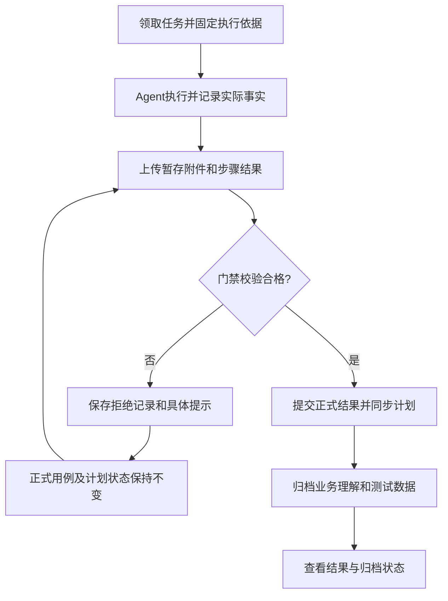

# MSP 个人 Agent 测试闭环简化产品方案

版本：V1.1｜日期：2026-10-20｜状态：产品方案完成，待研发实施与验收。本版明确三个旧功能分组整体隐藏的要求。

补充实施依据：[完整补充改造方案](msp-remediation-complete-plan-20261020.md)。以下“领取任务/会话”仅适用于可选自动任务；最新个人直连核心流程为获取用例合同、执行、暂存证据、提交及查询，无需任务、租约、Runner 或环境资产发布。导航迁移、整体隐藏和全局门禁仍为必做；证据语义核验及验收以补充方案为准。

## 1. 产品目标

以个人 AI Agent 通过 MCP 执行测试为首期主场景，将操作收敛为：

**个人配置 Agent → 配置测试平台 → 领取用例任务 → 执行测试 → 上传事实与附件 → 门禁评估 → 更新正式结果 → 按项目归档业务理解和测试数据。**

测试人员无需理解或单独维护环境资产、环境执行档案、Runner、租约、模型配置和执行合同。权限、用例快照、执行会话、证据归属和审计由后台处理。

本方案替代此前方案在个人 Agent 通道中的导航、环境前置及操作复杂度设计，不改变历史结果真实性要求，也不关闭质量门禁。平台模型和共享 Runner 高级通道保留兼容，默认不作为日常操作入口。

## 2. 明确需求

|编号|需求|产品决策|
|---|---|---|
|R01|减少个人 Agent 执行配置|用平台接入配置代替多处环境/登录/凭据维护，领取时自动完成必要检查|
|R02|执行中心集中管理|平台质量门禁、测试平台配置、自动测试任务统一进入执行中心|
|R03|个人接入归个人中心|个人中心“Agent 集成”重命名为“Agent配置”，承载实际接入操作；移除独立个人接入主入口|
|R04|取得目标平台登录配置|按项目、平台和任务角色发放最小必要登录配置与凭据|
|R05|门禁不合格不修改状态|提交先暂存并校验；不合格保留原正式结果，逐项提示|
|R06|定时无人值守执行|任务支持定时和手动触发，明确执行端在线状态与无人领取处理|
|R07|自动生成业务理解文档|每次执行形成有证据来源的业务理解，保存到该项目测试资产的业务文档|
|R08|自动归档测试数据|保存执行所用及生成的业务测试数据，按项目分区、标记复用和清理状态|
|R09|隐藏冗余功能分组|首期必须整体隐藏“项目执行设置、系统运行维护、扩展能力”及其旧子入口；必要功能迁入新流程，无引用且完成迁移后再删除旧实现|

## 3. 目标信息架构

```text
执行中心
├─ 自动测试任务                 默认入口，项目范围
│  ├─ 任务列表：定时 / 手动 / 已暂停 / 需处理
│  ├─ 新建或编辑任务
│  ├─ 执行记录                 页面内页签，可查看本项目全部运行
│  └─ 任务及单次执行详情
│     ├─ 用例结果与步骤证据
│     ├─ 门禁反馈及补交记录
│     └─ 业务文档、测试数据及归档状态
├─ 测试平台配置                 项目范围
│  └─ 平台基本信息、登录账号/角色、连接检查
└─ 平台质量门禁                 全平台范围，醒目标识
   └─ 当前策略、版本历史、发布及影响说明

个人中心
└─ Agent配置                    原“Agent 集成”
   └─ 我的 Token、项目范围、授权能力、MCP 接入说明、连接状态

测试资产（沿用现有模块）
├─ 业务文档                     按项目筛选、关联执行、保留版本
└─ 测试数据                     按项目筛选、关联执行、区分可复用和历史数据
```

自动测试任务与单次执行不同：一个定时任务可产生多次独立执行；“执行记录”不能与任务定义共用一个状态。已有一次性执行仍可在执行记录中查看，不强制创建定时规则。

平台质量门禁移动到执行中心后仍为全局策略。项目切换不能改变其策略，也不能将项目管理员自动提升为全局策略发布人。

### 3.1 入口迁移

|原入口|目标处理|
|---|---|
|设置 → 个人接入|迁移至个人中心 → Agent配置，删除旧主菜单|
|个人中心 → Agent 集成|改名Agent配置；直接承载配置内容，不再仅提供跳转旧入口的按钮|
|系统设置 → 质量门禁策略|迁移至执行中心 → 平台质量门禁，保留全局授权与历史|
|项目执行设置 → 环境/登录/凭据|整合至执行中心 → 测试平台配置|
|运行维护 → 调度规则|整合至自动测试任务|
|运行维护 → 执行器/租约/告警|从日常导航隐藏；任务详情保留与当前运行相关的提示，管理员可进入诊断工具|
|扩展能力 → 模型/Prompt/Page Object/业务流|默认隐藏，保留历史引用与高级通道，不作为个人Agent必填项|

建议路由：`/execution/tasks`、`/execution/platforms`、`/execution/quality-policy`。具体路由名需保持现有引用兼容。旧个人接入URL通过兼容处理打开个人中心Agent配置；旧质量门禁URL重定向到新入口，避免现有双向重定向形成循环。

### 3.2 三个旧分组整体隐藏（首期必做）

“项目执行设置”“系统运行维护”“扩展能力”不再作为常驻功能分组展示。该要求对普通测试人员、项目管理员、系统管理员均适用，不能只对普通用户隐藏，而让管理员仍看到原有整排菜单。

|隐藏分组|必须移除的旧可见入口|仍有必要的能力如何保留|
|---|---|---|
|项目执行设置|环境执行配置、自动登录配置、凭据引用、项目执行策略及旧质量门禁入口|环境/登录/凭据整合进测试平台配置；必要任务约束放任务表单；全局门禁只在执行中心维护；模型专用治理默认隐藏|
|系统运行维护|执行器管理、租约与调度、运行告警|调度迁入自动测试任务；心跳、租约由后台处理；故障提示放任务详情；管理员按需进入受权限控制的诊断页，不恢复常驻分组|
|扩展能力|模型执行配置、Prompt模板、Page Object、业务流、接入状态|已有引用和历史保留；当前个人Agent流程不要求配置。必要接入状态归Agent配置或任务详情，其余默认隐藏|

隐藏范围覆盖侧栏、顶部页签、快捷入口、页面交叉链接、全局菜单搜索及默认落地页；不能仅用CSS遮挡菜单。已有打开的旧页签应在升级后关闭或转向对应新入口。

旧URL处理：已迁移功能重定向到有相应权限的新页面；无替代的隐藏能力显示简洁停用说明和返回入口，不继续呈现可编辑的旧功能页。保留的管理员诊断页从任务故障上下文按需进入，继续执行后端权限校验。隐藏页面不等于撤销API授权，不能依赖隐藏实现安全控制。

首期隐藏前必须完成必要能力承接。不得先移除旧入口，却使平台配置、定时任务、门禁管理或历史结果无法访问。对已有高级任务保留协议与历史兼容；需要继续维护的少量高级配置，由明确授权的诊断/维护入口处理，不重新加入日常主菜单。

本要求中的“无用”指当前个人Agent工作流不需要用户操作的页面，不代表执行后台、审计或历史数据可以直接删除。物理删除需先确认无消费者及引用，另行列出删除和恢复清单。

## 4. 页面一：个人中心 → Agent配置

用途：让个人 Agent 获得访问 MSP 的授权。此处的 Token 是访问 MSP 的凭据，与被测平台登录 Token 分开。

内容：

- 我的Token：名称、可访问项目、权限范围、有效期、启停、撤销、最近使用时间；创建后秘密只展示一次。
- MCP接入信息：当前部署地址、可复制的配置示例及接入说明；示例不嵌入真实秘密。
- 连接检查：鉴权是否成功、可访问项目、执行端最近在线时间；“配置成功”与“已在线领取任务”分开。
- 不提供全平台Token管理或其他人的秘密查看功能；系统审计继续受管理员权限控制。

操作验收：用户可在个人中心完成创建Token、配置MCP、验证访问及撤销，全过程不跳回已撤销的独立个人接入页。中英文菜单、标题、帮助和搜索结果同步更名。

## 5. 页面二：执行中心 → 测试平台配置

### 5.1 数据与界面

|字段|要求|
|---|---|
|所属项目|取当前项目，后端再次验证权限|
|平台名称|如米多星球测试后台，项目内易于辨认|
|测试地址|必填URL；保存时提取主域，必要的跳转域在高级项配置|
|环境标识|测试/预发布等用于防误操作的标签，不要求另建环境资产|
|登录方式|无需登录、账号密码、手机号测试验证码、API Token、密钥引用、人工扫码/MFA接力等|
|账号与角色|一个平台可维护多组身份，任务按角色选择|
|秘密配置|密码、Token或密钥加密保存/复用秘密管理；默认只显示已配置、有效期及最后验证|
|适用状态|启用/停用、验证时间、验证失败原因|

列表提供新增、编辑、验证、启停和被哪些任务使用；删除有引用记录时采用归档或明确迁移，不破坏历史快照。

### 5.2 关键规则

1. 不展示“环境ID”手填框；平台ID由系统生成。个人Agent不需要先在资产目录发布环境。
2. 任务只引用一个主平台，首期允许额外选择本流程确需访问的关联平台及角色。多平台流程不能因此要求新建另一套环境档案。
3. 领取任务时冻结地址、登录方式和配置版本，秘密只保留引用，不进入任务普通JSON快照。实际获取时验证Token范围、任务归属和账号授权，提供限时访问；密码本身并不因交付限时而自动变成短期密码。
4. 登录需要人工操作时明确标记“需人工接力”；无人值守任务不得把这类配置显示为自动登录已就绪。
5. 配置验证分为格式检查、凭据可获取、实际登录验证；无法从MSP服务器访问目标内网时，可由授权执行端验证，并保留来源。未真实登录不得展示登录验证通过。
6. 凭据更新或撤销后，未开始执行采用新版本；运行中不静默更换身份，需停止/重新领取或按明确恢复流程处理。撤销权限立即阻止后续秘密获取。

## 6. 页面三：执行中心 → 自动测试任务

### 6.1 创建任务

|信息|字段|
|---|---|
|基本信息|名称、项目、负责人、测试目标|
|执行范围|选择测试计划或明确用例集合；任务范围预览|
|测试平台|选择已配置平台及角色，不输入内部ID|
|触发方式|手动、定时；定时明确时区、下次运行时间|
|执行端|选择可领取的个人Agent/执行端，展示最近在线状态|
|运行约束|超时、并发、失败重试上限；默认同任务不重叠|
|归档要求|默认生成业务理解和测试数据清单；提供归档位置链接|

定时任务默认每次触发读取范围内“当前有效用例”，在本次领取时固定快照；需要固定版本时作为高级选择。每次运行必须显示实际使用的用例版本和变更情况，不能执行过程中自动变化。

### 6.2 定时执行的真实机制

首期采用“平台调度器产生待领取运行 → 在线Agent适配器领取 → 后台心跳维持 → 提交结果”。定时任务不会凭空启动离线个人电脑。

- Agent离线：显示等待执行端及等待期限，到期标记执行阻塞，不计业务失败或通过。
- 调度去重：按任务和计划触发时刻生成唯一运行；重复触发不重复执行。
- 重叠处理：默认上一轮未结束时跳过本次触发并记录原因；可选排队策略需明确队列上限。
- 补跑：错过时刻不默认追补所有历史运行，默认记录错过；人工可发起一次补跑。
- 重试：只能针对可重试原因；订单提交等非幂等动作必须先核查业务状态，不盲目重做。
- 调度身份权限失效、平台停用或凭据撤销时阻塞新运行，提示负责人。

无人值守首期交付必须包含至少一种真实可部署的Agent适配器/常驻执行端及部署说明。不能只做定时任务表单就宣称支持无人值守。

### 6.3 领取操作

用户可以在页面“立即执行”，也可让Agent通过MCP指定计划或用例发起。面向Agent提供一个高层“领取/开始测试”操作，内部完成：

权限与范围校验 → 用例内容检查 → 平台配置检查 → 生成执行ID → 固定用例预期与策略 → 返回操作步骤、登录配置引用及证据要求。

不再要求Agent逐次拼接资产发布、预检ID、任务创建与租约参数。底层会话及心跳仍保留，由适配器自动处理。

不要求普通功能用例必须先在独立资产目录手动发布。领取时根据项目评审规则选择允许执行的用例内容并生成不可变快照；若项目要求评审通过，必须继续执行该约束。所有正式结果都关联领取时快照。

## 7. 平台质量门禁：控制正式结果，而非阻止保留事实

### 7.1 主流程



### 7.2 写入边界

- 文件先进入受控暂存区，以便校验真实大小、类型及内容；暂存不等于正式结果认可。
- 步骤提交可以提前给出门禁反馈，正式用例结果以该用例完整结果包为单位提交。批量包返回逐用例接受/拒绝清单，不允许客户端误以为全部成功。
- 不合格时不得更新用例及计划关联的正式状态、最后执行人和通过率；独立执行记录显示门禁拒绝及原因。
- 合格的业务失败应写入“失败”，不能因为不符合业务预期就拒绝记录真实失败。门禁评估内容质量，业务断言决定成功或失败，两者分开。
- 直接修改AI正式执行状态也必须走同一校验服务；网页、MCP、重试及批量接口一致。若保留人工测试结果，必须标记人工来源并有独立权限/规则，不能转换成AI通过来逃避门禁。
- 不允许“管理员强制通过”绕开硬规则。确需人工裁决应单独记录裁决，不伪装为自动门禁通过，首期不提供这类改判能力。

### 7.3 规则与反馈

首期保留现有截图格式/大小/前后角色、步骤归属、冻结预期断言及完成完整性规则，并验证其端到端效果。每个步骤需要什么证据在领取时明确。

拒绝反馈至少包含：提交ID、用例与步骤、规则ID、原因、缺失内容、建议动作、是否可补交、traceId。比如“第2步缺少操作后截图；本次提交未更新正式结果”。

对一次提交尽可能返回全部独立问题，避免用户反复只修一项；超大/危险文件可提前拒绝，但仍给安全、可操作提示。

补交保留原提交和拒绝结果，生成新修订。缺少当时截图不能事后补造：必要时重新执行受影响步骤或用例，保留原始尝试，且不得拼接不同执行的证据伪装同一次通过。

### 7.4 版本、并发与幂等

执行领取时绑定策略版本，新发布策略只作用于后续运行，已运行任务不静默改规则。策略全局发布需展示影响范围，历史策略不可直接修改。

网络超时重试使用同一提交ID和相同内容，返回原结果；同ID不同内容返回冲突。并发运行保留各自历史；更新计划最新结果需有明确版本/顺序规则，不能让迟到的旧运行覆盖新运行结论。

门禁接受与正式状态同步具备事务或可靠事件保证。无法完成同步时显示“结果已接受、同步待完成”，不得虚报计划已更新。

## 8. 自动归档业务理解与测试数据

### 8.1 业务理解文档

每轮形成项目内执行文档：业务目标、参与角色、实际经过的流程及状态变化、已验证规则、异常、未知边界、证据索引、与既有认知的差异。

每个结论区分实测事实/推断/待确认；引用本次执行ID、用例快照和证据。失败或阻塞运行同样归档，但不虚构未执行流程。

保存到“测试资产 → 业务文档 → 当前项目”。默认一轮一份执行认知文档，按执行ID去重；如要更新长期业务说明，生成候选修订并保留版本/审阅流程，不能由一次测试自动覆盖已确认规则。

### 8.2 测试数据

保存使用的业务输入、生成对象ID、数据来源、适用条件、有效期、清理状态及关联执行。划分：

- 可复用数据：适合后续测试，需注明前置条件和使用限制。
- 本轮历史数据：如已生效订单、已消耗券，只用于追溯。
- 待确认数据：来源或有效性尚不清楚，不自动推荐复用。

密码、密钥、登录Token、Cookie等不进入测试数据资产。敏感业务信息脱敏，必要时保存受权限控制的引用。没有业务数据时保存“本轮无新增/使用数据”的清单说明，不创建空数据集冒充产物。

### 8.3 归档状态独立

执行结果、门禁结果、归档状态分别显示。门禁通过后文档归档失败，不回滚真实业务结果，标记“归档待补齐”并重试；任务交付完成要求归档完成或有明确无需归档说明。采用executionId+产物类型作为幂等键，避免重试产生重复资产。

## 9. 权限与作用域

|能力|普通项目测试人员|项目管理员/授权维护者|系统策略管理员|
|---|---|---|---|
|个人Agent配置|本人Token及本人范围|同左|同左，管理审计另授权|
|测试平台配置|查看允许的元信息、按任务使用|维护项目平台和账号授权|不因系统身份默认读取全部秘密|
|任务与执行|按项目授权领取/发起/查看|维护定时规则和执行端关联|按授权查看运行管理|
|平台质量门禁|可读本任务绑定规则及拒绝原因|同左，不自动取得全局发布权限|按READ/MANAGE/PUBLISH管理全局策略|
|业务文档/测试数据|按项目资产权限查看或提交|维护项目资产|按原资产权限|

执行中心父菜单必须按可访问子页权限聚合，不能只要求AI_EXECUTION:READ导致仅有SYSTEM_QUALITY_READ的策略管理员进不去。前端隐藏、路由访问和后端授权保持一致。Agent Token不得修改全局门禁。

## 10. 数据与技术落地原则

本节供研发使用，不作为产品用户必填项。

优先复用：现有任务/触发器、执行记录、证据上传、门禁服务、Token、秘密引用、资产目录和版本服务。高层MCP操作封装底层流程，不创建第二套结果系统。

测试平台配置成为个人通道的唯一配置入口。可以迁移现有环境档案与凭据关系，也可以提供兼容适配；新个人流程不再强制依赖独立environment表发布记录。旧高级通道仍使用原关系时保留，不将两种ID混用。

需要明确的数据关系：项目→平台→角色/凭据引用；任务定义→多次执行；执行→用例快照/平台快照/策略绑定；执行→多次提交→门禁记录→正式结果；执行→业务文档/测试数据。

新增/调整接口需提供：平台列表维护及验证；任务定义及触发；一次领取；受控凭据获取；附件暂存；提交/补交/查询；业务产物归档及状态查询。具体路径和工具名由研发API设计确定，不把本方案中的业务动作名当成现有可调用接口。

## 11. 旧数据与导航迁移

1. 盘点原环境档案、登录配置、凭据、调度规则及引用；生成只读迁移预览。
2. 将能可靠映射的内容整合为测试平台配置。孤立environmentId标记“需修复”，不能自动绑定默认Mock或任意环境。
3. 保留原Token及授权范围，不因入口移动重建Token、扩大权限或输出旧秘密。
4. 历史执行、策略版本、附件、用例结果和审计不变；旧失败不自动改成通过。
5. 更新菜单、个人中心、中英文文案、资源权限、路由和帮助链接；兼容旧书签。
6. 先隐藏旧主入口，再观察引用与回归结果。物理删除代码/表需另列清单，确认无依赖并有备份恢复措施。
7. 灰度开放新个人流程，回退只切换新任务入口；已有运行按其协议版本继续处理，禁止回退到允许直接写成功的旧接口。

## 12. 研发拆分与需求追踪

|工作包|需求|前端|后端及数据|验收重点|
|---|---|---|---|---|
|A 导航与个人配置|R02/R03/R09|execution路由、个人抽屉、语言包、三个旧分组及子入口隐藏、旧入口重定向|原Token API及权限资源迁移|实际配置在个人中心完成；策略管理员能进新入口；三类角色均无旧常驻分组|
|B 测试平台配置|R01/R04|平台列表/表单/角色/验证|整合档案、登录、秘密引用，配置快照与授权|不需手填环境ID；任务只取得授权身份|
|C 任务与领取|R01/R06|任务定义、执行记录、在线/阻塞状态|调度去重、高层MCP领取、自动快照、适配器会话|手动和定时均能产生真实执行|
|D 门禁及正式结果|R05|步骤证据、拒绝列表、补交、同步状态|统一门禁、提交幂等、审计、正式回写|不合格状态不变，完整业务失败可保存|
|E 自动归档|R07/R08|运行产物链接、资产项目分类、重试|文档/数据生成及资产写入去重|事实可追溯、秘密不入库、归档失败不误改测试结果|
|F 迁移与回归|全部|旧路由、角色可见性、空/错/加载状态|迁移、历史协议兼容、容器及E2E|旧记录可查，新主路径无高级配置依赖|

已核对的实现入口：frontend/src/router/routes/modules/execution.ts、routes/execution-settings.ts、components/business/ms-personal-drawer/index.vue及locale、views/agent各配置页、views/execution/quality-policy.vue；后端AgentExecutionPreflightService、TestAssetCatalogService及现有门禁/执行服务。研发需继续核对具体字段、接口与权限消费者，不仅修改菜单名称。

## 13. 首期验收清单

1. 执行中心三个主入口符合本方案；旧入口兼容，无重复主菜单或重定向循环。
2. 个人中心名称准确为“Agent配置”，可以实际完成Token配置及连接检查。
3. 普通用户配置一个平台、选择用例即可领取任务，无需模型、Runner注册、环境资产发布等操作。
4. 定时触发有真实Agent领取；离线、重复触发、重叠和超时行为清楚且可追溯。
5. 完整证据正向通过；缺截图、缺步骤、缺断言、错误断言分别触发正确反馈，正式通过状态不被写入。
6. 业务失败且证据完整时正式保存失败；暂存和拒绝记录可查。
7. 跨项目、跨执行证据、越权凭据获取、同提交ID不同内容、旧直接结果写入均被拒绝。
8. 策略切换不改运行中及历史绑定；系统策略管理员不被执行中心父级权限挡住。
9. 每轮业务理解和数据清单按项目归档、关联运行、去重；无秘密泄露，无法确认的规则不写成事实。
10. 网络失败补交、正式结果同步失败、归档失败有可恢复状态；不能静默丢失或重复执行订单。
11. 升级保留历史结果、Token和证据；无效旧配置被提示而非偷偷修成Mock。
12. 相关单元、真实数据库集成、前端类型/lint/构建、后端打包、迁移及容器健康检查通过，并完成个人Agent端到端冒烟。
13. 普通测试人员、项目管理员、系统管理员的常规导航、快捷入口和菜单搜索均不再展示“项目执行设置、系统运行维护、扩展能力”及其旧子入口；刷新及切换项目后仍满足。
14. 旧书签及已有页签按迁移规则处理，无循环跳转、空白页或旧可编辑页面意外暴露；必要功能可从新入口完成，诊断入口不成为新的常驻功能分组。

首期不包含：建设新模型平台、复杂业务流编辑器、全自动绕过MFA、跨项目共享秘密、自动把单次认知合并成权威业务规则。

## 14. 本次交付状态与限制

本次只新增本产品方案，未修改前后端、菜单、数据库、Token或线上策略。已通过源码读取核对导航和个人中心入口；需求到功能/研发包/验收项已建立映射。

未执行运行测试、构建、数据库迁移及容器验证，因为本次是产品方案交付，不是实现。现有“完整预检失败”不会因本方案形成而自动消失。短期测试仍可按既有恢复方案补齐真实环境引用；长期实施采用本方案的平台配置简化路径，两者不要混为同一次修复。

功能状态：产品方案完成；产品改造未实施。实施顺序建议A/B → C/D → E → F；中间版本不得以菜单精简完成代替完整闭环验收。
