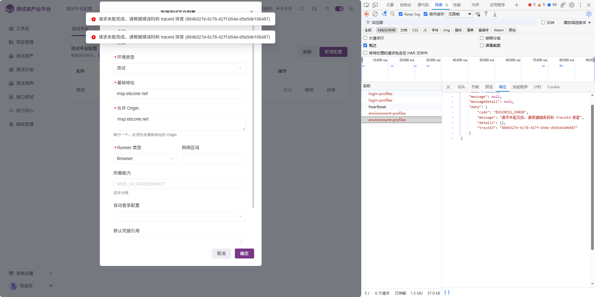
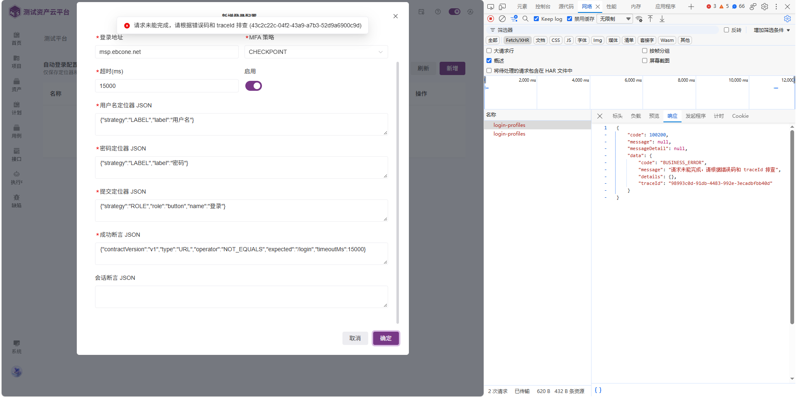

# 缺陷修复与整改汇总

- 整理日期：2026-10-22（北京时间）
- 文档状态：归并及详细修复改造方案已补充，依据当前工作区代码静态核查；待运行复现、方案评审和实施。
- 功能状态：部分完成，已实施修复及诊断代码，并取得部分构建、定向测试和隔离 MySQL 证据；运行验收进行中。以[实施与验证记录](implementation-progress-20261022.md)为当前状态依据，下文保留原方案及原始调查结论。
- 本文为后续缺陷修复与整改的主文档。三份原文保留为来源快照，后续方案和进度统一维护在本文件，避免重复更新。

## 1. 来源与分类追踪

| 来源 | 原编号 | 归并编号 | 分类与处理 |
| --- | --- | --- | --- |
| [需求与缺陷原文](../requirements-and-defects-2026-10-22.md) | D02、D03、D04 | DEF-01～DEF-03 | 用户报告的功能缺陷；待复现及根因确认 |
| [生产异常原文](msp-incident-remediation-20261021.md) | R01～R11 | INC-R01～INC-R11 | 全部纳入生产故障修复、诊断与稳定性整改；保留确定缺陷、待验证及运维整改的区别 |
| [外部图片原文](../mcp-external-image-attachment-requirements-2026-10-22.md) | 全文 | 无缺陷项 | 已归入[需求实现汇总](requirements-consolidated-2026-10-22.md) |

原生产文档中既有整改措施保留为初步方向，不代表已经形成详细设计或已经实施。不得把待验证的性能问题改写为已确认根因。

## 2. 功能缺陷
### DEF-01 切换测试计划后详情数据未刷新

前置条件：存在两个内容不同的测试计划，例如 100001 与 100002，当前用户均有查看权限。

复现步骤：

1. 从列表打开计划 100001，查看详情。
2. 返回测试计划列表。
3. 打开计划 100002。

实际结果（用户报告）：页面仍显示计划 100001 的详情。

预期：路由及当前计划标识变化后，详情应加载并展示计划 100002 对应数据。需排查缓存、组件复用、状态重置、请求参数及异步响应覆盖；以上为排查方向，不代表已确认根因。

验收：

- 按 100001 → 返回 → 100002 → 返回 → 100001 顺序切换，每次标题、编号、状态、统计、文档及各 tab 数据均属于当前计划。
- 快速切换及慢网络下，旧请求结果不得覆盖新计划数据。
- 加载过程中不将旧计划内容作为新计划内容展示；加载失败时提示错误并支持重试。
- 编辑、保存及其他写操作必须指向当前计划，不得误改上一计划。
- 直接访问详情地址、刷新页面、浏览器前进后退均正确；不存在或无权限的计划显示对应安全提示。

### DEF-02 测试平台新增配置失败

入口：执行中心 → 测试平台配置 → 测试平台 → 新增配置。

复现步骤：打开新增配置表单，填写配置并提交。截图可见环境类型为“测试”，基础地址和允许 Origin 均填写 `msp.ebcone.net`，Runner 类型为 Browser；其他字段和完整请求需补充核查。

实际结果（截图）：页面提示“请求未能完成，请根据错误码和 traceId 排查”；网络面板可见 `environment-profiles` 请求，响应业务错误码为 `BUSINESS_ERROR`。截图中同一 traceId 的错误提示重复出现。

证据 traceId：`884b527e-6c78-427f-b54e-d5e5de106487`。

预期：满足规则的配置能够保存并持久化，列表可查、重新进入仍存在；不满足规则的输入应给出可理解的字段提示。

核查重点：截图中的地址未包含协议，需结合现有规则确认是否必须填写 `https://` 等协议。不得仅凭截图断定输入合法或断定后端根因。若业务要求完整 URL，应明确提示地址格式，并校验允许 Origin 与基础地址的 Origin 关系。一次提交不应重复弹出同一错误。

验收：合法配置新增成功；必填缺失、地址或 Origin 无效、无权限、服务异常均有明确反馈；失败不显示成功、不残留错误数据；列表刷新及重新打开可验证持久化结果。

证据：



### DEF-03 登录方式新增配置失败

入口：执行中心 → 测试平台配置 → 登录方式 → 新增（截图表单标题为“新增登录配置”）。

复现步骤：填写登录地址、MFA 策略、超时、定位器 JSON 和成功断言 JSON 等字段，点击确定。

实际结果（截图）：页面提示“请求未能完成，请根据错误码和 traceId 排查”；网络面板可见 `login-profiles` 请求，响应外层 `code` 为 `100200`，内部 `data.code` 为 `BUSINESS_ERROR`。完整 HTTP 状态及请求参数未由截图确认。

截图中页面提示的 traceId 为 `43c2c22c-04f2-43a9-a7b3-52d9a6900c9d`，选中响应中的 traceId 与页面提示不同，可能属于不同请求；完整响应标识应从实际请求或日志复制核准，排查时需按实际提交记录关联。

预期：合法配置能够保存并持久化；地址、JSON 结构、定位器和断言规则不合法时，应明确指出问题字段，保留用户已填写内容供修改。

核查重点：登录地址格式、前后端 JSON 契约、枚举值、必填约束、权限及持久化。截图中的配置是否符合当前规则尚未验证，不能将通用错误当作根因。

验收：使用符合约定的配置新增成功，刷新后可查；对无效 JSON、结构错误、地址错误、必填缺失、无权限及服务异常提供安全明确的反馈；不返回虚假成功，不泄露敏感凭据或内部堆栈。

证据：



## 3. 通用质量要求

- 隐藏范围应覆盖该位置所有有访问权限的用户，不以单一账号截图作为唯一验收证据。
- 新增配置的前端校验与后端校验须一致；后端仍须独立校验参数、权限和业务规则。
- 错误优先沿用统一协议，向用户提供安全、可理解的原因及必要的 traceId；技术堆栈只进入日志。
- 配置页面覆盖 loading、empty、success、validation-error、permission-denied、network-error 和 server-error 状态，防止重复提交并保留失败后的输入。
- 除明确提出的修改外，不扩大删除数据、下线接口或改变历史业务行为的范围。

## 4. 功能缺陷链路追踪（待代码核查）

| 原编号 | 前端入口与实现范围 | 后端接口对应 | 数据或配置变更 | 验证范围 |
| --- | --- | --- | --- | --- |
| D02 | 测试计划 | 缺陷 | 切换计划后详情显示上一计划数据 | 当前页面全部数据必须对应当前计划 |
| D03 | 执行中心 | 缺陷 | 测试平台新增配置失败 | 核查请求及日志，修复合法输入无法保存的问题 |
| D04 | 执行中心 | 缺陷 | 登录方式新增配置失败 | 核查请求及日志，修复合法输入无法保存的问题 |
| D02 | 计划详情路由、状态及所有 tab 数据加载 | 待核查详情及各 tab 读写接口 | 优先排查状态和请求；是否涉及后端待确认 | 交替切换、慢网、竞态、写入目标 |
| D03 | 测试平台新增配置表单 | 截图请求名 environment-profiles；完整路由待核查 | 配置字段、约束及持久化待核查 | 新增、校验、权限、刷新持久化 |
| D04 | 登录方式新增表单 | 截图请求名 login-profiles；完整路由待核查 | JSON 契约、枚举及持久化待核查 | 新增、异常输入、权限、刷新持久化 |

## 5. 生产异常调查与整改（保留原有证据）

编制日期：2026-10-22  
事件日期：2026-10-21  
时间口径：北京时间（UTC+08:00）  
状态：部分完成。已完成现有日志分析，根因未最终确认；本文仅为整改方案，不代表修复已经实施。

### 5.1. 调查结论与边界

生产平台在人工重启前出现持续响应迟缓、内部接口超时和失效数据库连接。异常期间存在集中读取用例详情、批量处理用例等活动，但目前不能认定“导入 524 条用例导致崩溃”。现有记录更接近服务严重变慢或局部阻塞，没有证据表明应用进程在人工操作前自行退出。

用户确认：平台先异常，随后有人重启数据库，最后重启应用。数据库重启和应用重启均属于恢复操作，不应作为最初故障原因。

已确认的排序规则冲突必须修复，但其与全平台不可用之间的因果关系尚未建立。日志缺少请求和线程关联、请求耗时、历史连接池指标及 JVM/主机资源数据，无法区分数据库慢查询、锁等待、应用资源停顿或网络异常。

### 5.2. 证据与时间线

完整分析文件：`C:/Users/midoo/Downloads/metersphere-prod-before-failure.log`，25,829,690 字节、127,362 行，覆盖 18:00～20:00。另结合用户提供的容器状态、Docker/MySQL 日志，以及生产库只读查询结果。

| 时间 | 证据 | 解释及限制 |
| --- | --- | --- |
| 18:00～20:00 | AI 回写恢复定时任务出现 218 次错误 | 相同关联查询发生排序规则冲突，不能据此推断资源耗尽 |
| 18:08～19:13 | 42 次 `SessionDestroyedEvent` 发布警告 | 提供的日志未包含具体异常原因，不能直接判定 Redis 不可用 |
| 19:30～19:35 | 6767 条 SELECT 准备记录，多类用例详情关联查询各出现 543 次 | 支持集中读取活动；不是数据库 QPS，也不是成功查询数，不等于 543 个独立请求 |
| 19:44:51 | 完整文件内首次内部回调超时 | 最迟此时已有响应异常，不代表故障恰好从此刻开始 |
| 19:44～19:59 | 25 次内部回调超时、4 次 Hikari 失效连接校验警告 | 发生在人工重启数据库之前；连接失效原因未知 |
| 19:48:29.272～19:48:30.648 | 524 条用例基本信息写入准备记录，同时准备正文、自定义字段写入 | 无批次提交证据；不能以打印速度推算 SQL 执行速度；导入解析或校验可能更早开始 |
| 20:00:40～20:01:13 | 数据库收到停止信号，10 秒未退出被强制终止，随后启动并接受连接 | 人工恢复过程；不能据此认定数据库原先自行崩溃 |
| 20:12 | 人工重启应用 | 恢复操作，用户确认 |
| 20:29:38 | 操作日志记录 524 条 Excel 导入 | 用户认为是恢复后的重新导入；操作日志时间不等于请求开始时间 |

生产库核对：

- `ai_execution_task.id`、`current_execution_id`：`utf8mb4_general_ci`。
- `ai_execution_case_sync.task_id`、`execution_id`：`utf8mb4_0900_ai_ci`。
- 重启后统计中，相关恢复查询执行 1701 次、报错 1701 次；统计值仅代表查询当时、此次数据库启动后的累计数据。
- 慢查询开启，阈值 1 秒，输出文件 `/var/lib/mysql/slow.log`；用户确认文件约 6.1GB，尚未完成离线分析。
- 重启后部分列表/统计 SQL 最长约 11 秒，不能反推重启前耗时。
- 完整应用日志未发现明确的 OOM、GC overhead、死锁、锁等待超时、连接池获取超时或线程饥饿记录；未记录不等于未发生。

### 5.3. 修复与整改追踪表

优先级：P1 为优先安排，P2 为后续完善。所有条目当前均未实施验收；“待验证”条目应先测量，再决定是否修改。

| 编号 | 优先级/性质 | 需求与措施 | 前端入口及实现 | 后端对应 | 数据/配置 | 验证及验收证据 |
| --- | --- | --- | --- | --- | --- | --- |
| INC-R01 | P1，确定缺陷 | 修复 AI 回写恢复关联字段排序规则冲突 | AI 执行任务状态、回写结果展示；核对实际入口 | `AgentExecutionFinalizationService.recoverableTasks`、`AgentExecutionWritebackService.recoverPendingSync` | 版本化迁移统一关联字段规则；检查其他关联列、索引和比较语义 | 与生产相同 MySQL 版本及混合规则初始结构上完成迁移；原恢复查询成功，待回写任务正确恢复，无重复回写 |
| INC-R02 | P1，稳定性整改 | 定时任务异常分类、退避与告警，避免相同确定性错误持续刷堆栈 | 运维告警或任务状态入口，核对现有能力并复用 | 回写恢复及其他关键调度任务 | 告警去重、重试间隔、失败计数配置 | 持续失败只产生受控日志与告警；瞬态错误恢复后继续执行；不吞异常、不返回伪成功 |
| INC-R03 | P1，可观测性 | 记录导入开始、处理阶段、结束、失败和中断，覆盖传统 Excel 导入 | 原用例导入入口；显示任务号、进度、成功/失败数、安全错误提示 | `/functional/case/import/excel`、`FunctionalCaseFileService.importExcel` 及监听器 | 持久化任务状态、时间、操作者、文件大小、条数、traceId；不要误认为空的资产导入任务表已覆盖此入口 | 能追溯失败及回滚批次；刷新后可见状态；重启后中断任务可识别；日志和页面可关联 |
| INC-R04 | P1，待验证 | 评估导入资源占用与事务边界，必要时限流、分批或异步化 | 防止重复提交；展示排队、失败和部分成功；明确重试方式 | Excel 预处理、解析、批量执行、日志写入和后置同步 | 队列、并发、文件和附件大小限制；批次幂等策略 | 隔离环境测试 500+ 条及相近附件规模；记录内存、GC、连接占用、耗时；失败后的数据一致性符合既定事务语义 |
| INC-R05 | P1，待验证 | 核查集中详情读取及鉴权重复查询，按证据优化 | 核对批量读取、导出及 Agent 使用路径，避免重复触发 | 用例详情聚合、Token 鉴权、用户角色与权限查询 | 必要时批量接口或权限缓存；必须定义撤权失效、租户隔离和缓存边界 | 使用相同工作量对比查询数、延迟和并发影响；权限变更后行为正确；不能仅以日志数量判定接口滥用 |
| INC-R06 | P1，待验证 | 定位慢 SQL、索引和锁等待 | 用例列表、统计和导入相关页面 | 详情关联查询、列表 COUNT、多表关联、导入写入 | 依据执行计划决定索引或 SQL 变更；避免盲目全表改造 | 故障前慢日志离线分析；隔离环境 EXPLAIN/必要的实际执行分析；结果一致，耗时和扫描行数有前后对照 |
| INC-R07 | P1，待验证 | 验证数据库断连后的应用自恢复 | 请求失败使用安全错误提示，允许受控重试，避免重复写入 | Hikari、JDBC 超时、事务取消、重试与幂等 | 核对 maxLifetime、keepalive、连接验证、网络与 MySQL 超时；禁止只凭警告直接调参 | 隔离环境断开/恢复数据库，验证连接池恢复、请求有界失败、无持续积压及重复提交；记录恢复时间 |
| INC-R08 | P1，监控整改 | 建立故障现场留存和关联能力 | 复用监控与运维入口 | HTTP、数据库连接池、调度任务、JVM、主机和存储 | 采集请求量/延迟/错误率、连接 active/idle/pending、堆/GC、CPU、磁盘延迟、网络、数据库运行线程和锁等待；定义阈值与保留期 | 告警能覆盖“进程存活但接口不可用”；演练时保存线程、GC、连接池和数据库等待证据；统一时区 |
| INC-R09 | P1，日志运维 | 控制慢日志和生产 DEBUG 日志增长 | 无新增业务入口 | Logback 与 MySQL 日志 | 慢日志轮转、保留期、磁盘阈值；核对生产日志级别、异步队列和线程/requestId；保留故障证据后再清理 | 轮转后 MySQL 继续写入正确文件；磁盘使用可控；异常可关联；不以全局 DEBUG 作为长期监控 |
| INC-R10 | P2，恢复流程 | 调整数据库停止宽限时间，减少恢复时被强杀 | 运维流程 | Docker/Compose MySQL 容器 | 基于实际停止耗时评估 stop grace period；不是本次初始根因修复 | 隔离环境在代表负载下有序关闭，确认完整退出日志；不得为验证而重启生产 |
| INC-R11 | P2，待验证 | 澄清会话销毁事件警告 | 登录、退出、会话过期路径 | Spring Session 与会话事件监听器 | 按需补充受控诊断信息，不记录会话密钥 | 复现过期/退出，定位具体原因；核对资源是否释放；未定位前不得标记为 Redis 故障 |

### 5.4. 实施约束及异常行为

- 优先复用现有操作日志、任务状态、权限、错误协议和告警能力；先核对生产实际版本与本地代码差异。
- INC-R01 迁移前检查字段值、唯一键及大小写/重音比较语义，备份并评估 DDL 锁表影响；不能直接对整库执行排序规则转换。
- 导入须明确原子回滚或部分成功语义。改为分批提交会改变业务行为，不能把失败批次当作整体成功。
- 覆盖空文件、非法文件、损坏压缩包、条数/大小超限、附件存储失败、重复提交、取消、超时、权限不足和服务重启中断。
- 前端覆盖 loading、empty、success、validation-error、permission-denied、network-error、server-error；后端使用用户可理解的统一错误及 traceId，技术堆栈仅留日志。
- 不在生产重放导入或进行破坏性断连演练。不再次全量扫描 6.1GB 慢日志；先评估空间、传输和 I/O，安排离线副本分析。
- 应用 SQL 准备/参数日志不能证明执行或提交成功；无线程/requestId 时不能把相邻记录直接配对计算 SQL 耗时。

### 5.5. 验证计划与完成定义

#### 5.5.1 本次已执行的调查

| 检查 | 实际方式 | 结果 |
| --- | --- | --- |
| 完整日志分析 | 本机 Python 标准库读取文件，统计行数、错误类型、时间范围、SQL 准备及关键上下文 | 成功，结果见时间线；未在生产扫描慢日志 |
| 生产数据库字段与结构 | `mysql.exe` 只读执行 `information_schema.COLUMNS`、`SHOW CREATE TABLE`、`SHOW INDEX` | 确认排序规则冲突及操作日志索引 |
| 生产运行状态与历史留存 | `SHOW GLOBAL VARIABLES/STATUS`、`performance_schema.error_log` 与 SQL 摘要 SELECT | 确认数据库启动时间、慢日志配置及重启后统计边界 |
| 操作日志与导入任务 | 按日期索引限定查询 `operation_log`，检查 `case_asset_import_job` | 确认恢复后 524 条导入记录；资产任务表为空 |
| 本地代码检查 | `rg` 和 PowerShell 定点读取日志配置、导入服务、操作日志入口 | 找到相关实现；不代表生产版本完全一致 |

数据库诊断设置了会话只读和单条 SELECT 最大执行时间（按批次为 5～10 秒），未执行业务写入。未保存数据库密码到本文。

#### 5.5.2 修复后必须执行

本次仅输出文档，尚未实施上述修复，因此未执行单元/集成测试、前端类型检查及 lint、前后端构建、迁移演练、Docker 构建/启动/健康检查、核心路径端到端测试。风险是所有方案尚未验证可用，不能作为上线完成证据。

实施时须依据项目当时有效的构建脚本确定并保存准确命令，本文不提供未经核实的可执行构建命令。验收至少包括：

1. INC-R01 在混合排序规则数据库上的迁移及真实查询集成测试。
2. 导入有效/无效/部分失败/重试/权限及中断场景的前后端端到端验证。
3. 500+ 条相近数据、附件规模及并发详情读取的隔离环境测试，留存资源和耗时曲线。
4. 数据库短暂不可用后的连接池恢复与数据一致性演练。
5. 相关单元、后端集成、前端类型及 lint、生产构建、后端打包、数据库迁移、容器启动与健康检查。

性能阈值、并发量、恢复时间和资源预算须在测试前按环境容量及业务要求明确，禁止测试后倒推通过标准。

### 5.6. 收口与交付状态

现有应用日志分析到此收口。若有 19:25～20:00 两台服务器的历史监控，可补充判断瓶颈；若无历史现场，则将本事件记录为“响应异常已确认，根因未确认”，不继续用零散日志替代缺失证据。

后续优先实施 INC-R01、INC-R03、INC-R08、INC-R09，并针对 INC-R04～INC-R07 在隔离环境验证。各项应指定责任人、计划时间、变更文件、验证命令与结果，再决定是否上线。

本次交付仅新增本文档，未修改前端、后端、数据库或生产配置。没有声称任何修复已经完成。已知遗留为排序规则缺陷、历史可观测性不足，以及导入/集中读取与故障的因果关系未明确。

总体功能状态：**部分完成（调查与方案已整理，修复及验收未实施）**。

## 6. 详细修复改造方案

### 6.1 核查口径及代码索引

核查日期为 2026-10-22。下述“现状”来自当前工作区静态阅读，不等同于生产部署状态；工作区已有其他改动，实施前必须记录 Git 提交、相关未提交差异、应用镜像摘要和数据库迁移版本。不得用本地已有代码倒推历史故障已修复。

为便于实施，下表路径相对仓库根目录；新增文件均明确标为“拟新增”，其名称可在实施时按现有约定调整。

| 范围 | 已核查文件或位置 | 作用 |
| --- | --- | --- |
| 计划详情 | `frontend/src/views/test-plan/testPlan/detail/index.vue`、同目录 `plan/index.vue`；`frontend/src/router/routes/modules/testPlan.ts` | ID 初始化、缓存激活、详情加载、文档加载 |
| 计划 API | `frontend/src/api/modules/test-plan/testPlan.ts`、`frontend/src/api/requrls/test-plan/testPlan.ts` | `getTestPlanDetail` 实际请求 `GET /test-plan/{id}`，统计由 `getPlanPassRate` 调用 |
| 配置页面 | `frontend/src/views/execution/platforms.vue`、`frontend/src/views/agent/environment-profile.vue`、`frontend/src/views/agent/login-profile.vue` | 当前入口复用环境及登录配置组件；与截图布局可能不同 |
| 配置 API | `frontend/src/api/modules/setting/agentIntegration.ts`、`frontend/src/api/requrls/setting/agentIntegration.ts` | 平台和登录配置请求封装 |
| 配置后端 | `backend/services/agent-integration/src/main/java/io/metersphere/agent/` 下 `controller/AgentEnvironmentProfileController.java`、`controller/AgentLoginProfileController.java`、`service/AgentEnvironmentProfileService.java`、`service/AgentLoginProfileService.java` | 参数、项目隔离、业务校验及 JDBC 写入 |
| 错误协议 | 上述 Agent 目录 `controller/AgentExecutionExceptionHandler.java`、`service/AgentSafeErrorMapper.java`；`frontend/src/utils/appError.ts`、`frontend/src/api/http/index.ts` | 稳定错误码、安全消息、traceId 及提示展示 |
| 回写恢复 | 上述 Agent 目录 `service/AgentExecutionFinalizationService.java`、`service/AgentExecutionWritebackService.java` | 恢复候选查询、30 秒周期扫描、逐任务回写 |
| 导入 | `backend/services/case-management/src/main/java/io/metersphere/functional/controller/FunctionalCaseController.java`、`service/FunctionalCaseFileService.java`、`excel/listener/FunctionalCaseImportEventListener.java` | 传统 Excel 导入真实入口和监听器 |
| 基础设施 | `backend/app/src/main/resources/commons.properties`、`logback-spring.xml`；`deploy/quality-verify.compose.yml` | 连接池、日志、隔离环境依赖及就绪检查 |
| 迁移 | `backend/framework/domain/src/main/resources/migration/3.7.2/ddl/` | 增量迁移；不得修改已执行脚本及其校验和 |

### 6.2 DEF-01 计划详情串数据

**现状与定位。** `planId = ref(route.query.id as string)` 只在组件建立时赋值；`onBeforeMount` 加载详情，但 `onActivated` 仅设置 tab，没有重取 ID 和数据。当前未见对 `route.query.id` 的监听。`copyHandler` 跳转新 ID 后立即调用 `initDetail()`，仍可能使用旧 `planId`。这是代码层面明确的刷新缺口，仍需在实际缓存路径复现。文档子组件已监听 `props.planId`，但父级不更新时不会触发。

**修复步骤。**

1. 将当前项目 ID、路由计划 ID 作为统一加载上下文；对 ID 做字符串及非空校验。建立唯一的 `loadPlanContext(projectId, planId)` 流程，首次进入、同组件切换、复制跳转和缓存激活统一调用，避免 mount、watch、activated 重复发起同一轮请求。
2. 切换前保留现有文档未保存确认机制。为文档自动保存请求捕获原计划 ID 和编辑版本；旧计划尚未确认保存时不能把旧正文提交到新计划。确认离开后再重置详情、统计、tab 列表数据、选中行、抽屉和错误态。
3. 为每轮请求生成递增序号，所有成功、异常及 finally 更新均比较序号和项目/计划 ID；旧响应直接丢弃。底层支持取消时同时取消旧请求，不能只依赖取消成功。
4. 审计 `featureCase`、`bugManagement`、`apiCase`、`apiScenario` 和 `executeHistory` 的 ID 来源。优先显式传入 ID 并监听变化；对状态复杂的子树可按项目与计划组合 key 重建，避免全局删除 keep-alive 造成其他页面回归。
5. 复制流程等待导航完成，由统一监听加载新 ID，移除紧接导航的旧上下文加载。编辑、关注、删除和文档保存提交前再次确认上下文未变化；未加载到有效当前详情时禁用写操作。
6. 使用已有安全错误组件显示详情加载失败及重试。统计失败只影响统计区，不以默认零值伪装成功；403/404 不继续显示旧详情。

**接口和数据。** 复用详情、统计及各 tab 现有 API；预期无需数据库变更。后端仍按计划归属和项目权限校验读写，不依赖前端 ID。检查接口响应中的记录 ID 与请求 ID 是否一致。

**验收与回滚。** 在真实后端创建两份内容明显不同的计划，验证原复现序列、复制后进入新计划、刷新、前进后退、跨项目和无权限访问。额外使用响应延迟验证竞态，验证离开未保存文档不会跨计划写入。回滚只回退该页面及相关子组件改动，不回退用户数据。与 REQ-02 同文件修改需合并验证。

### 6.3 DEF-02 测试平台新增配置失败

**已核查事实。** 页面 `save` 仅检查名称、基础地址和 Origin 非空。后端 `requireSafeHttpUri` 明确要求完整 HTTP/HTTPS URL；截图的 `msp.ebcone.net` 不符合当前规则。服务中的中文校验异常经过 Agent 优先异常处理器时，`safeCode` 会将非稳定英文码转换为 `BUSINESS_ERROR`，存在具体校验原因丢失的链路。该链路能解释现象的一部分，但需实际请求和部署版本确认。

**完整链路。** 执行中心 → `platforms.vue` → `environment-profile.vue` → 配置 API → `POST /ai/environment-profiles`（兼容 `/api/ai/environment-profiles`）→ `AI_EXECUTION:RUN` 权限 → 项目解析与校验 → `ai_environment_execution_profile` → 返回配置 DTO → 列表刷新。

**实施方案。**

1. 页面基础地址与 Origin 均校验协议、主机和端口，提示示例 `https://msp.ebcone.net`，不静默猜测 HTTP/HTTPS。Origin 使用协议、主机、非默认端口规范化，不允许用路径、查询参数掩盖错误输入；基础 URL 可保留业务路径。比较规范化后的基础 Origin 是否位于允许列表。
2. 为服务的地址格式、禁止目标地址、Origin 不匹配、名称冲突、创建时不允许绑定等预期失败定义稳定错误码，并在 `AgentSafeErrorMapper` 映射安全中文消息。校验错误返回明确 400/422，权限 403，版本或名称冲突 409，未知故障 500；实际采用项目既有契约，不在页面硬解析原始异常字符串。
3. 扩展校验错误的安全字段详情，使表单定位到 `baseUrl`、`allowedOrigins` 等字段。保持 `AgentExecutionExceptionHandler` 的技术信息屏蔽能力，不能通过放行所有异常消息修复提示。
4. 当前后端创建阶段拒绝直接绑定登录方式/默认凭据，更新阶段才验证绑定关系。核对表单是否仍在创建时提交这两项；采用先创建平台，再在已有平台内配置登录和凭据的既有流程，不用取消后端约束绕过循环依赖。
5. 创建请求选用单一错误展示责任：对该配置 API 使用已有 `errorMessageMode` 关闭全局弹窗，再由表单显示一次错误及 traceId；或统一由全局展示，页面只设置字段错误。禁止同一请求同时被两处弹出。
6. 保存中禁用重复提交。区分“保存已成功但列表刷新失败”和“保存失败”：前者保留已返回的配置 ID，提示刷新列表，不诱导重新新增。项目切换或关闭后不得把旧请求结果写入新项目。

**数据与验证。** 不预设迁移。先对照实际表结构、当前迁移记录、请求 DTO、INSERT 列与参数个数；仅发现结构差异才新增兼容迁移。扩展 `AgentEnvironmentProfileServiceTests`、异常处理器测试和真实 MySQL 持久化测试，覆盖截图地址、合法 URL、Origin 不匹配、同名、跨项目、无权限及保存后刷新。保存成功后仍保留生产执行限制等既有规则。回滚前端和定点后端改动，保留已创建配置。

### 6.4 DEF-03 登录方式新增配置失败

**完整链路。** 平台内登录方式或兼容入口 → `login-profile.vue` → `POST /ai/login-profiles`（兼容 `/api/ai/login-profiles`）→ `AI_EXECUTION:RUN` → `AgentLoginProfileService.validate` → 同项目环境、登录 URL Origin、枚举、定位器和断言校验 → `ai_login_profile` → DTO 与列表。

**现状。** 前端目前只做必填和 JSON 语法校验；后端还通过 `AgentWebExecutionContractValidator` 校验结构。请求 DTO 限定超时为 1000～60000ms。登录 URL 同样受完整 URL 及平台 Origin 限制。现有 `AgentLoginProfileServiceTests` 的创建测试使用模拟 JDBC 和校验器，不能证明截图配置可持久化；截图与响应 traceId 不同，必须重新采集一次完整提交。

**实施方案。**

1. 先建立合法平台配置，再以该平台 ID 创建登录方式。测试用 `https://msp.ebcone.net/login` 等完整 URL，并确保属于所选平台允许的 Origin；仅作为格式示例，不在验证时对该外部网站发起登录。
2. 对定位器和断言逐字段解析为对象，拒绝数组、null、无策略、无目标字段、非法枚举及超限超时。前端展示与后端 DTO 一致的模板；不能因 JSON 可解析就认定契约有效。
3. 服务将地址/Origin、定位器、成功断言、会话断言、MFA、登录类型和配置版本分别映射为稳定错误码及字段详情。保留 `LOGIN_LOCATOR_INVALID`、`LOGIN_ASSERTION_INVALID` 等已有语义并细化安全定位，不输出用户整段 JSON 或凭据。
4. 新增时绑定明确的平台 ID；编辑时保留 version 乐观锁，跨项目绑定拒绝。不得为解决创建失败跳过 `assertTargetAllowed` 或启用生产执行。
5. 复用 DEF-02 的单次错误展示与“写入成功、刷新失败”处理。保存失败保持原输入；保存成功重新读取并验证字段、启用状态及所属平台。

**验证与回滚。** 补真实校验器单元测试、Controller 权限/错误协议测试和真实数据库 create/get/update 集成测试。覆盖合法 JSON 但结构错误、截图无协议地址、Origin 不匹配、1000/60000 边界和越界、跨项目、版本冲突。仅在发现真实缺列或 SQL 问题时安排迁移。回滚定点代码；已存配置不删除，必要时停用新配置并保留历史任务引用。

### 6.5 INC-R01 排序规则冲突治理

**本轮发现。** 当前 `recoverableTasks` 已在两个 JOIN 键上使用 `BINARY` 比较；`AgentQualityFinalizationMySqlTests` 已构建任务表 `general_ci` 与后续迁移表的混合结构并调用恢复查询。原事件修复项仍须保留，但先对照生产版本及运行此测试，不能重复添加同一补丁。`V3.7.2_99__quality_finalization.sql` 建表未显式指定 COLLATE，部署默认规则仍可能带来差异。

**方案。**

1. 在隔离副本读取关联列类型、长度、字符集、规则、索引和数据分布，覆盖 `task.id ↔ sync.task_id`、`current_execution_id ↔ sync.execution_id` 及所有同用途 JOIN。
2. 先验证已有字节比较补丁能恢复查询，并用大小写不同的 ID、旧 attempt、重复扫描测试精确比较及回写隔离。分析 `BINARY` 对执行计划和扫描量的影响。
3. 长期方案对不透明 ID 的比较语义统一为明确的二进制规则；目标具体 COLLATE 需核对相关引用列及兼容 MySQL 版本后确定。迁移前检查按新规则的唯一性、索引和锁等待，在新增版本脚本中定点修改关联列，保留原类型/长度/空值属性，禁止整库转换。
4. 若迁移耗时或锁风险不可接受，暂保留已经验证的查询级兼容，单独排期结构迁移，并明确登记未完成的结构治理；不能以临时补丁代表迁移已完成。

**验收。** 与生产同版本 MySQL、同混合规则初态，迁移前后恢复查询均无冲突；重复回写不产生重复结果，旧执行轮次不能覆盖当前轮次，执行计划及耗时有对照。备份原 DDL 和相关数据；回滚应用保留兼容 SQL，数据库逆向 DDL 需先演练，优先向前修复，不承诺无条件即时回退。

### 6.6 INC-R02 调度异常分类、退避与告警

**现状。** `recoverPendingSync` 每 30 秒执行；逐任务有 try/catch，但 `finalization.recoverableTasks()` 在循环之前调用，其查询异常不被内部 catch 捕获。查询级错误可能持续由调度器打印；任务级已有 `attempt_count`、`next_retry_at` 和最多 20 次候选条件，不能再叠加不受控重试。

**改造。** 为扫描阶段与单任务阶段分别设置错误边界。按 SQLState/异常类型归类为结构或配置错误、瞬态连接错误和业务失败，不能按 SQL 原文展示分类。结构错误暂停该扫描通道并周期性低频探测；瞬态失败使用有上限的指数退避和抖动，成功后复位；任务失败沿用现有持久重试字段。记录首次堆栈，后续聚合次数；复用 `AgentExecutionAlertService`，对通道、错误类和时间窗去重，不把 token、URL 签名作为标签。

**状态和验收。** 复用现有观测入口展示最后成功扫描、连续失败次数、下次探测及恢复状态；若无法复用，增加受权限保护的诊断读接口。多实例使用共享状态或分布式约束防止每台重复告警。注入查询异常、任务异常及恢复，验证日志有界、告警去重、不吞失败、任务最终恢复；回滚调度策略而不重置任务已持久化的重试状态。

### 6.7 INC-R03 传统 Excel 导入任务可追踪

**现状。** `/functional/case/import/excel` 调用 `FunctionalCaseFileService.importExcel`，依次预处理合并单元格、读取与监听器入库，返回成功/失败数。类级事务存在；catch 将 `e.getMessage()` 或异常类名拼入业务异常，须同时修正安全消息。不能假定资产导入表或 MCP 导入任务已覆盖该入口。

**实现步骤。**

1. 复用现有任务设施前先比对生命周期与权限；无法覆盖传统入口时拟新增 `FunctionalCaseImportJobService` 及专用任务表，字段至少包括 jobId、项目、操作者、源类型、幂等键、文件哈希/大小、阶段、行数、开始/结束/心跳、错误码与 traceId。文件名仅保存净化版本。
2. 状态定义为 `QUEUED/RUNNING/SUCCEEDED/PARTIAL_FAILED/FAILED/INTERRUPTED`；阶段为接收、校验、解析、写入、后处理。统计必须来自已提交结果，业务行校验失败与事务全回滚不能混淆。
3. 第一阶段保留现有同步响应并附 jobId，通过拟新增 `GET /functional/case/import/jobs/{jobId}` 查询任务状态；响应扩展须兼容现有消费者。任务状态事务放入独立 Spring Bean 的短事务中，避免同类调用使事务传播失效；业务回滚后任务失败记录仍需保留。
4. 页面在现有导入弹窗显示任务号、阶段和最终计数；页面刷新后按项目及操作者查询未结束任务恢复展示。增加任务列表查询时必须分页并验证项目权限，不暴露其他项目文件信息。
5. 服务启动根据持久心跳、实例标识和租约识别中断任务；禁止多实例把其他存活实例任务标成中断。未知提交结果保留“待核对/中断”，不直接重新导入。
6. 错误只返回安全摘要与 traceId，技术详情进入日志；清理暂存文件采用可重试补偿，不能先删元数据后丢失文件定位信息。

**迁移及验收。** 增量创建任务表和项目/状态/时间索引，不复用语义不兼容的空表。验证完整成功、行级失败、事务异常、刷新、重启、无权限、重复请求及过期清理。回滚可保留新增表，关闭追踪新入口并保留原导入兼容；不得删除审计证据。

### 6.8 INC-R04 导入资源和事务边界

先测量后改造。使用隔离环境代表性 Excel（含 500+ 行及相近附件规模），分别执行单用户导入、有限并发导入、导入叠加详情读取；记录解析堆内存峰值、GC、两套连接池占用、事务时长、文件 I/O、总耗时及服务请求延迟。客户端填写的 count 不能作为真实行数或资源预算依据。

第一阶段在接收端限制文件大小、真实行数、压缩展开规模和附件总量，并以项目/用户限并发；拒绝使用无限队列。默认保持当前对外事务语义，先验证监听器行级校验与数据库异常分别如何提交。性能不足时选择批量写入并减少事务内外部 I/O；仍不足才引入有界异步 worker，前端使用 INC-R03 jobId 展示排队与进度。

若决定分批提交，必须明确改为部分成功的业务契约，设计批次/行幂等和失败行重试，记录已提交/未提交范围；不能把最后一批成功作为整体成功。覆盖超限、重复提交、附件失败和服务重启。阈值在压测前记录于验收基线；回滚 worker 时先停止接收并处理在途任务，不直接丢弃队列。

### 6.9 INC-R05 集中详情读取及鉴权查询

从 `AgentTokenFilter`、`AgentBusinessAccess` 和详情聚合服务入手，使用请求级 traceId 统计一次详情读取包含的鉴权、角色、字段、附件、缺陷查询，区分前端重复请求、Agent 批量调用和必要校验。先建立相同数据规模、同一业务工作量的查询数和延迟基线，不将应用 SQL 准备条数当 QPS。

优先移除同一请求中的重复加载，采用请求级权限上下文与批量查询；权限上下文不跨请求复用，不能因缓存绕过 token 撤销、项目限制或资源级权限。确需跨请求缓存时单列设计 TTL、权限版本和撤权失效事件，测试成员移除、token 停用、跨组织及跨项目访问。批量接口必须有条数上限、逐项授权和明确部分失败结果。

验收使用相同读场景比对数据库查询数、p95 和并发影响，读取结果及权限行为一致。优化可通过开关回退原查询，保留安全校验；不为性能直接跳过鉴权。

### 6.10 INC-R06 慢 SQL、索引及锁等待

在约定的离线副本分析故障窗口慢日志，先按时间切片，再按 SQL 指纹统计次数、总耗时、最大耗时、扫描/返回行数与锁时间。联合线程、连接池及业务 traceId；没有历史关联数据时结论明确标为推测。

在隔离副本复现列表 COUNT、详情聚合和导入写入，先执行 EXPLAIN，必要时仅对安全 SELECT 在隔离环境做实际执行分析。优先修正不必要 JOIN、N+1 和不可用索引条件；索引按过滤、关联与排序设计，记录新增索引空间及写入成本，不全库批量加索引。列表结果、COUNT、租户及权限过滤须前后一致。

每条优化提交保存原 SQL、新 SQL、参数规模、执行计划和耗时分布，未定位瓶颈则交付分析结论而非无依据改 SQL。索引使用独立增量迁移，提前估算锁和空间；回滚查询代码后再评估是否删除索引，禁止在压力期间直接做高风险 DDL。

### 6.11 INC-R07 数据库断连自恢复

当前 `commons.properties` 包含业务和 Quartz 两套 Hikari 配置，分别有池大小、30 秒连接获取超时及生命周期等设置；方案需核对部署覆盖项，而非直接修改静态默认值。隔离环境模拟连接中断、数据库短暂重启和恢复，记录业务请求失败上界、池 pending、存量事务、调度任务及恢复耗时。

依据测量协调 JDBC 连接/读取超时、池验证、maxLifetime、keepalive 和数据库/网络超时，防止单一超时无限等待。仅对可证明幂等的操作做有限重试；写操作提交结果未知时先查询幂等记录或业务结果，不能盲目重放。请求返回安全失败并带 traceId，连接恢复后无需应用重启即可重新服务。

验收必须包括两套池均恢复、无持续 pending 积压、无重复业务写入和无连接泄漏。断连演练仅针对独立测试数据库。回滚到已记录的原配置，停止新重试策略而不清除业务幂等记录。

### 6.12 INC-R08 故障现场及观测能力

复用 `AgentExecutionMetrics`、`AgentExecutionObservabilityService`、`AgentExecutionAlertService` 和已有 Actuator 能力。当前通用配置默认关闭端点，隔离 Compose 显式启用 readiness；不能将暴露全部端点当作监控方案。

补齐四层指标：HTTP 请求量/延迟/错误率和业务可用性；业务及 Quartz 连接池 active/idle/pending/acquire-timeout；JVM 堆、GC、线程与 CPU；主机磁盘、I/O、网络、MySQL running/locks。指标标签使用固定路由和错误类别，避免用户、任务 ID、SQL 或 URL 造成高基数。

故障采集流程在“进程仍活但接口持续超时”时保存有界的线程快照、GC/JVM 摘要、连接池状态、数据库等待和部署版本；受运维权限保护，设置采样频率、文件上限、保留期和脱敏。统一北京时间展示及 UTC/时区记录。先人工演练采集，再接告警触发；监控不可依赖同一已耗尽线程池。验收必须在故障注入时拿到可关联证据，而非只看到健康端点 UP。

### 6.13 INC-R09 日志增长控制

`logback-spring.xml` 已有 50MB 分片及历史保留配置，不能重复声称完全没有轮转；仍需核查生产 logger 的 DEBUG、压缩、总容量上限及部署覆盖。按包降低高频 SQL DEBUG，保留可定位业务阶段的结构化事件；将 traceId/requestId/任务号纳入日志上下文，并在线程池传播后清理，避免串请求。

MySQL 慢日志独立设计轮转、压缩、保留期和磁盘告警。轮转前保全故障窗口副本；通过 MySQL 支持的日志重开方式让实例写入新文件，验证文件句柄及新增记录，不能仅重命名后删除仍被占用的大文件。生产不立即扫描或清理 6.1GB 文件。

若引入异步日志，明确队列容量及丢弃策略，审计/错误日志不应静默丢失。验收检查峰值日志速率、轮转持续写入、总容量、脱敏和关联能力。回滚日志级别与轮转配置，证据副本不回滚删除。

### 6.14 INC-R10 数据库停止宽限时间

该项属于恢复流程优化，不是初始故障根因。先识别生产实际 Compose/容器编排文件，在隔离同版本、代表负载下记录 MySQL 有序停止耗时、刷盘和完整退出日志，再以实测高位耗时加余量设置 `stop_grace_period`（拟从 120 秒起评估，不直接认定适用于生产）。同时核对外层编排或宿主机停止超时，避免内层配置被覆盖。

发布流程先停止写入及后台任务、等待在途事务，再停止数据库；记录人工强杀条件和恢复核验清单。验收确认停止日志完整、重启可读写且数据一致。回滚配置不需要触发生产重启；不以重启生产作为本项验证方式。

### 6.15 INC-R11 会话销毁警告定位

当前静态搜索未在业务 Java 代码中定位到直接处理 `SessionDestroyedEvent` 的实现，先核对 Spring Session、事件广播器、Shiro/Redis 版本和部署配置，再收集带原因链的受控诊断；不能据 42 次警告判定 Redis 故障。

在隔离环境依次测试正常退出、自然过期、重复销毁及应用关闭；核对事件监听执行、会话相关资源释放、Redis 可达性及线程异常。只记录哈希化会话标识和 traceId，禁止保存 session/token 内容。根据复现原因决定修复监听器、配置或依赖兼容性；没有复现则保留诊断和监控，不做猜测性依赖升级。验收以警告原因明确、资源正常释放及登录退出无回归为准，依赖升级须单独准备版本回滚。

### 6.16 实施顺序、变更边界和交付物

| 阶段 | 条目 | 前置与输出 |
| --- | --- | --- |
| S0 | 全部 | 记录本地/生产版本差异，保存复现、表结构及指标基线，建立逐项证据目录 |
| S1 | DEF-01～03；INC-R01、R02 | 先修确定刷新缺口、校验提示及扫描错误边界；验证现有 BINARY 补丁；结构迁移单独演练 |
| S2 | INC-R03、R08、R09 | 建立可追溯导入、现场留存与日志容量控制，为性能决策提供依据 |
| S3 | INC-R04～R07 | 隔离测量后按证据实施限流、查询、事务及连接恢复改造 |
| S4 | INC-R10、R11 | 恢复演练、会话问题定位及针对性修复 |

生产原优先级保持不变；上表为技术依赖顺序，不承诺人员和排期。每项保存代码差异、数据与配置变化、回滚说明、准确命令及实际结果；无证据的条目保持未实施或未验证状态。

### 6.17 验证命令与证据计划

以下是依据已读取脚本整理的**后续执行命令，当前未执行**。在仓库根目录使用 PowerShell，先确认 JDK 21、Node、pnpm、Docker 和测试依赖；不得将任何故障演练指向生产。前端完整构建先于应用打包，防止 JAR 带入旧静态资源。

```powershell
# 前端类型、非自动修复 lint、API/路由契约及生产构建
pnpm -C frontend run type:check
pnpm -C frontend exec eslint src --ext .vue,.js,.jsx,.cjs,.mjs,.ts,.tsx,.cts,.mts
pnpm -C frontend run test:api-contracts
pnpm -C frontend run test:route-tabs
pnpm -C frontend run build

# 现有配置、异常协议和回写单元测试；新增相关测试后纳入同一选择器
.\mvnw.cmd -pl backend/services/agent-integration -am test '-Dtest=AgentEnvironmentProfileServiceTests,AgentLoginProfileServiceTests,AgentExecutionExceptionHandlerTests,AgentFrozenWritebackTests' '-Dsurefire.failIfNoSpecifiedTests=false'

# 真实 MySQL 回写集成测试；先按 deploy/quality-verify/README.md
# 准备独立 127.0.0.1:13326 测试 MySQL，测试将创建并删除临时 schema
.\mvnw.cmd -pl backend/services/agent-integration -am test '-Dtest=AgentQualityFinalizationMySqlTests' '-Dquality.mysql=true' '-Dsurefire.failIfNoSpecifiedTests=false'

# 业务模块测试及完整后端打包；若测试需固定 fixture，先完成隔离初始化
.\mvnw.cmd -pl backend/services/test-plan,backend/services/case-management -am test
.\mvnw.cmd -pl backend/app -am package

# 复用既有镜像构建流程：校验 JAR 内前端资源并产出 msp-quality:remediation
powershell -NoProfile -File scripts/verify-msp-remediation.ps1 -Stage Image
```

容器验证使用已有隔离项目。先设置该项目原有 `QUALITY_DB_PASSWORD`、`QUALITY_STORAGE_PASSWORD`、`QUALITY_FACTS_KEY`，不重新生成密钥覆盖现存数据；同名项目在使用时需安排验证窗口。以下 tag 操作会替换隔离项目待启动镜像，须先记录原镜像摘要。

```powershell
docker compose -p msp-quality-verify -f deploy/quality-verify.compose.yml config --quiet
docker tag msp-quality:remediation msp-quality:verify
docker compose -p msp-quality-verify -f deploy/quality-verify.compose.yml up -d --wait
powershell -NoProfile -File scripts/verify-quality-environment.ps1
Invoke-RestMethod http://127.0.0.1:17071/actuator/health/readiness
docker compose -p msp-quality-verify -f deploy/quality-verify.compose.yml logs --tail 200 app
```

迁移通过容器应用启动执行并严格校验记录；现有健康脚本只检查既定历史版本，新增迁移必须补充目标版本、结构和数据断言，不能仅凭 readiness 通过。新迁移需同时做空库全量启动和代表性旧库升级。

端到端复用现有 `frontend/e2e/remediation-navigation.spec.ts` 及真实测试账号/fixture；拟新增 `frontend/e2e/test-plan-context.spec.ts`、`platform-configuration.spec.ts`、`functional-import-tracking.spec.ts`，分别覆盖串数据、两类配置创建及导入追踪，文件实施后才能执行。按 `frontend/playwright.config.ts` 设置 `PW_BASE_URL`、`PW_STORAGE_STATE`，浏览器访问隔离前端代理或构建产物；不能把 18081 后端地址当成已确认的独立前端页面服务。

证据建议保存到 `outputs/remediation-20261022/<条目编号>/`，包含命令、退出码、测试报告、请求 traceId、截图、迁移版本和性能前后曲线。当前未新建此证据目录，也未执行上述运行检查。

## 7. 本轮文档交付状态

- 来源覆盖：3 项功能缺陷、11 项生产故障整改均已归入本文，证据、边界及原有验证要求保留。
- 修改范围：仅文档；前后端、数据库、配置和运行环境均未修改。
- 验证：实际使用 `rg -n`、`rg --files` 和 PowerShell `Get-Content` 核查实现、测试及部署脚本；PowerShell 编号覆盖、链接存在性及代码围栏检查通过，覆盖 14 项详细方案；原生产调查为历史记录，未在本轮重新执行。
- 未执行：功能复现、单元及集成测试、类型检查、lint、构建、迁移、Docker、健康检查和端到端验证；原因是本轮仅编写方案、未实施代码变更。已核查的后续命令见 6.17；新增场景仍需实现测试后运行。残留风险为静态结论尚未取得运行证据。
- 遗留风险：生产初始根因未确认，功能缺陷待运行复现，迁移目标及性能阈值仍需隔离验证；方案不构成上线依据。
- 状态：文档归并及详细方案补充完成；修复实施及验收未完成。
