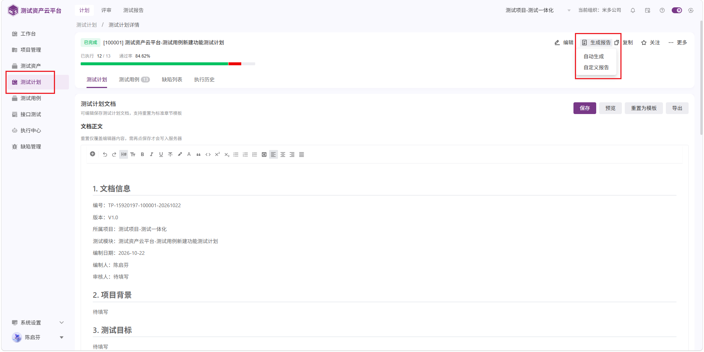

# 需求实现汇总

- 整理日期：2026-10-22（北京时间）
- 文档状态：归并及详细实现方案已补充，依据当前工作区静态核查；待评审和实施验证。
- 功能状态：部分完成，已实施代码并通过部分构建及定向测试；运行验收进行中。以[实施与验证记录](implementation-progress-20261022.md)为当前状态依据，下文保留原方案。
- 本文为后续需求实现的主文档。三份原文保留为来源快照，后续方案和进度统一维护在本文件。

## 1. 来源与需求追踪

| 归并编号 | 来源 | 原编号 | 需求 |
| --- | --- | --- | --- |
| REQ-01 | [外部图片原文](../mcp-external-image-attachment-requirements-2026-10-22.md) | 全文 R01～R08、A01～A12 | MCP 外部图片转存附件及长期留存，作为一项完整需求保留子项 |
| REQ-02 | [需求与缺陷原文](../requirements-and-defects-2026-10-22.md) | R01 | 隐藏测试计划详情生成报告入口 |
| REQ-03 | 同上 | R05 | 核查并按需补充缺陷关联状态同步；已实现并验证通过则不修改 |
| REQ-04 | 同上 | R06 | 优先删除生成用例 tab，影响过大则隐藏 |
| REQ-05 | 同上 | R07 | 隐藏业务文档 AI生成用例按钮 |
| REQ-06 | 同上 | R08 | 隐藏用例资产四项 AI 操作 |

[生产异常原文](msp-incident-remediation-20261021.md)的 R01～R11 均为故障相关修复、诊断及稳定性整改，统一归入[缺陷修复与整改汇总](defect-remediation-consolidated-2026-10-22.md)，不重复作为本文件的新需求。

## 2. REQ-01 MCP 外部图片转存附件

本节完整保留原需求的范围、接口约束、验收、待定项和追踪关系；其中 R01～R08、A01～A12 是 REQ-01 的原始子项编号。
### 2.1. 背景与目标

原始诉求为：“看看能不能支持这个，直接 url 展示就行，就是支持放外部图片。”结合“截图证据统一放附件里”的上下文，目标是允许 MCP 调用方通过外部图片 URL 添加截图证据，并在业务记录的附件区展示。

已明确无需人工录入入口。为支持长期留存，采用“接收 URL → 下载图片 → 转存系统附件 → 关联业务记录”的方式。转存成功后的查看不依赖原始 URL。

### 2.2. 范围

#### 2.2.1 本期包含

- MCP 通过图片 URL 添加附件，关联到指定用例、缺陷或执行记录。
- 后端获取和校验图片，复用现有附件存储与关联机制。
- 在对应记录现有附件区展示图片，支持缩略图及大图预览。
- 转存后的图片沿用现有附件访问权限、删除、备份及保留规则。
- 对下载、校验、存储或关联失败返回明确结果。

#### 2.2.2 本期不包含

- 页面新增“添加图片链接”等人工录入入口。
- 仅在正文中插入外部图片链接作为附件功能的替代。
- 仅保存外部 URL、查看时仍从外部来源加载图片。
- 自动同步源图片后续修改。
- 历史正文图片的批量迁移。

#### 2.2.3 建议的首期来源范围

支持后端可直接访问的 HTTP/HTTPS 图片 URL，包括尚未过期的签名 URL。需要登录态、Cookie 或额外鉴权头的图片来源，首期建议不支持，最终范围由评审确认。

### 2.3. 用户场景与处理流程

MCP 调用方已获得截图 URL，希望直接将截图作为业务记录的证据保存，无需人工下载和上传。

1. 调用方提交目标记录类型、目标记录标识及图片 URL，可选提交附件名称。
2. 系统校验调用身份、目标记录存在性及附件添加权限。
3. 系统校验 URL 安全性并下载图片。
4. 系统校验实际图片内容、类型、大小等限制。
5. 系统将图片写入现有附件存储并生成附件 ID。
6. 系统将附件与目标记录关联。
7. 关联成功后返回附件标识及处理结果；用户重新打开记录时可在附件区查看。

仅完成下载或存储，尚未成功关联到目标记录时，不得返回整体成功。

### 2.4. 功能需求

| 编号 | 需求 | 预期行为 |
| --- | --- | --- |
| R01 | MCP 接收外部图片 URL | 调用方可提交目标记录和图片 URL，无需先上传图片文件取得附件 ID |
| R02 | 自动转存 | 系统保存实际图片文件，后续展示使用系统附件资源 |
| R03 | 关联业务记录 | 图片关联到指定用例、缺陷或执行记录，遵循对应业务关联规则 |
| R04 | 现有附件区展示 | 外部转存图片与普通上传附件使用一致的展示及预览方式 |
| R05 | 长期留存 | 转存并关联成功后，原链接失效、过期或源图删除不影响已保存图片 |
| R06 | 权限一致 | 添加、查看、删除均遵循现有项目及记录附件权限，不因外链来源绕过权限 |
| R07 | 明确失败 | 下载、校验、存储、关联任一步失败均返回失败，不生成虚假成功记录 |
| R08 | 无人工入口 | 不新增图片 URL 录入页面或按钮 |

### 2.5. 接口与数据约束

本节定义接口能力，不指定尚未核实的工具名称、路由或字段命名；开发前需核对现有接口，优先复用附件服务与错误协议。

#### 2.5.1 输入与输出

| 方向 | 信息 | 要求 |
| --- | --- | --- |
| 输入 | 目标记录类型 | 用例、缺陷或执行记录，校验类型是否合法 |
| 输入 | 目标记录标识 | 必填，校验记录存在且调用方有权限 |
| 输入 | 图片 URL | 必填，校验格式、安全性和可访问性 |
| 输入 | 附件名称 | 可选；缺省时生成安全的文件名称 |
| 输出 | 附件 ID、目标关联信息、处理结果 | 仅在转存并关联成功后返回成功 |
| 输出 | 错误码、用户可理解的错误信息 | 失败时返回；可附 traceId 供排查 |

#### 2.5.2 存储与生命周期

- 保存图片实际内容，并持久化附件元数据和业务关联关系。
- 已关联的图片不得被临时附件清理任务误删。
- “长期留存”定义为：业务记录存续期间，按系统附件保留及备份策略保存；不代表永久不可删除。
- 删除、回收站及恢复行为与现有附件策略保持一致；现有策略如无法满足上述要求，需列为实施变更。
- 原 URL 如需用于追溯，应限制访问并保护其中的签名等敏感参数，不直接写入普通日志或展示给无权限用户。
- 转存后保存的是当时下载的图片快照，源图片后续变化不自动覆盖附件。

### 2.6. 异常、安全与边界

| 场景 | 处理要求 |
| --- | --- |
| URL 为空、格式错误或协议不支持 | 拒绝请求，返回可理解的校验提示 |
| 目标记录不存在或无权限 | 拒绝操作，避免泄露无权限记录的信息 |
| URL 过期、来源拒绝访问或需要登录 | 返回获取失败，不创建成功附件 |
| 网络超时、重定向异常或下载中断 | 有限超时和重定向限制，返回失败 |
| 内容并非受支持图片、文件损坏或超出限制 | 拒绝保存或关联，返回原因 |
| 文件名或响应头伪装图片 | 按实际内容校验，不能只依赖扩展名或 Content-Type |
| URL 指向内网、环回或云元数据等受限地址 | 防范服务端请求伪造（SSRF），拒绝访问；每次重定向及实际连接目标均需校验 |
| 存储成功但关联失败 | 返回失败，回滚或通过可靠清理机制处理孤立文件 |
| 调用方重复提交或失败重试 | 明确幂等与去重策略，避免因系统自动重试产生重复附件 |
| 图片存储资源暂时不可用 | 页面显示安全的加载失败提示，支持重新加载，不暴露内部错误 |

具体支持格式、单图大小、下载超时、重定向次数及重复提交策略需在评审时确定。限制应与现有附件能力协调，不能以未定义的无限制下载作为实现。

后端错误优先沿用现有统一协议；若尚无统一协议，可采用 `{ code, message, details?, traceId? }`。异常堆栈、数据库错误及敏感来源信息只进入受控日志。附件展示应覆盖加载中、空态、成功、无权限、网络异常和服务端异常状态。

### 2.7. 验收标准

| 编号 | 场景及操作 | 验收结果 |
| --- | --- | --- |
| A01 | 对有权限的记录，通过 MCP 提交有效图片 URL | 返回成功及附件 ID；附件区展示对应图片 |
| A02 | 保存后刷新页面、重新打开记录 | 附件仍存在，缩略图和大图预览可用 |
| A03 | 转存成功后使原 URL 失效或删除源图，再重新加载附件 | 仍可查看系统保存的图片，加载请求不依赖原 URL |
| A04 | 分别对用例、缺陷、执行记录执行添加 | 图片准确关联到指定对象，符合各对象关联规则 |
| A05 | 同一记录已有普通上传附件，再添加外部图片 | 两类附件均正常展示及预览 |
| A06 | 无权限调用方尝试添加、查看或删除 | 操作被拒绝，无越权访问 |
| A07 | 提交过期 URL、非图片、超限文件或受限目标地址 | 明确失败，无虚假成功或不安全请求 |
| A08 | 模拟下载、存储或关联失败 | 返回明确失败；无错误关联，孤立文件按约定处理 |
| A09 | 重试同一请求 | 行为符合评审确定的幂等策略 |
| A10 | 执行临时附件清理，并按现有机制重启服务 | 已关联图片仍存在且可访问 |
| A11 | 按现有备份恢复流程抽查图片及关联关系 | 文件、元数据和关联可恢复，保留证据 |
| A12 | 检查页面入口 | 未新增人工 URL 录入入口；现有附件交互无回归 |

### 2.8. 需求追踪表与实施前核查

以下为待实施映射，不代表现有实现已具备这些能力。开发前需补充真实文件、工具、接口及验收证据。

| 需求 | 前端入口 | 前端实现 | 后端接口 | 数据或配置变更 | 测试 |
| --- | --- | --- | --- | --- | --- |
| R01、R08 | MCP 调用，无新增页面入口 | 复用现有业务页面 | 待核查 MCP 工具与服务接口 | 来源访问及限制配置 | A01、A12 |
| R02、R03 | 对应记录附件区 | 复用附件列表 | 待核查下载、存储及关联服务 | 附件文件、元数据、关联关系 | A01、A04、A08 |
| R04 | 对应记录附件区 | 缩略图、预览及状态展示 | 待核查附件读取接口 | 复用存储配置 | A02、A05、A12 |
| R05 | 对应记录附件区 | 使用内部附件资源 | 待核查清理、备份及恢复链路 | 保留策略及清理规则 | A03、A10、A11 |
| R06、R07 | MCP 及现有附件交互 | 安全错误提示 | 鉴权、校验及统一错误处理 | URL 安全策略、日志保护及清理机制 | A06、A07、A08、A09 |

实施前还需核对：执行记录的附件可见时机及状态约束、是否存在已配置的附件保留期限、现有备份是否同时覆盖文件和数据库，以及三类业务对象是否均支持现有附件关联。

### 2.9. 评审待定项

1. 确认首期仅支持后端可直接访问的 HTTP/HTTPS 图片，是否包含需额外鉴权的来源。
2. 确认图片格式、单图大小、超时及重定向上限。
3. 确认重复提交的幂等策略及是否需要批量 URL 能力；批量处理不作为当前验收前提。
4. 确认业务记录及附件的保留期限、删除规则与备份恢复要求。
5. 确认执行记录是否必须提交执行结果后附件才可见，是否需要调整这一业务约束。

### 2.10. 实施完成判定

本次交付为需求文档，不涉及功能代码、接口或数据库修改。实现阶段须补齐需求到前后端及数据的真实映射，并依据项目规则完成单元测试、集成测试、类型检查、lint、生产构建、后端打包、迁移验证、Docker 构建、容器健康检查及核心端到端冒烟测试。

任何未执行项都必须说明原因、风险和可执行命令；没有相应证据时，不得将功能标记为完成。

## 3. 页面调整与条件同步需求

### REQ-02 测试计划详情隐藏“生成报告”

入口：测试计划列表 → 测试计划详情 → 顶部操作区。

需求：隐藏“生成报告”按钮及其“自动生成”“自定义报告”下拉菜单。范围仅为该详情页入口，不据此删除其他页面的测试报告能力、既有报告数据或后端服务。

验收：

- 进入不同计划详情，“生成报告”按钮及其菜单均不可见、不可通过键盘聚焦触发。
- 编辑、复制、关注、更多等相邻操作正常，布局无残留空位或异常。

证据：



### REQ-03 同步状态至测试计划时核查缺陷关联状态

入口：测试用例 → 同步状态至测试计划。

处理顺序：先检查现有实现并实际验证是否已同步缺陷关联状态。若已满足要求，记录验证证据并关闭本项，无需重复开发；若未满足，则补充同步。

目标：同步后，目标计划中对应执行用例的缺陷关联状态应与本次同步语义一致，不能仅更新执行结果而遗漏缺陷状态。

待核查边界：现有缺陷状态是实时派生还是独立保存；是否需要同时同步关联关系；解除关联是否应同步移除；多个目标计划及不同执行批次如何隔离。用户已要求同步“缺陷关联状态”，并未明确授权覆盖全部历史关联，实施前需明确这些数据语义。

验收：

- 分别验证无关联缺陷、有一个缺陷、有多个缺陷的用例，同步后目标计划展示符合约定。
- 核查关联及解除关联后的同步行为，状态与详情不矛盾。
- 仅影响该操作按既有规则确定的目标计划及对应记录，不误改归档计划、其他项目或执行历史。当前项目级入口实际覆盖本项目所有未归档计划，详见 6.3，不新增选计划交互。
- 重复同步结果稳定；无权限、目标不存在或部分失败时有明确反馈，不伪报全部成功。
- 若现有功能已满足以上范围，交付核查结论及证据，不进行重复改动。

### REQ-04 删除或隐藏“生成用例”tab

入口：测试用例模块 → 生成用例 tab。

处理原则：优先评估并删除该 tab 及其独有入口；若依赖较多、影响其他功能或改动范围过大，则采用隐藏方案，并记录影响评估及选择依据。不得为删除 tab 连带删除共享组件、既有用例数据或其他仍使用的生成能力。

验收：默认可见 tab、溢出菜单及键盘导航中不再出现该入口；刷新或携带旧 tab 参数时进入有效的保留 tab，不出现空白或报错；其他 tab 及用例操作无回归。隐藏不等同于后端能力下线，既有直达路由如存在，需明确兼容处理方式。

### REQ-05 隐藏业务文档中的“AI生成用例”

入口：测试资产 → 业务文档 tab → AI生成用例按钮。

验收：按钮及其该处派生菜单入口不可见、不可聚焦触发；业务文档浏览、编辑等保留能力不受影响。不据此删除历史生成数据或其他模块的同名能力。

### REQ-06 隐藏用例资产中的四项 AI 操作

入口：测试资产 → 用例资产 tab。

隐藏清单：

1. 选择 AI 执行环境下拉框。
2. 检查 AI 可执行性按钮。
3. 页面对象按钮。
4. 业务流按钮。

验收：四项控件及其在该操作区的折叠菜单替代入口均不可见、不可聚焦触发，布局正常；用例资产列表、查询及保留操作正常。隐藏控件不应继续触发其专属初始化请求并产生无意义错误；共享请求是否保留需依据依赖核查。不据此删除后端数据或其他模块入口。

## 4. 通用质量要求

- 隐藏范围应覆盖该位置所有有访问权限的用户，不以单一账号截图作为唯一验收证据。
- 新增配置的前端校验与后端校验须一致；后端仍须独立校验参数、权限和业务规则。
- 错误优先沿用统一协议，向用户提供安全、可理解的原因及必要的 traceId；技术堆栈只进入日志。
- 配置页面覆盖 loading、empty、success、validation-error、permission-denied、network-error 和 server-error 状态，防止重复提交并保留失败后的输入。
- 除明确提出的修改外，不扩大删除数据、下线接口或改变历史业务行为的范围。

## 5. 页面调整与条件同步链路追踪（原编号）

| 原编号 | 前端入口与实现范围 | 后端接口对应 | 数据或配置变更 | 验证范围 |
| --- | --- | --- | --- | --- |
| R01 | 测试计划 | 入口调整 | 隐藏详情页“生成报告”按钮 | 同时移除其下拉操作入口 |
| R05 | 测试用例 | 条件需求 | 同步状态至测试计划时，同步缺陷关联状态 | 先验证；已实现且验证通过则无需修改 |
| R06 | 测试用例 | 入口调整 | 移除“生成用例”tab | 优先删除；影响面过大则隐藏 |
| R07 | 测试资产 | 入口调整 | 隐藏业务文档 tab 的“AI生成用例”按钮 | 隐藏指定位置入口 |
| R08 | 测试资产 | 入口调整 | 隐藏用例资产 tab 的四项 AI 操作 | 下拉框及三个按钮全部隐藏 |
| R01 | 计划详情顶部按钮及菜单 | 本需求未要求变更报告接口 | 无预期数据变更 | 入口隐藏、相邻操作回归 |
| R05 | 同步操作及目标计划缺陷展示 | 待核查状态同步及缺陷关联接口 | 状态与关联存储语义待核查 | 现状确认、关联变更、目标隔离 |
| R06 | 测试用例 tab、导航及旧参数兼容 | 是否有共享依赖待核查 | 无预期数据删除 | 影响评估、删除或隐藏、其他 tab 回归 |
| R07 | 业务文档 AI生成用例按钮 | 本需求未要求下线生成接口 | 无预期数据变更 | 隐藏及文档操作回归 |
| R08 | 用例资产四项控件及专属加载逻辑 | 相关接口依赖待核查，未要求下线 | 无预期数据删除 | 四项隐藏、请求行为及资产操作回归 |

## 6. 详细实现方案

### 6.1 核查基线及共用约束

核查日期为 2026-10-22。本方案基于当前工作区代码，不代表生产版本；实施前记录相关提交及未提交差异，复核生产部署版本。以下“拟新增”接口、类、表和测试均为设计，不是已存在能力。

优先复用现有 MCP → Agent 工具分发 → 权限服务 → 附件或业务服务 → 数据库/文件存储 → 既有页面的链路。所有写入都需要账号、Token scope、项目及目标资源权限共同通过；隐藏入口不替代后端授权。复用 `{ code, message, details?, traceId? }` 的 Agent 错误语义及前端 `appError` 归一化，保留现有兼容响应封装。

修改区域与[缺陷修复方案](defect-remediation-consolidated-2026-10-22.md)有交叉：REQ-02 与 DEF-01 共用计划详情，REQ-01 复用 Agent 错误映射，REQ-04 与 REQ-05 存在生成页跳转依赖；同区域应在同一集成基线验证。

### 6.2 REQ-01 外部图片转存附件

#### 6.2.1 已有链路与缺口

| 层次 | 已核查文件（相对仓库根目录） | 可复用能力与限制 |
| --- | --- | --- |
| MCP | `metersphere-mcp/src/tools/caseLibrary.ts`、`client.ts`、`tools/uploadExecutionAttachment.ts` | 普通附件已有 prepare/complete；个人执行证据接受本地文件或 Base64，未见 URL 导入 |
| 工具分发 | `backend/services/agent-integration/src/main/java/io/metersphere/agent/tool/functional/FunctionalAttachmentAttachToolHandler.java`、`AgentAttachmentUploadTools.java`、`AgentDirectExecutionTools.java`；同级 bug 目录 `BugAttachmentAttachToolHandler.java` | 用例/缺陷关联已上传的临时附件；个人执行证据有独立契约 |
| HTTP | 同 Agent 目录 `controller/AgentAttachmentController.java` | `/agent/v1/attachment/upload` 及 `/api/agent/v1/attachment/upload` 上传临时文件，按 purpose 检查 scope |
| 存储 | 同目录 `service/AgentTempAttachmentService.java`、`AgentUploadStorageGuard.java` | 临时附件上传、所属 Token/用户/项目/用途校验、关联标记、过期未关联清理和存储补偿 |
| 业务关联 | 同目录 `service/AgentFunctionalCaseAttachmentService.java`、`AgentBugAttachmentService.java` | 用例附件通过 `CaseFileSourceType.ATTACHMENT` 进入附件区；不能误用富文本内嵌图来源 |
| 个人执行 | 同目录 `service/AgentDirectExecutionService.java`、`AgentOperationExecutor.java` | 证据暂存在 `agent_case_evidence`，绑定内容哈希及步骤；经提交门禁后发布；幂等结果与数据库副作用同事务提交 |
| 前端 | `frontend/src/views/case-management/caseManagementFeature/components/tabContent/` 及既有缺陷、计划执行附件组件 | 复用普通附件与执行证据各自的展示和预览，实施时继续核对具体读取路径 |

普通用例附件的临时用途为 `CASE_DETAIL`，但最终展示来源应为 `ATTACHMENT`。临时上传返回的 `attachmentId`、文件 `fileId`、业务关联 `associationId` 以及执行证据 `evidenceId` 含义不同，接口和页面不能混用。

#### 6.2.2 工具与接口设计

建议新增专用 URL 工具，保持现有上传与关联参数兼容，不把 URL 塞入 `attachmentIds`。拟命名如下，实施时需核对注册与名称映射：

| 拟新增工具 | 请求字段 | 权限及结果 |
| --- | --- | --- |
| `metersphere.functional.attachment.import_url` | projectId、caseId、url、requestId；可选 fileName | `CASE_ATTACHMENT` 及用例更新权限；成功返回附件及关联标识 |
| `metersphere.bug.attachment.import_url` | projectId、bugId、url、requestId；可选 fileName | `BUG_ATTACHMENT` 及缺陷更新权限；成功返回附件及关联标识 |
| `metersphere.functional.execution.evidence.import_url` | projectId、caseId、contentHash、stepNum、purpose、url、requestId；可选 fileName | 沿用个人执行上传所需 `FUNCTIONAL_SUBMIT`、`CASE_ATTACHMENT` 和资源权限；返回暂存 evidenceId，待现有 submit 通过门禁后关联执行记录 |

首期按当前个人执行通道补充 URL 来源，不把普通附件接口用于绕过受管执行的 lease、任务或证据门禁。`upload_execution_attachment` 等兼容执行通道如要支持，需单列通道适配及验证，不在已有个人工具中暗中改变执行归属。

普通附件成功结果建议包含 `state=ATTACHED`、projectId、目标 ID、attachmentId、fileId、associationId、fileName、contentType、sizeBytes、sha256。执行工具返回 `state=STAGED`、evidenceId 及过期时间，不返回“已关联成功”。提交成功后既有执行记录展示证据；原需求“记录存续期间保留”从成功发布开始计算。该可见时机沿用门禁规则，是本方案对原待定项的建议，需评审确认。

Agent 原生工具通过现有分发通道实现，通常无需新增公开 REST 上传路由；若有独立 HTTP 消费方，另行设计等价的受权接口，不能为复用而引入未鉴权下载代理。MCP 层只传 URL 与上下文，网络获取由后端受控服务完成，不让不同 MCP 客户端实现不同安全策略。

#### 6.2.3 下载与业务落库分阶段设计

拟新增 `AgentExternalImageService`、URL 安全策略组件及三个 ToolHandler；普通附件继续调用现有业务关联服务，执行证据复用 `AgentDirectExecutionService` 的验证与暂存逻辑。执行服务建议抽取“校验后字节暂存”内部方法，避免 URL 下载后通过 Base64 再复制多份内存；现有文件/Base64 工具保持兼容。

1. **授权与幂等预查。** 检查目标及 scope、记录是否可写、requestId 格式；调用既有 `AgentOperationExecutor.completed` 或等价设施，已完成请求先重新授权再返回结果。已完成请求即使源 URL 过期也不重新下载。
2. **事务外获取。** 下载不能放进 `AgentOperationExecutor` 当前 15 秒数据库事务或持有行锁期间。用有界连接池与临时文件获取、计算哈希、检测图片，再进入短事务。并发同 requestId 最终由既有幂等键串行确认，只允许一次业务关联；失败的竞争请求清理自己的暂存文件。
3. **存储与业务事务。** 普通图片通过现有临时附件服务写文件及元数据，在短事务内复核资源权限、关联、`markLinked`、记录幂等结果；对象存储无法参与数据库事务，必须接入存储 guard 的预留与补偿机制。下载完后重新校验目标及权限，防止下载期间记录被删除或权限撤销。
4. **崩溃窗口。** 为每次操作保存可追踪的存储预留，验证进程在上传前后、关联前后退出时均有回收依据。关联及幂等结果已提交时不得补偿删除；只回收未提交关联且过期的对象。不能仅以 try/finally 作为崩溃后的唯一清理机制。
5. **执行证据。** 重新校验 contentHash、stepNum 与目的，按现有证据大小及额度规则暂存。下载成功不代表提交成功；未提交证据按既有过期策略处理，已发布证据不得被暂存清理任务误删。

幂等范围为 Token、工具、requestId，同键参数不同返回冲突；不同键重复 URL 默认允许形成新的业务附件，不做跨项目全局哈希复用。请求参数哈希可以覆盖完整 URL，但原 URL 不落普通审计日志，日志只保留操作 ID、目标、文件哈希、大小和安全错误码；需要追溯原地址时必须受控存储且保护签名。

#### 6.2.4 安全、限制与失败协议

以下为建议首期默认值，**尚未作为已确认的产品参数**：PNG/JPEG，单图最大 5MiB（与个人证据及普通 prepare 工具对齐），单请求单图，最大 3 次重定向，连接 3 秒、读取空闲 5 秒、总下载 15 秒，最大 2000 万解码像素；并发上限应基于隔离压测确定。参数统一配置，不依赖单次请求自行放宽。

- URL 只允许 http/https，首期端口仅 80/443，拒绝 userinfo、非必要协议及来源鉴权头；带签名查询可使用，但不得在错误消息中回显。其他端口、内网业务图片及需登录来源由评审另行确定。
- 每次解析和重定向均校验地址类别，拒绝环回、私网、链路本地、组播、未指定、云元数据等地址，覆盖 IPv6、映射 IPv4 和混合解析结果；域名出现任一禁止地址则拒绝。
- HTTP 客户端必须连接经校验的实际地址，并保留正确 Host、TLS SNI 和证书校验，防止“检查一次、连接时重新 DNS 解析”的绕过。禁止自动跟随未经校验的跳转，禁止信任环境代理绕开地址策略。
- 响应采用流式字节累计限制，Content-Length 缺失或虚假也不能绕过；限制压缩响应展开、并发临时文件总量和解码像素。先读取尺寸再进行受限解码，按文件签名与实际解码确认类型，不接受 SVG/HTML、仅扩展名伪装或损坏图。
- 采用安全文件名和推断后缀，净化控制字符与路径。对公网 HTTPS 保持标准证书校验，不通过关闭 TLS 校验解决下载失败。

拟新增稳定错误码：`EXTERNAL_IMAGE_URL_INVALID`、`EXTERNAL_IMAGE_TARGET_FORBIDDEN`、`EXTERNAL_IMAGE_FETCH_FAILED`、`EXTERNAL_IMAGE_TIMEOUT`、`EXTERNAL_IMAGE_TOO_LARGE`、`EXTERNAL_IMAGE_TYPE_UNSUPPORTED`、`EXTERNAL_IMAGE_INVALID`。沿用现有权限、目标不存在、存储和幂等错误码，补 `AgentSafeErrorMapper` 安全文案与分类。可控超时/来源不可用应区分于系统未知错误；HTTP 语义在既有异常处理器中统一映射，MCP 返回对应工具失败，不能包成成功文字。

安全测试可在隔离 HTTP 客户端/解析器中构造域名重绑定和内网响应；最终端到端必须另外使用受控可访问图片源，不能为测试放开生产私网限制。

#### 6.2.5 留存、迁移与回滚

普通附件持久化继续使用现有文件存储、临时元数据、用例/缺陷附件关联表。个人证据当前具有数据库暂存及发布链路，备份必须按实际发布方式覆盖文件、数据库和相关加密密钥；不能只备份 MinIO 就宣称执行证据可恢复。

优先复用既有幂等、存储预留与审计表；如审计无法承载来源类型或补偿状态，再新增最小元数据列/表，按增量迁移保留哈希、来源类型和预留状态，不复制已有业务关联模型。迁移版本实施时按最大版本分配，不能占用已存在编号。

用户删除业务记录或附件时沿用既有删除/回收规则。清理与并发关联需使用原有行锁或条件更新，避免清理误删已关联对象。必须验证原 URL 删除后附件仍可读，临时清理、应用重启和备份恢复后仍存在。

回滚时先关闭新增 URL 工具注册/入口，保留原上传工具与所有已转存文件、数据库记录及幂等结果；新增表/列不在应用回滚时直接删除，补偿清理继续运行到在途操作收口。

#### 6.2.6 验收证据

原 A01～A12 全部保留；按用例、缺陷、个人执行三个通道分别验证成功及权限失败。普通附件验证附件列表、缩略图、预览和删除；执行验证暂存不可见、提交门禁失败不发布、成功后可见及旧内容哈希拒绝。补充 URL 重定向、DNS 变更、无长度/超长响应、像素超限、并发重试、对象存储故障、关联回滚和进程中断的补偿测试。

测试输出必须区分附件成功与证据暂存成功；最终长期留存证据需要主动使图片源不可访问、重新打开页面并抓取内部资源请求，再做恢复抽查。

### 6.3 REQ-03 缺陷关联状态同步

#### 6.3.1 现状与范围校正

实际入口位于 `frontend/src/views/case-management/caseManagementFeature/components/caseTable.vue` 的 `handleSyncProjectCases`，调用 `syncProjectFunctionalCases(projectId)` → `POST /test-plan/functional/case/sync/project/{projectId}`。后端为 `TestPlanFunctionalCaseController` → `TestPlanFunctionalCaseService.syncProjectCases`，目标是当前项目所有未归档计划；另有计划级同步方法。当前不增加人工选择计划入口。

`syncPlanCases` 对计划加锁，读取源用例与现有关联，移除失效源用例对应计划记录，更新执行结果及时间；静态阅读未见缺陷关联复制。缺陷关系已由 `bug_relation_case` 表记录，计划关联使用 `caseId`、`testPlanCaseId`、`testPlanId`。缺陷计数和列表还可能在读取时派生，因此“没有复制代码”不足以证明页面未同步，必须实际验证。

#### 6.3.2 先验证的决策门

1. 为同一项目准备未归档计划 A/B、归档计划 C、其他项目计划 D；给源用例关联 0/1/多个缺陷，并建立仅属于计划的人工缺陷关联。
2. 触发当前项目级同步，比较计划列表计数、执行用例详情、缺陷列表及关系表；再测试解除源关联、缺陷状态变化及删除。
3. 若展示已通过同一实时关系来源满足要求，记录查询路径和运行证据，仅补回归验证，不新增复制表或定时同步。
4. 若不满足，按以下方案补齐；不得对归档计划或历史执行快照作默认覆盖。

#### 6.3.3 需要补充时的实现设计

优先沿用已有关系模型为当前同步目标建立缺失的缺陷关联，不另存容易过期的布尔“有关联”状态。缺陷自身的打开/关闭等状态从缺陷实体读取，关联状态和缺陷工作流状态不能混淆。

- 在 `syncPlanCases` 当前目标及源用例范围内批量读取有权访问、有效的源关联和现有计划关联，按 `(project, testPlanId, testPlanCaseId, bugId)` 做差集。避免逐用例 N+1，使用已有批量 Mapper 模式。
- 保留人工建立的计划关联，不把其他计划关系当作源。源关系筛选须核对 `test_plan_case_id`/`test_plan_id` 的实际空值及业务来源规则，不能只按 caseId 全表复制。
- 最小方案先补齐缺失关联，不因源解除关联就直接删除计划人工关联。若产品确认“解除源关联也同步移除”，应记录同步来源及关系归属，拟新增轻量来源映射或来源标记；仅删除系统同步产生且仍归系统所有的关联，历史无来源数据不自动归类。
- 如一条关系可同时由人工和同步产生，来源模型要允许多来源；移除同步来源后，存在人工来源的关系继续保留。不得只加一个 source 字段就覆盖所有权。
- 依托现有计划锁实现同计划同步串行；同时处理人工关联并发的唯一性。若数据库缺少合适唯一约束，先对历史重复关系做评估，再选择去重迁移或原子插入机制，不能靠前端防重复。
- 项目级当前事务、计划级锁及失败计数需核查后保持一致，不在本需求中顺带改变“整体回滚/逐计划提交”语义。返回 DTO 可向后兼容增加缺陷关联新增/移除/跳过计数，前端成功提示区分执行状态更新和缺陷关联变化。

**待评审语义。** 默认建议补齐缺失关系并保留人工关联；源解除关联自动移除需确认并实现来源追踪。这是影响历史数据的明确决策点，不能在实施时擅自按全量覆盖处理。

**验证及回滚。** 验证无/多缺陷、重复同步、撤销权限、删除源用例、归档/跨项目隔离、并发人工关联、事务失败及解除关联策略。回滚新增同步逻辑时保留已建关联及来源审计，是否撤销系统新增关系需有逐条来源证据，不全量清空计划缺陷。

### 6.4 REQ-02 隐藏计划详情生成报告

已定位 `frontend/src/views/test-plan/testPlan/detail/index.vue`：`MsTableMoreAction` 包裹生成报告按钮，菜单来自 `reportMoreAction`，动作通过 `handleMoreReportSelect` 调用自动生成或自定义配置。

方案：删除该位置的模板入口及菜单；若函数、导入和菜单常量确为该入口独用，一并清理，保留本页面仍使用的 `MsTableMoreAction` 组件及其他操作。不能只给按钮加 CSS 隐藏而留下可聚焦菜单。`generateReport` 公共 API、报告路由、报告列表及后端生成服务继续保留。

预期无后端及数据库变更。与 DEF-01 同页修改合并验证，覆盖普通/管理员、归档/未归档及窄屏。回滚恢复该页面入口即可，不涉及数据恢复。

### 6.5 REQ-04 删除或隐藏生成用例 tab

**已发现依赖。** `frontend/src/router/routes/modules/caseManagement.ts` 注册 `caseGenerate` 路由，具有 `isTopMenu`、`requiresLlm`、`adminOnly`、权限及 `FUNCTIONAL_CASE_AI_GENERATE_TAB` 资源码；枚举在 `frontend/src/enums/routeEnum.ts`，路径映射在 `frontend/src/config/pathMap.ts`。页面 `caseGenerate/index.vue` 包含持久化对话、草稿等能力，业务文档 `openAiGenerate` 也跳转该路径。

**推荐实施路径。** 先删除可见顶层 tab 和所有通向它的指定页面入口，保留最小旧路由兼容重定向至功能用例列表；不直接删除整个生成服务、对话/草稿数据及共享上传解析接口。完成引用检索和构建后，若生成页面及其独有依赖确认不再使用，再删除前端页面和仅其使用的文件。若权限资源、导航框架或共享引用使清理范围过大，采用集中可见性策略隐藏该 tab，仍必须处理旧链接，不能只对普通用户隐藏。

实施步骤：

1. 检索路由名、路径、枚举、pathMap、动态标签、权限资源配置及文档按钮的全部引用，形成删除影响清单。
2. 对顶层导航使用框架现有可见性机制，确保管理员和开启模型功能时也不显示；删除 pathMap 中该可操作导航项，保留兼容所需标识时注明用途。
3. 旧路径使用同名兼容路由重定向到保留页面；丢弃旧对话、草稿等页面专属参数，仅保留合法项目上下文，不能把旧参数误作新建用例参数。
4. 若用户仅有生成权限而无用例列表权限，按现有路由守卫进入其有权访问的页面或无权限页，禁止重定向循环。
5. 验证已打开的标签、浏览器刷新、收藏链接及前进后退；对无效缓存 tab 做定点归一化，不清空所有用户缓存。

预期只调整前端导航与兼容；若后端返回导航资源还会注入此 tab，则定点停用该可见资源并用增量迁移/配置变更记录，保留 API 权限本身。验收记录最终采用删除还是隐藏及依据。回滚恢复导航配置和兼容路由；不删除或重建用户历史草稿。

### 6.6 REQ-05 隐藏业务文档 AI生成用例

已定位 `frontend/src/views/test-asset/documents.vue` 顶部按钮 `openAiGenerate()`；表格行操作还有 `openAiGenerate(record)` 的“生成用例”链接，均跳转 `caseGenerate`。顶部按钮是原需求指定目标；行入口因 REQ-04 移除目标页必须联动隐藏，避免留下不可用功能，此联动作为方案明确记录。

删除/条件不渲染两处生成入口，并清理独有 handler 和路由依赖；保留上传、解析、搜索、预览、追溯、删除等仍在使用的逻辑。不得因权限前缀相同而删除 `FUNCTIONAL_CASE_AI:UPLOAD`，该权限当前仍用于业务文档上传与重新解析。共享 AI store 或 API import 逐引用确认后清理。

预期无后端、数据与存储变更。使用已解析、解析中、失败文档及不同权限账号回归，确认未调用生成接口，上传/解析/追溯仍正常。回滚只恢复按钮及独有 handler。

### 6.7 REQ-06 隐藏用例资产四项操作

已定位 `frontend/src/views/test-asset/cases.vue`：页首“页面对象”“业务流”分别导航至 `AgentPageObject`、`AgentBusinessFlow`；执行环境下拉框绑定 `environmentProfileId`；检查按钮调用可执行性检查逻辑。`loadEnvironmentProfiles` 在挂载和项目切换时触发，另有依赖环境选择的 watcher。

实施步骤：

1. 移除四项控件的模板和该处派生操作入口，保留它们在其他模块的导航及后端能力。
2. 对 `environmentProfiles`、`environmentProfileId`、环境 loading、加载函数、可执行性 handler、结果展示及 watcher 做依赖分析。仅服务于被隐藏控件的状态、请求和结果区域一并清理；共享模型及请求封装保留。
3. 明确区分已有资产字段展示与这次主动检查产生的临时结果；保留仍有业务意义的资产数据，不因按钮隐藏删除历史评估记录。
4. 挂载、项目切换、列表刷新均不再自动发起这组控件专属环境请求；对剩余仍需要的请求保持权限及错误处理，不能用空 catch 吞错。
5. 检查列表查询、导入、发布及保留操作是否意外依赖 `environmentProfileId`，如有依赖先解除不合理耦合，不能让隐藏输入的空值阻塞正常资产操作。

无预期数据库变更。验收检查四项不可见、无残留区域和无专属网络请求；回归项目切换、列表筛选分页及既有资产操作。回滚仅恢复该组件的控件和对应加载逻辑，不回滚共享 API。

### 6.8 实施文件、接口、数据及测试追踪

| 编号 | 主要修改位置 | 后端对应/数据影响 | 必须提供的证据 |
| --- | --- | --- | --- |
| REQ-01 | MCP `caseLibrary.ts` 及工具注册；Agent URL 服务、handler、安全下载组件、已有附件/证据服务与错误映射 | 复用上传/关联、业务访问、幂等和存储补偿；新增元数据仅在设施不满足时迁移 | 三类通道、原 URL 失效、权限、SSRF、门禁、幂等、清理及恢复 |
| REQ-02 | 计划详情 `index.vue` | 复用原报告服务，无数据变化 | 指定按钮与菜单消失，其他操作正常 |
| REQ-03 | `TestPlanFunctionalCaseService`、相关 Mapper、响应 DTO；用例同步提示 | 复用项目/计划同步路由及 `bug_relation_case`；按解除关联语义决定来源追踪迁移 | 现状验证结论、作用范围、关联计数及详情一致、人工关系保护 |
| REQ-04 | `caseManagement.ts`、`pathMap.ts`、枚举及独有生成页面；如必要定点导航资源配置 | 生成后端能力和历史数据保留；动态导航变更需单列 | 删除/隐藏影响评估、旧路由、权限和保留 tab 回归 |
| REQ-05 | `test-asset/documents.vue` | 原上传解析及追溯接口保留，无预期数据变化 | 顶部/行生成入口处理及文档操作回归 |
| REQ-06 | `test-asset/cases.vue` | 仅停止本页专属请求，后端不下线，无预期数据变化 | 四项控件、初始化请求及资产操作回归 |

### 6.9 测试与执行命令

本节是**后续执行计划，尚未运行**。先补有意义的行为测试，不以搜索模板文本或 Mock 固定成功响应作为真实链路证据。

- REQ-01：扩展 `metersphere-mcp/test/` 的工具参数和真实传递测试；拟新增 `AgentExternalImageServiceTests`、URL 安全策略测试和真实 MySQL/对象存储集成测试；复用 `AgentTempAttachmentCleanupTests`、`AgentAttachmentDownloadTests` 和 `AgentDirectExecutionService` 对应已有测试覆盖旧通道。拟新增类实施后才能纳入测试选择器。
- REQ-03：补 `TestPlanFunctionalCaseService` 同步的真实关系集成测试，覆盖当前项目级入口。若验证现有行为已满足，仅补证据和必要回归，不重复实现。
- REQ-02/04/05/06：复用 `frontend/e2e/remediation-navigation.spec.ts`、`information-architecture.spec.ts`；补齐当前需求断言。对简单入口隐藏不另写仅复刻模板的单元测试，重点验证导航、保留操作及网络行为。
- 跨层冒烟：复用 `personal-agent-execution.spec.ts`、`mcp-case-library.spec.ts`、`mcp-bug-transfer.spec.ts` 并新增 URL 证据场景；测试账号、fixture 和相关 feature env 按现有文件配置，不使用生产数据。

仓库根目录 PowerShell 命令：

```powershell
# MCP 完整构建和现有测试；新增 URL 工具测试纳入既有 test 目录
npm --prefix metersphere-mcp test

# 前端静态和生产构建；不使用项目带 --fix 的 lint 脚本改写无关文件
pnpm -C frontend run type:check
pnpm -C frontend exec eslint src --ext .vue,.js,.jsx,.cjs,.mjs,.ts,.tsx,.cts,.mts
pnpm -C frontend run test:api-contracts
pnpm -C frontend run test:route-tabs
pnpm -C frontend run test:permission-resources
pnpm -C frontend run build

# 附件既有回归；新增外部图片测试实施后加入选择器
.\mvnw.cmd -pl backend/services/agent-integration -am test '-Dtest=AgentTempAttachmentCleanupTests,AgentAttachmentDownloadTests' '-Dsurefire.failIfNoSpecifiedTests=false'
.\mvnw.cmd -pl backend/services/test-plan -am test
.\mvnw.cmd -pl backend/app -am package

# 现有浏览器回归；先配置隔离 PW_BASE_URL、PW_STORAGE_STATE 及所需测试 fixture
pnpm -C frontend exec playwright test e2e/remediation-navigation.spec.ts e2e/information-architecture.spec.ts --workers=1
```

数据库迁移、镜像构建、容器启动及健康检查使用[缺陷方案 6.17](defect-remediation-consolidated-2026-10-22.md)所列已核查脚本及隔离 Compose。新增迁移必须补准确版本断言，并进行空库和旧库两条验证；没有数据变更的入口隐藏明确标为迁移不适用。

建议证据目录为 `outputs/requirements-20261022/<REQ编号>/`，保存命令、退出码、接口请求结果及 traceId、截图、网络记录、关系数据差异与文件哈希。当前没有新建运行证据目录，不以文档检查代替这些验证。

### 6.10 发布步骤、回滚与待定决策

1. 先确认来源及保留参数、同步解除关联语义和生成 tab 影响范围；记录生产/本地版本及当前基线。
2. REQ-02/04/05/06 可作为入口精简批次，但 REQ-02 必须与 DEF-01 合并回归，REQ-04/05 同批处理旧链接。
3. REQ-03 先验证后实施，若需来源追踪先上兼容迁移再上代码；不改变历史数据语义后才允许默认启用。
4. REQ-01 先完成安全下载、存储补偿和幂等测试，再接业务关联及 MCP 注册；用配置开关控制新工具，仅关闭新工具即可回滚，旧上传不受影响。
5. 先在隔离环境完成迁移、容器、真实 UI/MCP 路径和恢复验证，再形成可审阅的发布与回滚清单。不得把本方案作为已经授权执行生产发布的依据。

仍需评审的决策及建议：

| 决策 | 建议 | 未确定的影响 |
| --- | --- | --- |
| URL 来源及格式 | 首期直接可访问 HTTP/HTTPS、80/443、PNG/JPEG、5MiB；鉴权及内网另议 | 决定下载策略及可接入来源 |
| 下载限制 | 采用 6.2.4 建议默认值，经隔离压测定并发 | 决定资源占用与失败边界 |
| 执行证据可见性 | 沿用暂存后提交门禁发布；首期个人执行通道 | 决定是否需要另做其他执行通道适配 |
| 长期留存 | 业务记录存续期内按附件策略保存，含备份和密钥 | 需明确实际保留期限与恢复目标 |
| 解除源缺陷关联 | 默认先补齐，不删除人工关联；自动移除需来源追踪 | 决定是否新增来源模型及迁移 |
| 生成用例 tab | 优先删除可见入口并兼容旧路由，整体页面删除依据引用评估 | 决定前端删除范围，不能扩展为后端下线 |

待定项不阻碍本次方案编写；涉及公开行为或数据归属的决定应在对应功能实施前落实。

## 7. 本轮文档交付状态

- 来源覆盖：外部图片完整需求和 5 项业务调整已纳入本文，原验收要求及图片证据保留。
- 修改范围：仅文档；已补现有前后端链路与拟修改位置，前后端及数据变更尚未实施；新增工具、服务和数据结构均为设计。
- 验证：实际使用 `rg -n`、`rg --files` 和 PowerShell `Get-Content` 核查代码和项目脚本；PowerShell 编号覆盖、链接存在性及代码围栏检查通过，覆盖 6 项详细方案，原 12 项图片验收标准保留。
- 未执行：单元及集成测试、类型检查、lint、构建、迁移、Docker、健康检查和端到端测试；原因是本轮仅编写方案、未实施功能。后续命令见 6.9 及关联缺陷方案 6.17；新增工具与用例须实施后执行。残留风险为功能及兼容性尚无运行证据。
- 已知风险：REQ-01 参数及生命周期建议待评审，REQ-03 运行现状和解除关联语义待确认，REQ-04 最终删除影响面待构建与引用核查；详细方案不代表功能已实现。
- 状态：文档归并及详细方案补充完成；功能实现及验收未完成。
