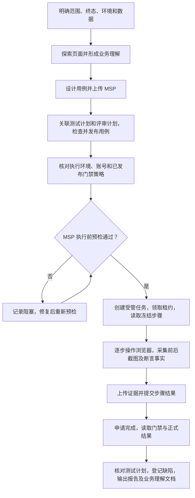

# 米多星球 AI 自动化测试操作指南

适用场景：通过个人 AI Agent（PERSONAL_MCP）连接 MSP 测试平台，使用浏览器自动化测试米多星球“创建订单至已生效”，将执行事实交给 MSP 校验并形成正式结果。

编写日期：2026-10-19。依据本轮页面实测、MSP 测试环境工具清单和当前仓库实现。本文是操作指南，不是完整受管链路已经验收通过的证明。

**当前限制：本轮发现有效用例仍被预检误报 `CASE_STEPS_OR_ASSERTION_MISSING`，尚未完成受管链路验收。遇到该错误必须停在预检阶段。以下任务领取、证据提交和结果门禁流程依据接口契约整理，须在问题修复后实际验证。**

## 一、先理解完整流程

### 1. 谁负责什么

|参与方|职责|
|---|---|
|测试负责人|确认测试范围、账号权限、数据及预期，审阅用例，处理阻塞与风险|
|AI Agent|探索流程、编写用例、调用 MSP、驱动浏览器、采集真实证据、生成报告|
|MSP|管理项目/用例/计划，执行预检，冻结执行依据，接收事实、校验证据并记录正式结果|
|米多星球|被测业务系统；订单创建和审批实际发生在这里|

本文描述个人 Agent 执行方式。平台定时调度和平台 Runner 的配置流程不在本文范围内。

### 2. 测试流程



三条边界必须明确：

1. **探索不等于正式执行。** 探索用于理解页面、设计用例，其截图不能冒充后续任务的执行证据。
2. **预检是正式执行的前提。** 没有通过预检、没有任务及有效租约，不进入本文的正式业务执行步骤。
3. **附件上传不等于结果通过。** 用例详情附件、评论属于补充资料；正式结果需要受管任务的步骤和门禁校验。

### 3. 被测业务流程

登录 → 创建订单 → 选择客户 → 选择商品 → 填写签约日期、销售凭证 → 提交订单 → 签约审批中 → 同意签约审批 → 待支付 → 填写回款并上传支付凭证 → 支付审批中 → 同意回款审批 → **已生效**。

本轮已观察到上述全款路径；“已生效”不等于交付完成或开票完成。分期、拒绝、撤回等路径需要另外设计用例。

## 二、准备工作

### 步骤 1：填写本轮执行信息

|项目|填写要求|
|---|---|
|MSP 地址|`https://msp.ebcone.net`，MCP 端点为 `/api/mcp`|
|米多星球地址|`https://admin.t.ebcone.cn/login`|
|业务终态|订单已生效，并核对列表和详情一致|
|账号|由负责人提供测试手机号及测试验证码；不要写入可分发指南、报告或代码库|
|权限|MSP 资产、执行及证据权限；米多星球下单、签约审批和回款审批权限|
|数据|测试客户、商品、数量、付款方式、日期、测试凭证、测试收付款账户|
|副作用范围|允许新增测试订单和进行测试审批；不得真实转账；测试备注须可识别|
|追踪标识|使用本轮日期/批次作为项目、计划、任务、文件和备注标识|

保管好 Agent Token、登录凭据、租约令牌和上传令牌；报告只保存可用于追踪的资源 ID，不保存这些秘密。

### 步骤 2：连接 MSP，验证连接目标

1. 在浏览器登录 MSP 测试平台。
2. 使用已有有效 Agent Token；没有时，在平台提供的 Agent Token 管理入口创建，并配置本轮所需项目和权限。入口名称以部署版本为准。
3. 将 Agent 的 MCP 服务地址设为 `https://msp.ebcone.net/api/mcp`。
4. 读取工具清单、项目列表，核对连接目标和可见项目。**不能因为连接器名称相同就默认它连接测试环境；本轮已有连接器曾指向 `.cn`，而目标是 `.net`。**
5. 先验证读取成功，再创建资产；鉴权失败时修复 Token 或项目权限，不切换到生产环境试写。

完成标志：Agent 能读取目标测试平台的项目和工具清单。

### 步骤 3：准备浏览器与证据目录

1. 准备可用的浏览器自动化工具，例如 Playwright，以及独立测试浏览器会话。
2. 建立本轮目录，例如 `output/playwright/msp-order-YYYYMMDD/`。
3. 建立执行记录表，至少包括：用例 ID、任务 ID、执行 ID、步骤 ID、操作、预期、实际值、结果、时间、截图/附件 ID、错误及 traceId。
4. 准备标注 `TEST ONLY` 的测试凭证图片。业务上传凭证与测试截图用途不同，不能用凭证图片代替操作证据。
5. 截图前设置手机号、账号等敏感信息遮罩，关键业务状态须保持可辨认。

## 三、探索流程、设计用例并入库

### 步骤 4：进行流程探索

1. 登录米多星球，找到订单列表和创建入口。
2. 识别客户选择、商品选择、销售凭证、签约审批、支付、回款审批页面。
3. 记录必填项、按钮启用条件、状态变化和角色要求。
4. 能通过阅读和不提交的操作确认时，不重复创建订单。必须提交才能确认的动作，要在授权范围内进行并标为探索数据。
5. 输出业务理解草稿，将“实测事实”“推断”“待确认”分开。

探索记录不计入正式受管执行通过率。已有流程资料可复用，但需核对当前页面变化。

### 步骤 5：编写可执行用例

每条至少包含：标题、优先级、前置条件、数据、按顺序列出的动作和逐步预期。预期应能比较，不要只写“正常”“成功”。

建议覆盖：完整订单路径、未选客户、无匹配客户、未选商品、数量与金额、缺销售附件、缺支付凭证、取消确认、金额输入状态、附件预览、取消创建。

例：

|步骤|操作|预期|
|---|---|---|
|1|选择指定客户和商品，数量为 1|客户、商品正确，金额与所选商品一致|
|2|填写签约日期并上传测试销售凭证，提交|生成本轮订单，状态为签约审批中|
|3|在该订单的签约审批中同意|该订单变为待支付|
|4|填写全款回款信息、上传凭证并确认提交|该订单变为支付审批中|
|5|同意该订单回款审批|该订单已生效，已收等于应收、未收为 0|

实际执行时应按冻结步骤粒度取证；如需细分步骤，正式执行前修改并重新发布用例，而不是执行后补造步骤。

可用 `generate-test-cases-skill` 生成 Excel，按平台导入模板核对字段。不可将 Excel 的“通过”文本当作平台实际执行结果。

### 步骤 6：创建资产、关联并发布

1. 创建或选择本轮项目，记录 projectId。
2. 创建测试计划，填写范围、负责人和计划目标，记录 testPlanId。
3. 创建评审计划，关联同一批用例，指定评审人。
4. 导入 Excel 或通过 MCP 创建用例。
5. 回读用例详情，检查数量、步骤、预期和字符内容；关联测试计划和评审计划。
6. 按团队流程处理评审意见；关联评审计划不能记作“评审已完成”。
7. 发布将用于受管执行的用例版本，记录版本 ID；修改用例后重新发布并重新预检。

完成标志：平台可读到本轮用例及步骤，计划关联数量正确，有可供执行的已发布版本。

## 四、先通过预检，再执行

### 步骤 7：核对环境和门禁

1. 在项目执行配置中选择米多星球测试环境档案，核对 baseUrl、允许访问的域名、环境已启用。
2. 浏览器执行能力应包含 `WEB_UI` 和 `SCREENSHOT`；按任务方式核对 Runner 或个人 Agent 条件。
3. 如使用凭据引用，确认其环境、角色、有效期和权限匹配。
4. 查看已发布的质量策略。已验证的管理页面路由为 `/#/setting/system/quality-policy`。
5. 记录当前策略版本和要求。2026-10-19 发布的 V1 要求每步前后截图、PNG/JPEG、单张不超过 5 MB，断言预期来自冻结用例，允许 EQUALS/IN_RANGE。以后运行必须重新读取，不能假设策略未变。
6. 没有策略或需要更改时，由有权限的负责人处理；全局策略影响其他项目，不应为单次测试擅自降低要求。

### 步骤 8：调用执行前预检

个人 Agent 调用 `metersphere.execution.preflight`。以下是参数形状示例，尖括号必须替换为本轮真实值，具体字段以当前工具 schema 为准：

```json
{
  "projectId": "<项目ID>",
  "testPlanId": "<计划ID>",
  "caseIds": ["<用例ID>"],
  "environmentProfileId": "<环境档案ID>",
  "runnerType": "BROWSER",
  "requiredCapabilities": ["WEB_UI", "SCREENSHOT"],
  "requestId": "<本次请求唯一ID>"
}
```

逐项阅读响应，不以 HTTP 成功代表预检通过。检查范围、环境、凭据、执行能力、风险策略、用例可执行性和发布资产等；只有响应明确通过，才能使用返回的 preflightId 创建任务。

用例可执行性会检查已发布版本、内容、启用环境以及已配置的角色/页面对象/数据集/业务流依赖。它不是截图校验。

**失败处理：** 保存错误码、缺失项、traceId 和预检 ID，标记阻塞并修复前置条件；不要改用直接结果回写，也不要继续在外部浏览器执行后声称受管执行通过。当前已知的步骤读取误判需先修复。过期、已消费或条件发生变化的预检应重新申请。

### 步骤 9：创建并领取执行任务

1. 调用 `metersphere.execution.create`，传入 projectId 和通过的 preflightId，以及当前接口允许的任务信息。
2. 确认创建成功并记录任务 ID，不用猜测或伪造 ID。
3. 调用 `metersphere.task.claim` 领取本轮个人任务；检查返回任务属于本轮项目、计划和范围。
4. 保存服务端返回的执行 ID、租约 ID、租约令牌，读取冻结用例、步骤 ID、预期和策略。
5. 按接口要求调用 `metersphere.task.lease.heartbeat` 续租。租约丢失或过期时停止提交并按平台恢复机制处理。

完成标志：拥有正确任务及有效租约，能明确列出本轮要执行的冻结步骤。此时才开始下面的正式业务操作。

## 五、米多星球订单的具体执行步骤

以下为本轮观察到的全款系统商品路径；具体菜单名、商品价格和字段以当前页面及冻结用例为准。不得复用旧订单伪装为本轮新增订单。

### 步骤 10：登录并创建订单

1. 打开米多星球测试登录页，选择手机号登录，输入负责人提供的测试手机号和验证码。
2. 确认进入正确环境和账号，打开订单列表，再打开创建订单入口。
3. 按用例选择订单类型/商品入口，用客户编号查询并选择测试客户；核对名称后进入下一步。
4. 添加指定商品，核对编码、名称、数量、单价、总金额和付款方式。
5. 本轮参考数据为客户 `MDC2026085213`、商品 `RJ015`、数量 1、全款 29800；这些是历史实测数据，正式运行前必须检查仍可用且与用例一致，不应硬编码为所有订单规则。
6. 填写签约日期，上传测试销售凭证，备注本轮测试批次及“仅测试环境，无真实交易”。
7. 提交订单，记录新订单号，确认状态为“签约审批中”。

### 步骤 11：完成签约审批

1. 用本轮订单号定位签约审批记录，核对客户和金额。
2. 具有审批权限的账号执行同意，记录操作事实。
3. 返回该订单列表/详情确认状态变为“待支付”。若无审批权限，标记阻塞并交接授权人员，不修改权限绕过。

### 步骤 12：提交支付信息

1. 打开该订单支付/回款操作，上传测试支付凭证。
2. 按用例填写收款账户、本次回款金额、付款账号和付款日期，核对与本轮订单一致。
3. 如用例包含取消确认测试，先取消确认并检查数据是否保留，再按冻结步骤重新提交。
4. 确认提交后，核对订单状态为“支付审批中”。本操作是测试系统记账，不进行真实银行转账。

### 步骤 13：完成回款审批并核对终态

1. 找到本轮订单的回款审批，核对金额及凭证。
2. 如果用例要求预览凭证，实际打开预览并检查图片是否呈现；预览失败应记录失败，不能因为后续审批成功而覆盖。
3. 执行审批同意，返回订单列表及详情分别确认“已生效”。
4. 对本例全款路径核对应收、已收、未收和回款比例；保存能识别订单号与状态的证据。
5. 停在约定终态，不自动继续交付、开票或清理数据。

异常、必填和取消类用例按各自独立步骤执行。共享订单或连续步骤必须记录依赖；上游失败导致下游无法执行时，下游应标记阻塞，不能假定成功。

## 六、每一步如何取证和提交

### 步骤 14：执行一条冻结步骤

每一步按以下顺序进行，不能等全流程结束后凭记忆补写：

1. 读取该步骤的冻结操作及预期，记下 stepId 和开始时间。
2. 采集操作前截图，对应 `BEFORE_ACTION`。
3. 执行真实页面操作，不修改页面状态伪造成功，不用测试脚本“预期值”冒充读取到的实际值。
4. 等待明确业务状态，读取实际页面文本、金额、属性或结果。
5. 采集操作后截图，对应 `AFTER_ACTION`。
6. 使用冻结预期做断言，记录实际值和比较结论。失败时保留原始错误及证据。
7. 通过受管证据接口上传截图，取得有效 artifactId，再提交该步骤的事实。

截图文件名建议为 `任务ID_用例ID_步骤ID_before.png` / `after.png`。文件名只是便于查找，不能代替服务端要求的步骤绑定、用途和角色字段。

### 步骤 15：上传证据并提交步骤

|顺序|工具|操作要求|
|---|---|---|
|1|`metersphere.artifact.prepare`|带任务、执行、租约信息，按 schema 填用途、文件名、MIME、实际字节数、SHA-256 等|
|2|按 prepare 返回的上传方式传文件|使用返回的地址/令牌和请求要求，不自行猜测上传端点|
|3|`metersphere.artifact.commit`|确认上传，检查服务端验证结果；仅 prepare 成功不表示上传完成|
|4|`metersphere.execution.step.submit`|提交真实 stepId、状态、输入摘要、输出事实、断言结果、artifactIds 和时间等|

`assertionResult` 等字段的内部结构、角色绑定方式和状态枚举，必须读取当前工具 schema/冻结合同或官方接口定义，不能只根据字段名拼字符串。requestId 应能支持同一逻辑提交的幂等重试；不因网络超时重复执行已提交订单或审批。

每次检查业务响应是否接受并保存回执。上传失败、步骤拒绝或租约失效时先处理问题；不能忽略错误继续宣布成功。普通“用例详情附件上传”不能替代这条链路。

### 步骤 16：申请完成并回读结果

1. 检查所有应执行步骤已有实际处置和证据，无遗漏。
2. 调用 `metersphere.execution.complete`，使用当前有效租约；不要从客户端自行决定平台最终通过。
3. 使用 `metersphere.execution.get` 查询任务详情，使用 `metersphere.artifact.list` 核对证据元数据，检查门禁、步骤及最终状态。
4. 回读测试计划中的关联用例结果，确认与任务结果一致；若没有更新，记录链路问题。
5. 通过必须同时满足业务断言和平台证据规则。失败、阻塞、跳过、未执行分别统计。

## 七、如何专门验证质量门禁

先使所有场景都通过相同有效用例的准入检查，再分别创建独立执行场景。每次只改变一个因素，避免无法解释拒绝原因。

|场景|输入差异|应验证的现象|
|---|---|---|
|完整正向对照|步骤、前后截图、断言完整且业务符合预期|能够完成并形成正确正式结果|
|仅缺截图|保留有效步骤事实和断言，只缺必需截图|对应证据规则拒绝，不能形成正式通过|
|仅缺步骤事实|证据已上传，但不提交必需步骤事实就请求完成|对应完整性规则拒绝，不能形成正式通过|
|仅缺断言|截图和操作事实完整，只缺必需断言|对应断言规则拒绝，不能形成正式通过|
|断言不匹配|证据和断言结构完整，实际值与冻结预期不同|不得通过；保存失败或拒绝结果及规则原因|
|旧直接结果入口|调用已禁止的直接回写入口|拒绝旧入口；本项只证明防绕过，不证明上述证据规则|

具体在哪一次调用拒绝，以服务端规则为准；验收要记录触发接口、规则/错误码、响应和计划结果。只有完整正向能放行、各负向因对应原因不通过，才能对这些规则给出验收结论。

如果所有场景都卡在预检，结论只能是“准入阻塞，结果门禁未验证”。切勿写为“缺截图/步骤已被门禁正确拦截”。

## 八、收尾、交接和问题处理

### 步骤 17：输出交付物

每轮至少保存：需求与范围、用例 Excel/平台 ID 映射、环境及策略版本、预检回执、任务/执行/步骤 ID、逐项结果、截图及证据索引、缺陷、测试报告、**业务理解认知文档**。

业务理解文档应包含状态链、角色、数据、已验证业务规则、未知边界和与上轮变化，并将事实与推断分开。测试报告分别统计正式受管结果和外部探索观察，不能混算。

平台查看顺序：选择本轮项目 → 测试计划及关联用例 → 执行任务详情（通过任务 ID 查询）→ 步骤/证据/门禁结果；补充资料在用例详情附件/评论中，缺陷在缺陷管理中。页面入口名称若与当前版本不一致，使用已验证的查询工具定位，不能把找不到页面当作数据已保存。

### 常见问题处理

|问题|处理|
|---|---|
|有步骤却报缺步骤|保存用例详情、版本及预检错误，登记阻塞；检查内容读取链路，不能删掉准入规则继续执行|
|无权访问门禁页面|确认角色与接口权限；交由管理员处理，不更换身份绕过|
|业务已操作但任务不存在|归档为外部观察，不计受管通过；修复流程后在新任务下重新执行|
|截图上传成功但步骤拒绝|检查租约、任务/步骤关联、证据角色、大小及断言结构；以拒绝原因定位|
|审批或提交超时|先按订单号回读状态，再决定恢复；不得盲目重复点击|
|证据缺失|如实记录失败/阻塞；不得从旧轮次拷贝截图补装本次证据|

### 可直接交给 AI Agent 的任务说明

> 在 MSP 测试环境 https://msp.ebcone.net 中，为本轮米多星球订单测试建立或使用指定项目、测试计划和评审计划。米多星球地址为 https://admin.t.ebcone.cn/login，账号由负责人安全提供。先探索并编写可验证的用例，回读导入内容、关联和发布版本。核对环境与已发布门禁策略，调用执行前预检；失败时记录阻塞并停止正式执行，不改用独立浏览器执行后直接回写。只有任务创建成功、取得有效租约并读取冻结步骤后，才按步骤进行订单操作，目标为已生效。每步记录操作前后截图、真实事实和冻结预期断言，经受管证据接口及步骤接口提交，再申请完成并回读任务和计划。输出测试报告、证据索引、缺陷和业务理解认知文档。所有真实资金操作均不在授权范围内；需要改变全局策略时先明确影响并取得授权。

## 九、依据与本指南验证范围

- [2026-10-19 复测报告](../../output/playwright/msp-order-20261019/report.md)
- [本轮业务理解](../../output/playwright/msp-order-20261019/business-understanding.md)
- [用例可执行性检查实现](../../backend/services/agent-integration/src/main/java/io/metersphere/agent/service/AgentCaseExecutabilityService.java)
- [执行前预检实现](../../backend/services/agent-integration/src/main/java/io/metersphere/agent/service/AgentExecutionPreflightService.java)
- [用例快照与可执行性预检设计](../task/ai_webui_execution_20260806/task004-P0-用例快照步骤标准化与可执行性预检.md)

本次仅新增操作文档，未修改前后端代码或平台数据；核对了现有实测记录、代码及工具参数。未重新执行订单、未重新验收受管链路，也未运行单元测试、构建或容器检查。文档整理完成；平台完整受管验收仍须解除已知阻塞后进行。
