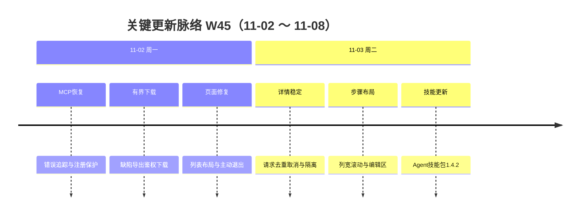

# 周报 2026-W45（2026-11-02 ～ 2026-11-08）

> **总计 2 次提交 | 41 个文件变更（已入库） | +2,082 行 / -136 行 | 净增 1,946 行 | 0 个编号 PR 合并**
>
> **贡献者**：chenqifen-miduo（2 次提交）
>
> **整体状态：部分完成** — 本周重点从大范围平台整改转向 MCP 可靠性和用例页面体验收口。MCP 错误恢复、追踪、注册保护和缺陷导出下载进入实现；用例详情请求生命周期、步骤布局、列表滚动及主动退出得到修复。前端生产构建和多组组件级测试通过，但新增下载类、真实登录态 E2E、正式镜像及全栈健康检查仍缺完整证据。

**本周趋势**：提交量较上周显著回落，工作集中在两条精细化主线：一是增强 Agent/MCP 在错误、重试、追踪和文件下载方面的可恢复性；二是解决测试用例详情瞬时报错、缩放布局、列表滚动和退出登录等用户可见问题。工作区已清理，无未提交改动，但部分已提交功能仍受内存、登录环境和镜像网络限制，不能整体标记完成。

> **统计口径**：统计当前分支 `codex/weekly-remediation-20261028` 在 2026-11-02 00:00 至 2026-11-09 00:00 的 Git 历史。去重变更使用首个提交 `89ef9d8931` 的父提交至最新提交 `da6a493070` 的单次差分。两次内部合并不是 `Merge pull request #...` 形式，故编号 PR 数为 0。

---

## 关键更新脉络

---

## 一、本周完成情况（按验收证据分级）

### 1. MCP 错误恢复与追踪能力增强

> **价值**：当 Agent 请求失败或结果不确定时，能够获得安全、可追踪、可判断下一步的错误，而不是盲目重试或重复写入。

- 补充安全恢复元数据和错误细节结构。
- 请求链优先沿用 MDC 中的 `traceId`，无请求上下文时生成 UUID。
- 限流错误返回稳定业务码和保守等待建议，不承诺未知异常可自动重试。
- 强化临时附件、流式 MCP、错误映射和工具处理链。
- 第一批生产类定向编译、测试编译及 13 项 JUnit 测试通过。
- **状态**：⚠️ 部分完成。新增 RPC 入口、真实数据库、容器和部署后错误恢复仍未完成全链路验收。

### 2. 缺陷导出有界下载能力

> **价值**：Agent 可以在权限控制下下载缺陷导出文件，同时避免大文件一次性进入内存造成服务不稳定。

- 新增 `AgentBugExportDownloadService` 和 `AgentBugExportDownloadTool`。
- 下载前复用临时附件权限、TTL 和资源归属校验。
- 以 8 KiB 缓冲扫描完整文件并计算摘要，每次响应最多返回 64 KiB，沿用 5 MiB 文件上限。
- 设计上保持内存有界；当前分块重复扫描，I/O 会随块数增加，尚未完成性能验收。
- 新增聚焦测试代码，但第二轮主编译因空闲内存低于 300 MiB 被保护机制主动终止。
- **状态**：⚠️ 实现已提交、验证未完成。不得将新增下载类描述为已经编译、上线或可稳定使用。

### 3. MCP 工具注册与 Schema 保护

- 工具重名或别名冲突时直接失败，避免静默覆盖正式工具。
- 强化工具注册表、Handler、Streamable Service 和默认 Schema 处理。
- 增加注册冲突、错误映射和 Bundle 服务相关测试。
- **状态**：⚠️ 第一批定向测试通过；全部工具的公开 Schema、运行校验和客户端兼容矩阵仍待完成。

### 4. 测试用例详情加载稳定性改造

> **价值**：用户点击用例详情时不再因重复请求、取消请求或旧响应覆盖而短暂显示错误或错误内容。

- 新增 `latestDetail.ts` 统一协调详情请求状态。
- 同一 ID 的在途请求复用；切换 ID 时取消旧请求。
- 通过请求序号忽略旧请求的成功或失败，关闭详情时使当前请求失效。
- 详情容器成为唯一加载入口，上一条/下一条组件只负责导航。
- HTTP 层保留取消标记，不把主动取消转换为普通请求失败。
- 新增 5 项加载器测试，覆盖同 ID 去重、旧成功/失败忽略、取消、真实失败重试、关闭和空 ID，全部通过。
- 真实 Vue 组件夹具验证请求序列 `A,B,B`，页面无错误提示。
- **状态**：⚠️ 组件级完成；真实业务接口只请求一次、评论去重和生产路由 E2E 尚未验收。

### 5. 用例步骤布局与编辑体验修复

- 步骤和预期结果列最小宽度调整为 280px，实际结果调整为 220px。
- 根据启用列累计表格总宽度，使用局部横向滚动，避免强行压缩成逐字竖排。
- 输入框及包装层填满内容区域，长文本和 URL 保留正常换行。
- 前置条件编辑操作改为正常文档流 flex 行，不再通过绝对定位覆盖正文。
- 组件测量在 1100、900、720px 容器中均保持约 1,330px 表格宽度和可用文本列。
- **状态**：⚠️ 第一阶段组件测量通过；真实 100%/110%/125% 缩放矩阵、长文本、锁状态和执行编辑仍待验证。

### 6. 用例列表与详情页面简化

- 取消用例列表固定纵向滚动高度，改为页面滚动，保留横向滚动和分页。
- 删除用例详情额外概览侧栏及占位样式，保持单栏展示，不删除后端业务数据。
- 调整详情抽屉、上一条/下一条、步骤组件及列表页面配合逻辑。
- 前端类型检查和 Vite 生产构建通过。
- **状态**：⚠️ 已实现待真实视觉验收。1366×768、1440×900、10行一屏和真实权限数据未完成验证。

### 7. 主动退出与 SSO 行为修复

> **价值**：用户主动退出后不会被自动 SSO 立即重新登录，退出意图得到尊重，同时保留明确的重新登录入口。

- 个人菜单主动退出后，在当前标签页记录 `msp_explicit_logout`。
- 刷新仍停留退出页，用户点击重新登录后才重新进入 SSO 流程。
- 服务端退出失败时清理本地凭据并显示“服务端退出未确认”，不冒充完全退出成功。
- 被动过期继续使用原重认证行为，不写入主动退出标记。
- 新增 3 项流程测试，覆盖正常主动退出、服务端失败和被动过期，全部通过。
- 退出页刷新及重新登录失败分支浏览器验证通过。
- **状态**：⚠️ 部分完成。真实菜单退出、服务端会话失效及 SSO 成功回跳未验证。

### 8. Agent 技能包升级至 1.4.2

- 新增归档产物 `docs/artifacts/metersphere-agent-skill-1.4.2.zip`。
- 同步本轮 MCP 恢复、追踪和执行指导，使 Agent 更容易选择正确路径并避免无依据重试。
- **状态**：⚠️ 包已生成并提交；真实安装、旧版本升级和客户端业务回放未形成验收证据。

### 9. 前端构建与组件级验证

- `npm run test:detail-loading`：5/5 通过。
- `node --test scripts/test-latest-detail.mjs scripts/test-explicit-logout.mjs`：8/8 通过。
- `npm run test:case-layout-edit`：5/5 通过。
- `npm run test:layout-overflow`：通过。
- `npm run test:api-contracts`：通过。
- `npm run test:weekly-remediation-sfc`：13个 SFC 语法/模板检查通过。
- `npx prettier --check`：通过。
- `npm run build`：类型检查和 Vite 生产构建通过；最终 CSS 补充后再次执行 Vite 构建和 manifest 生成成功。
- **状态**：✅ 当前前端变更的构建和组件级验证通过；这不等同真实登录态业务 E2E 通过。

### 10. 容器与集成验证仍有缺口

- 正式基础镜像 `nginx:1.24.0` 拉取时 Docker Hub 授权端点连接超时，正式镜像未构建成功。
- 使用本地缓存 `nginx:alpine` 临时替换基础镜像完成替代验证：镜像构建、容器启动、首页 HTTP 200 和挂载节点检查通过，日志无启动异常。
- 替代验证未修改仓库 Dockerfile，验证后已移除容器。
- `LoginControllerTests` 因 Java/Testcontainers 未检测到 Docker 而失败。
- **状态**：❌ 正式镜像、后端完整打包、全栈 API、数据库和健康检查未完成；替代镜像不能作为正式验收。

### 11. 上周重点任务推进有限

- ⚠️ MCP 四类缺陷：错误恢复和注册保护推进；创建名称/等级/模板/项目标识等全量闭环证据不足。
- ⚠️ 全量质量门禁：前端通过，新增下载编译和完整后端/容器未通过门槛。
- ❌ 导入真实闭环、资产批量生产验收、117接口正向矩阵和历史正文恢复：无新增完整证据。
- ❌ M1/M2指标对账、小程序规模化验证、M3指标看板和M4智能营销巡检：本周未见新增验收证据。
- ✅ 文档与证据入库：W44周报及本轮方案、实现记录和验证证据已随提交入库。

---

## 二、需求追踪结果

| 需求 | 前端入口/实现 | 后端/API | 数据或配置 | 测试与验收 | 状态 |
|------|---------------|----------|------------|------------|------|
| MCP错误恢复 | MCP客户端错误展示 | SafeErrorMapper、StreamableService、Handler | 沿用限流窗口，无DDL | 第一批13项通过 | 部分完成 |
| 缺陷导出下载 | MCP工具调用 | bug.export.download、临时附件鉴权 | TTL、5MiB限制 | 测试已编写，编译受内存保护终止 | 实现待验证 |
| 工具注册保护 | tools/list及调用入口 | Registry、Bundle、Schema | 无DDL | 注册/Schema定向测试 | 部分完成 |
| 详情加载稳定 | 用例详情抽屉、前后切换 | 原GET详情接口，新增AbortSignal传递 | 无迁移 | 5项加载器及组件夹具通过 | 组件级完成 |
| 步骤布局 | 详情步骤、前置条件编辑 | 复用原保存、锁和权限接口 | 无迁移 | 构建、组件测量通过 | 部分完成 |
| 列表与详情简化 | 用例列表、详情页 | 原分页和详情接口 | 无迁移 | 构建通过，真实多视口未验 | 部分完成 |
| 主动退出 | 个人菜单、退出页、重新登录 | `/signout`及SSO状态/桥接接口 | sessionStorage标记 | 3项流程测试通过 | 部分完成 |
| Agent技能包1.4.2 | 客户端技能安装 | MCP现有能力 | ZIP归档 | 未做真实安装/升级回放 | 待验收 |

### 异常、边界与权限行为

- 主动取消和过期详情请求不显示普通失败；当前真实请求失败必须显示安全提示和重试入口。
- 详情主请求与评论等辅助请求分开处理，辅助失败不得清空已加载正文。
- 下载必须验证 Token、临时附件、资源归属、TTL、范围和响应上限，不得绕过原权限。
- 服务端退出失败只能确认本地凭据已清理，不得向用户宣称服务端会话已成功销毁。
- 未知 MCP 错误不承诺自动重试；返回 `traceId` 供排查，不暴露堆栈、SQL、Token或原始敏感数据。
- 当前没有数据库迁移变更，迁移验证对本周功能不适用。

---

## 三、本周工程数据

### 每日提交分布

| 日期 | 提交数 | 重点方向 |
|------|--------:|----------|
| 11-02（周一） | 1 | MCP恢复、有界下载、用例布局和退出修复 |
| 11-03（周二） | 1 | 详情加载、步骤布局、技能包更新 |
| 11-04～11-08 | 0 | 无新增提交 |
| **合计** | **2** | **可靠性与体验收口** |

### 提交类型分布

| 类型 | 数量 | 占比 |
|------|-----:|-----:|
| feat | 1 | 50% |
| fix | 1 | 50% |
| **合计** | **2** | **100%** |

### 代码变更概览

| 指标 | 数量 |
|------|-----:|
| 去重文件变更 | 41 |
| 新增行数 | 2,082 |
| 删除行数 | 136 |
| 净增行数 | 1,946 |
| 编号PR | 0 |
| 贡献者 | 1 |
| 未提交工作区文件 | 0 |

### 本周提交明细

| 日期 | Commit | 摘要 | 状态备注 |
|------|--------|------|----------|
| 11-02 | `89ef9d8931` | 新增MCP错误恢复和有界导出下载 | 第一批13项通过；下载编译、后端、DB和E2E待补 |
| 11-03 | `da6a493070` | 稳定用例详情与布局，更新Agent技能包 | 前端构建和组件验证通过；真实业务E2E待补 |

---

## 四、与上周 W44 对比

| 指标 | W44 | W45 | 变化 |
|------|----:|----:|------|
| 提交数 | 55 | 2 | -96.4% |
| 编号PR | 0 | 0 | 持平 |
| 文件变更 | 796 | 41 | -94.8% |
| 净增行数 | 142,717 | 1,946 | -98.6% |

> 本周从大规模整改切换到小范围可靠性和体验修复，提交量显著下降。工作区已清洁，但部分已提交代码仍缺编译或真实环境验收，因此“已入库”不能等同“已完成”。

### 上周方向落地情况

| W44建议方向 | W45实际进展 |
|-------------|-------------|
| P0 MCP四类缺陷闭环 | ⚠️ 错误恢复、追踪和注册保护推进；四类业务契约未见完整复验关闭 |
| P0 全量质量门禁 | ⚠️ 前端构建通过；新增下载编译、完整后端、正式镜像及E2E未完成 |
| P0 导入真实闭环 | ❌ 无新增完整证据 |
| P0 资产批量生产验收 | ❌ 无新增完整证据 |
| P1 MCP前置数据矩阵 | ❌ 未补齐117接口正向矩阵 |
| P1 历史正文恢复 | ❌ 无新增存量恢复证据 |
| P1 M1/M2指标对账 | ❌ 无新增100%指标表 |
| P1 小程序规模化验证 | ❌ 无新增覆盖率、成功率和接管率证据 |
| P1 M3指标看板 | ❌ 未见持续统计看板 |
| P2 M4智能营销巡检 | ❌ 未见连续一周巡检记录 |
| P2 文档与证据入库 | ✅ W44周报及本轮方案、实现和验证材料已入库 |

---

## 五、里程碑完成情况

| 里程碑 | 目标日期 | 当前判断 | 本周进展与差距 |
|--------|----------|----------|----------------|
| M1：测试资产统一沉淀、复用与追溯 | 2026-08-30 | ⚠️ 部分完成，已逾期 | 本周未新增资产治理验收；归档率、关联准确率、检索时效、迁移一致性及越权为0仍缺完整对账 |
| M2：测试任务、执行、缺陷和改进闭环 | 2026-09-20 | ⚠️ 部分完成，已逾期 | 新增缺陷导出下载能力，但编译和真实下载未验；责任人、证据、缺陷关联、遗漏分析及回归补充的100%指标仍未证明 |
| M3：Agent辅助个人测试任务执行 | 2026-11-30 | 🟢 阶段里程碑完成 / 总目标建设中 | MCP错误恢复、追踪和技能包继续增强；智能营销85%、防窜物流55%、月度项目60%人机协同及小程序规模化指标无新增证据 |
| M4：AI定时巡检与主动质量预警 | 2027-02-20 | 🟡 前期能力建设 | 可恢复错误和追踪可作为巡检基础；智能营销定时巡检稳定运行一周仍无证据 |

---

## 六、验证情况

### 已执行并通过

| 验证命令/范围 | 结果 |
|---------------|------|
| MCP第一批定向检查 | 生产类定向编译、测试编译、13项JUnit通过 |
| `npm run test:detail-loading` | 5/5通过 |
| `node --test scripts/test-latest-detail.mjs scripts/test-explicit-logout.mjs` | 8/8通过 |
| `npm run test:case-layout-edit` | 5/5通过 |
| `npm run test:layout-overflow` | 通过 |
| `npm run test:api-contracts` | 通过 |
| `npm run test:weekly-remediation-sfc` | 13个SFC语法/模板检查通过 |
| `npx prettier --check` | 通过 |
| `npm run build` | vue-tsc及Vite生产构建通过 |
| 最终CSS补验 | Vite重建成功，6,717模块，约3分56秒；manifest生成完成 |
| 替代基础镜像验证 | 缓存nginx:alpine构建/启动成功，首页HTTP200；非正式验收 |
| `git diff --check` | 通过 |

### 未执行、失败或阻塞

| 验证项 | 原因 | 剩余风险 |
|--------|------|----------|
| 缺陷下载新增类编译和测试 | 空闲内存低于300MiB，资源保护终止 | 可能存在编译或运行错误 |
| 完整后端构建与单元/集成测试 | 未执行 | 跨模块兼容性未知 |
| `LoginControllerTests` | Java/Testcontainers未检测到Docker | 真实数据库登录集成未知 |
| 正式前端镜像 | Docker Hub授权端点连接超时 | 指定nginx:1.24.0镜像未验证 |
| 后端新镜像与全栈健康 | 未执行 | API、数据库和中间件集成未知 |
| 真实用例详情E2E | 本地账号/权限状态阻塞 | 请求次数、评论去重和真实页面高度未知 |
| 多视口视觉矩阵 | 未执行完整1366/1440及100%/110%/125%组合 | 布局仍可能在真实数据下异常 |
| 真实退出与SSO成功回跳 | 缺少可用本地SSO环境 | 服务端会话和回跳行为未知 |
| Agent技能包安装/升级 | 未执行 | 客户端兼容和指导有效性未知 |

---

## 七、下周优先级建议

| 优先级 | 方向 | 建议动作 |
|--------|------|----------|
| P0 | 缺陷导出下载验证 | 在资源充足环境完成编译、单测、权限、分块、摘要、过期和真实下载验收 |
| P0 | 真实详情E2E | 使用有效隔离账号验证单次详情请求、快速切换、评论去重、真实4xx/5xx和重试 |
| P0 | 正式镜像与全栈健康 | 恢复基础镜像访问，完成正式镜像、后端打包、容器启动、API和健康检查 |
| P0 | MCP四类缺陷复验 | 重跑名称、等级、模板、项目标识及幂等/权限负向矩阵 |
| P1 | 真实布局矩阵 | 完成1366×768、1440×900和100%/110%/125%视觉与交互验收 |
| P1 | 退出与SSO闭环 | 验证菜单退出、服务端会话、刷新/后退、重新登录成功及失败恢复 |
| P1 | Agent技能包回放 | 在新旧客户端安装1.4.2并执行代表性任务、错误恢复和文件下载 |
| P1 | W44遗留生产验收 | 补齐导入、资产批量、117接口前置数据和历史正文恢复 |
| P1 | 小程序与M3指标 | 启动代表性用例及智能营销/防窜物流/米多星球/IMP量化看板 |
| P2 | M4巡检试点 | 启动智能营销最小巡检集，连续运行一周并验证告警、复验和恢复通知 |

---

## 八、修改文件与前后端对应关系

### 修改范围

- 已入库41个文件：后端Agent集成14个、前端业务与测试约15个、方案/证据/技能包及周报12个。
- 当前工作区干净，无已修改、已暂存或未跟踪文件。
- 本次周报新增：`docs/weekly_report/report.2026-W45.md`。

### 前后端对应关系

| 用户能力 | 前端/客户端 | 后端/API | 数据/配置 | 当前结论 |
|----------|-------------|----------|-----------|----------|
| MCP错误恢复 | RPC error details与traceId | SafeErrorMapper、Streamable、Handler | 限流窗口，无DDL | 部分完成 |
| 缺陷导出下载 | MCP `bug.export.download` | DownloadService、临时附件鉴权 | TTL、5MiB、64KiB块 | 实现待验证 |
| 详情稳定加载 | 详情抽屉、前后导航、重试 | 原详情GET，AbortSignal传递 | 无迁移 | 组件级完成 |
| 步骤与列表布局 | 列表、详情、步骤、前置条件 | 复用原查询/保存/权限 | 无迁移 | 实现待真实验收 |
| 主动退出 | 菜单、退出页、重新登录 | signout、SSO状态与桥接 | sessionStorage标记 | 部分完成 |
| Agent技能包 | 技能包1.4.2 | 现有MCP工具 | ZIP归档 | 待客户端回放 |

---

## 九、已知风险和遗留问题

1. 缺陷导出新增类未获得编译通过证据，属于已提交但未验证实现。
2. 真实详情路由、评论请求和多视口视觉矩阵未验收，组件测试不能替代业务E2E。
3. 正式基础镜像、后端完整包和全栈健康检查缺失。
4. 替代 `nginx:alpine` 只证明静态容器可启动，不能证明正式镜像或API链路。
5. 登录集成测试失败，真实退出及SSO回跳仍有环境差异风险。
6. MCP四类业务契约、117接口正向矩阵和历史正文恢复未在本周关闭。
7. M1、M2持续逾期，关键100%指标无新增对账。
8. M3总体覆盖率、小程序执行质量及月度60%人机协同无新增量化数据。
9. M4智能营销巡检仍未进入连续运行验收。

---

## 十、功能状态结论

**本周功能状态：部分完成。**

可以确认完成的是当前前端变更的类型检查、生产构建和组件级测试，以及 MCP 第一批错误恢复/注册保护的13项定向验证。详情加载协调、步骤布局、列表滚动和主动退出已形成真实代码实现。

缺陷导出下载尚未取得编译通过证据；真实登录态详情、退出、正式镜像、完整后端和全栈健康均未通过验收。因此不得表述为“所有修复已完成”“MCP下载可以正常运行”或“页面问题已全面解决”。

---

## 附录：Pull Requests 与内部合并

- 本周没有 `Merge pull request #...` 形式的编号PR。
- 11月2日内部合并：MCP恢复、下载及UI修复进入 `chenqifen` 和 `main`。
- 11月3日内部合并：用例详情、布局和Agent技能包进入 `chenqifen` 和 `main`。
- 最近历史编号PR仍为 #126，本周没有新增 #127 及以后编号PR。
