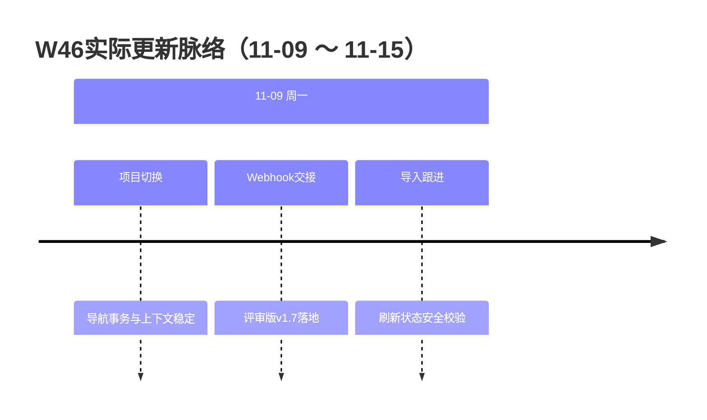

# 周报 2026-W46（2026-11-09 ～ 2026-11-15）

> **W46实际活动：当前分支0次提交 | 0个文件变更 | +0行 / -0行 | 3个编号PR合并（#155～#157）**
>
> **历史补录：PR #127～#157中可见26个PR | 净影响1,717个文件 | +239,273行 / -5,575行**
>
> **贡献者**：当前分支无W46普通提交；本期PR均来自此前及本周 `chenqifen-miduo/main` 合并
>
> **整体状态：部分完成** — W46实际新增集中在项目切换导航、Webhook交接和导入跟进状态修复；当前工作分支没有普通提交。由于W45报告最后记录PR为#126，而Git全历史现已出现至#157，本报告同时补录26个可见PR，并将跨周补录与W46实际活动严格分开。

**本周趋势**：本周实际研发活动较少，重点是三个已评审能力的主线合并：项目切换事务稳定、Webhook handoff v1.7、导入跟进状态安全刷新。另一方面，PR历史同步后暴露出此前周报未捕获的大量合并记录，本报告以补录方式恢复质量策略、个人Agent、资产工作流、CI整改、计划评审、项目文件等交付的PR追溯关系，不将其冒充W46新增产出。

> **统计口径**：W46提交、文件和行数统计当前分支 `codex/weekly-remediation-20261028` 在2026-11-09 00:00至2026-11-16 00:00的历史，结果为0。PR依据W45报告最后编号#126顺延到当前最大#157；其中#129～#131、#147、#151在本地Git历史中无对应合并记录，实际可见26个PR。#155～#157于W46合并，其余23个为跨周历史补录。补录净变更仅用于说明追溯范围，不参与W46周度代码量和环比。

---

## 关键更新脉络

---

## 一、W46实际完成情况

### 1. 项目切换与导航事务稳定性

> **价值**：用户切换项目时，即使取消、失败或页面状态变化，也不会丢失当前项目上下文或跳转到错误页面。

- 修复计划列表首次进入时的初始化问题。
- 修正项目切换过程中的导航和分页行为。
- 切换取消或失败时保留原项目上下文。
- 在项目切换事务期间隔离导航副作用，避免旧请求或中间状态污染目标页面。
- 深读PR实际提交：
  - `f8e7c4be2c`：初始化计划列表并修复项目导航与分页。
  - `9280132f53`：取消或失败切换时保留项目上下文。
  - `96e64a1955`：在项目切换事务中隔离导航。
- **关联PR**：#155。
- **状态**：⚠️ 实现已合并；本期未在当前分支获得真实多项目、失败回滚和浏览器E2E新证据，仍为部分完成。

### 2. Webhook交接能力v1.7落地

> **价值**：为测试平台与外部系统之间提供正式、可评审的事件交接能力，减少人工同步和不可追踪的临时调用。

- 合并经评审的Webhook handoff v1.7实现。
- 本地深读范围中PR仅包含一条实现提交 `bba35557ac`，未发现可独立核对的详细验证说明。
- **关联PR**：#156。
- **状态**：⚠️ 代码已合并，但当前证据不足以证明前端入口、鉴权、重试、签名、失败回放、数据持久化和真实接收端E2E全部完成。

### 3. 导入跟进状态安全刷新

> **价值**：用例导入后进入计划或评审时，系统依据刷新后的真实状态判断结果，避免旧状态导致重复操作或错误提示。

- 在导入跟进操作后重新读取最新状态。
- 对刷新后的状态进行安全检查，保留既有恢复语义。
- 防止异步状态变化时使用旧结果继续推进。
- 与此前的导入阶段报告、安全恢复和计划/评审关联工作形成连续链路。
- **关联PR**：#157；前置补录PR #154。
- **状态**：⚠️ 修复已合并；真实Excel导入、计划/评审跟进、网络失败与重复重试的完整E2E仍未在本期关闭。

---

## 二、历史PR补录（#127～#154）

### 4. 测试计划与评审关联工作流

> **价值**：用例能够在导入或选择后直接进入测试计划和评审，并清楚展示历史占用与恢复状态。

- 建立测试计划、评审关联及安全恢复机制。
- 增加关联候选交互和历史占用提示。
- 交付经评审的列表关联UX v1.4。
- 导入跟进分阶段报告结果，失败时保留安全恢复状态。
- **关联PR**：#149、#150、#152、#154。
- **补录状态**：⚠️ 已合并历史能力；应按原发生周解释，不计入W46新增。

### 5. 项目原始文件版本化管理

> **价值**：项目原始资料可以按版本保存并精确读回，减少文件被覆盖后无法追溯的问题。

- 新增版本绑定的项目原始文件上传和精确读回。
- 修复可选详情元数据的规范化和复制逻辑。
- 保留文件版本、详情元数据和读取结果的一致性。
- **关联PR**：#152、#153。
- **补录状态**：⚠️ 实现已合并；跨项目权限、并发覆盖、历史版本恢复和大文件验证需以对应交付证据为准。

### 6. 缺陷图片按版本读取

- Agent支持读取与缺陷版本绑定的图片。
- 避免更新缺陷后读取到错误版本或失效附件。
- **关联PR**：#152。
- **补录状态**：⚠️ 代码已合并；完整鉴权、版本边界、文件缺失和客户端回放证据未在本期重新执行。

### 7. MCP与个人Agent核心能力演进

> **价值**：让AI可以从个人任务出发，安全完成用例读取、执行、取证、结果回写、导出和错误恢复。

- 质量门禁、鉴权、幂等、冻结写回和确定性断言。
- 个人Agent任务执行、用例库、步骤结果和附件闭环。
- MCP证据发布、导航安全和结果出口保护。
- 可恢复用例导出、缺陷交付、外部附件和SQL稳定性。
- MCP接口契约、附件访问、导出映射、错误恢复和有界下载。
- 用例详情、布局及Agent技能包更新。
- **关联PR**：#132～#137、#145、#146、#148。
- **补录状态**：⚠️ 核心阶段能力已在此前报告中分级验证；本期不重复声明全面完成。

### 8. 测试资产、导入编排与用例级证据

- 测试资产批量工作流、来源关系、导出和同步补偿。
- 批量表单类型修复、Excel辅助工作表处理和评审上下文捕获。
- 计划概览选择、导入布局和批量编辑整合。
- 用例级图片覆盖多步骤执行并保留完整步骤事实。
- **关联PR**：#138～#142、#144。
- **补录状态**：⚠️ 主体实现已合并；真实导入和资产生产验收仍应保持此前“部分完成”结论。

### 9. CI、权限与平台稳定性集中整改

> **价值**：使构建和测试失败能够反映真实产品问题，而不是被夹具污染、错误断言或环境差异掩盖。

- PR #143实际包含49个提交，不能只按合并标题归类。
- 内容覆盖正文压缩保护、真实权限、角色和文件范围、MySQL夹具隔离、API负向契约、弹窗错误处理、前端类型构建和CI缓存。
- 修复测试污染、无效断言、SQL/MockServer泄漏和下游模块契约。
- 增加Token横向访问、计划上下文、缺陷传播和核心路径验收。
- **关联PR**：#143。
- **补录状态**：⚠️ 原始CI失败集及部分核心路径已取得通过证据；部署、历史数据和完整客户端矩阵不因PR补录自动变为完成。

### 10. 平台级质量策略与统一权限

- 增加版本化质量策略配置和回归覆盖。
- 将质量策略扩展为平台级强制执行。
- 增加系统权限和执行导航收敛，简化资产入口。
- **关联PR**：#127、#128。
- **补录状态**：⚠️ 仅恢复PR追溯关系；本期未重新执行平台级验收。

### 11. PR历史补录与统计治理

- W45报告最后已知编号为#126，本期按技能规则从#127顺延至#157。
- 本地实际存在26个合并PR。
- 缺少合并记录：#129、#130、#131、#147、#151。
- #127～#154实际发生在9月23日至11月6日；#155～#157发生在11月9日。
- 补录范围净影响1,717个文件、+239,273/-5,575行，但不得计入W46单周代码量。
- **状态**：✅ PR追溯口径已恢复；缺号只记录“本地历史中不可见”，不推断其被删除、关闭或未创建。

### 12. W45重点任务推进情况

- ⚠️ MCP四类缺陷复验：本期无完整负向矩阵关闭证据。
- ⚠️ 导入跟进：安全刷新有新修复，完整Excel/计划/评审E2E仍未关闭。
- ❌ 缺陷导出下载完整验证、真实详情E2E、正式镜像与全栈健康：无本期新增证据。
- ❌ 真实布局矩阵、退出与SSO闭环、Agent技能包回放：无本期新增证据。
- ❌ 小程序规模化验证、M3指标看板和M4巡检试点：无本期新增证据。

---

## 三、需求追踪结果

| 需求 | 前端入口/实现 | 后端/API | 数据或配置 | 测试与验收 | 状态 |
|------|---------------|----------|------------|------------|------|
| 项目切换导航 | 计划列表、项目选择、分页与路由 | 复用项目切换及计划查询接口 | 无本期迁移证据 | PR提交已合并；无本期真实E2E | 部分完成 |
| Webhook handoff v1.7 | 未从当前提交信息确认完整入口 | Webhook交接实现 | 配置、签名与持久化需继续核对 | 无本期完整验证记录 | 部分完成 |
| 导入跟进安全刷新 | 导入任务及计划/评审跟进状态 | 跟进状态重新读取和安全校验 | 复用既有阶段和恢复数据 | 无本期完整Excel E2E | 部分完成 |
| 计划/评审关联 | 候选列表、占用提示、关联交互 | 关联及安全恢复服务 | 既有关联和阶段数据 | 历史PR补录，不作本期新增验收 | 历史已合并 |
| 项目原始文件 | 文件上传、版本列表和读回 | 版本化文件接口 | 文件版本及元数据 | 历史PR补录 | 历史已合并/待全验 |
| 缺陷版本图片 | Agent/MCP图片读取 | 版本绑定附件读取 | 文件及缺陷版本关系 | 历史PR补录 | 历史已合并/待全验 |
| 个人Agent与MCP | Token、任务、执行、证据、导出 | MCP工具、质量门禁、幂等及错误恢复 | 迁移、附件和技能包 | 前期多轮验证；本期无重跑 | 阶段完成/总体建设中 |

### 异常、权限与失败行为

- 项目切换取消或失败时必须保留原项目上下文，不能先修改全局状态再尝试回滚。
- 异步导航只允许已确认的新项目状态触发，旧请求和中间状态不得覆盖当前页面。
- 导入跟进必须基于刷新后的服务端状态判断；状态未知时进入可恢复状态，不得固定返回成功。
- Webhook必须继续核对鉴权、签名、幂等、重试、超时、失败记录和敏感信息保护，当前提交标题不足以证明这些链路完整。
- 文件和图片读取必须验证项目、缺陷、版本和附件归属，不得通过可猜ID跨项目读取。
- 未知错误使用安全提示和`traceId`，技术堆栈、SQL、Token及原始敏感数据只进入日志。

---

## 四、本周工程数据

### W46当前分支提交分布

| 日期 | 提交数 | 重点方向 |
|------|--------:|----------|
| 11-09～11-15 | 0 | 当前工作分支无普通提交 |
| **合计** | **0** | **实际交付通过远端PR合并体现** |

### W46编号PR分布

| 日期 | PR数 | PR | 重点方向 |
|------|-----:|----|----------|
| 11-09（周一） | 3 | #155～#157 | 项目切换、Webhook交接、导入跟进刷新 |
| 11-10～11-15 | 0 | — | 无新增编号PR |
| **合计** | **3** | **#155～#157** | **W46实际PR活动** |

### 代码变更概览（W46实际口径）

| 指标 | 数量 |
|------|-----:|
| 当前分支提交 | 0 |
| 当前分支文件变更 | 0 |
| 当前分支新增/删除 | +0 / -0 |
| W46编号PR | 3 |
| 工作区既有未跟踪文件 | 1（`docs/weekly_report/report.2026-W45.md`） |

### 历史补录概览

| 指标 | 数量 |
|------|-----:|
| 编号范围 | #127～#157 |
| 实际可见PR | 26 |
| 缺少本地合并记录 | 5 |
| 补录净影响文件 | 1,717 |
| 补录新增/删除 | +239,273 / -5,575 |

---

## 五、与上周W45对比

| 指标 | W45 | W46实际 | 变化 |
|------|----:|--------:|------|
| 当前分支提交数 | 2 | 0 | -100% |
| 当期已知编号PR | 0 | 3 | +3 |
| 当前分支文件变更 | 41 | 0 | -100% |
| 当前分支净增行数 | 1,946 | 0 | -100% |

> W46代码活动通过远端PR合并体现，而当前工作分支没有同步这些普通提交，因此不能用“当前分支0提交”推断团队无研发工作。历史补录26个PR也不能反向改写为W46新增。

### 上周方向落地情况

| W45建议方向 | W46实际进展 |
|-------------|-------------|
| P0 缺陷导出下载验证 | ❌ 无新增编译、权限、分块和真实下载验收证据 |
| P0 真实详情E2E | ❌ 无新增真实路由和评论去重证据 |
| P0 正式镜像与全栈健康 | ❌ 无新增正式镜像、后端包或健康检查证据 |
| P0 MCP四类缺陷复验 | ❌ 未见完整名称/等级/模板/项目标识矩阵 |
| P1 真实布局矩阵 | ❌ 无新增多视口和缩放矩阵证据 |
| P1 退出与SSO闭环 | ❌ 无新增真实会话和成功回跳证据 |
| P1 Agent技能包回放 | ❌ 无新增安装、升级和业务任务回放证据 |
| P1 W44遗留生产验收 | ⚠️ 导入跟进安全刷新有修复；其余生产验收未关闭 |
| P1 小程序与M3指标 | ❌ 无新增量化数据 |
| P2 M4巡检试点 | ❌ 无连续一周运行证据 |

---

## 六、里程碑完成情况

| 里程碑 | 目标日期 | 当前判断 | 本周进展与差距 |
|--------|----------|----------|----------------|
| M1：测试资产统一沉淀、复用与追溯 | 2026-08-30 | ⚠️ 部分完成，已逾期 | 补录资产和项目文件PR追溯；归档率、关联准确率、检索时效、迁移一致性和越权为0仍无本期对账 |
| M2：测试任务、执行、缺陷和改进闭环 | 2026-09-20 | ⚠️ 部分完成，已逾期 | 计划/评审关联和导入跟进链路继续修复；责任人、证据、缺陷关联、遗漏分析与回归补充100%仍未证明 |
| M3：Agent辅助个人测试任务执行 | 2026-11-30 | 🟢 阶段里程碑完成/总目标建设中 | 补录个人Agent与MCP完整PR链；本期未新增后台覆盖率、小程序成功率或月度60%人机协同证据 |
| M4：AI定时巡检与主动质量预警 | 2027-02-20 | 🟡 前期能力建设 | Webhook交接可作为告警集成基础，但定时巡检、自动复验和连续一周稳定运行仍无证据 |

---

## 七、验证情况

### 本期可确认的验证证据

| 范围 | 结果 |
|------|------|
| PR历史完整性 | #127～#157逐号检查；26个可见、5个无本地合并记录 |
| PR深读 | 对26个可见PR读取实际提交，不使用合并标题代替内容分析 |
| W46实际PR | #155含3条业务修复提交，#156和#157各1条业务提交 |
| 双口径统计 | 当前分支W46为0提交；补录范围净变更单独计算 |

### 未执行或证据不足

| 验证项 | 原因 | 剩余风险 |
|--------|------|----------|
| 项目切换真实E2E | 本期仅分析Git提交和既有证据 | 失败回滚、并发切换和路由状态可能仍有问题 |
| Webhook完整链路 | 提交说明缺少细节，本期未运行 | 鉴权、签名、重试、幂等和接收端兼容未知 |
| 导入跟进真实E2E | 本期未执行Excel导入 | 状态刷新、重复重试和计划/评审恢复未知 |
| 前端/后端全量测试 | 当前分支无W46代码，未重新运行 | 远端合并主线与当前分支可能不同 |
| 数据库迁移 | 本期未验证 | 补录PR中的迁移不能视为本期重新通过 |
| Docker构建、启动与健康 | 本期未执行 | 主线镜像和全栈运行状态未知 |
| 小程序与巡检 | 无本期执行证据 | M3/M4量化目标无法更新 |

---

## 八、下周优先级建议

| 优先级 | 方向 | 建议动作 |
|--------|------|----------|
| P0 | 同步并验证主线 | 将#155～#157对应主线同步到受验分支，运行前后端构建、测试和核心E2E |
| P0 | 项目切换验收 | 覆盖正常、取消、失败、快速连续切换、分页、计划列表和后退导航 |
| P0 | Webhook交接验收 | 补齐入口、签名、权限、幂等、重试、超时、失败记录和真实接收端回放 |
| P0 | 导入跟进闭环 | 用真实Excel验证导入、状态刷新、计划/评审关联、失败恢复和重复请求 |
| P1 | PR缺号核对 | 从代码托管平台核对#129～#131、#147、#151真实状态，不凭本地缺失推断 |
| P1 | W45遗留P0 | 完成缺陷下载、详情E2E、正式镜像和MCP四类缺陷复验 |
| P1 | M1/M2指标对账 | 输出资产、关联、越权、任务、证据、缺陷和回归补充指标 |
| P1 | 小程序与M3指标 | 建立代表性用例、覆盖率、成功率、接管率和人机协同看板 |
| P2 | M4巡检试点 | 将Webhook作为告警出口，启动智能营销最小巡检集并连续运行一周 |
| P2 | 周报PR同步机制 | 每周生成前先更新远端PR历史，避免再次跨多周补录 |

---

## 九、修改文件与前后端对应关系

### 本次周报修改

- 新增：`docs/weekly_report/report.2026-W46.md`。
- 未修改产品代码、数据库迁移、构建配置或测试代码。
- 既有未跟踪文件：`docs/weekly_report/report.2026-W45.md`，本次保留不改。

### W46实际PR前后端对应

| 用户能力 | 前端 | 后端/API | 数据/配置 | 当前结论 |
|----------|------|----------|-----------|----------|
| 项目切换 | 项目选择、计划列表、分页、路由 | 复用项目/计划接口 | 无本期DDL证据 | 已合并待真实E2E |
| Webhook handoff | 需进一步核对配置/管理入口 | Webhook交接实现 | 签名、目标和失败记录需核对 | 已合并待完整验收 |
| 导入跟进刷新 | 导入任务和跟进状态展示 | 刷新后状态安全判断 | 复用已有阶段/恢复数据 | 已合并待真实导入验收 |

---

## 十、已知风险和遗留问题

1. 当前工作分支未同步W46远端PR普通提交，分支状态与合并主线存在差异。
2. #129～#131、#147、#151本地无合并记录，实际平台状态尚未核对。
3. Webhook仅从单条提交标题可见，缺完整需求追踪和验证证据。
4. 项目切换及导入跟进没有本期真实业务E2E。
5. 补录范围跨越9月至11月，不能用其239,273新增行评价W46工作量。
6. W45遗留的下载、详情、镜像、MCP负向矩阵仍未关闭。
7. M1、M2关键100%指标继续缺失。
8. M3覆盖率、小程序规模化和月度人机协同没有新增量化结果。
9. M4智能营销巡检尚无连续运行记录。

---

## 十一、功能状态结论

**本周功能状态：部分完成。**

W46可以确认的是#155～#157已进入远端合并历史，分别覆盖项目切换、Webhook交接和导入跟进安全刷新；同时本报告恢复了#127～#157的PR追溯口径。

由于当前工作分支没有W46普通提交，且本期未重新执行前端构建、后端测试、数据库迁移、正式镜像、健康检查和真实E2E，不得声明三个W46功能已全面完成或可以正常运行全部场景。历史PR补录也只代表追溯关系恢复，不代表本周重新验收通过。

---

## 附录：编号PR明细（#127～#157）

| PR | 合并日期 | 实际内容摘要 | 归属 |
|----|----------|--------------|------|
| #127 | 09-23 | 执行导航、资产入口、版本化质量策略 | 历史补录 |
| #128 | 09-24 | 平台级质量策略和系统权限 | 历史补录 |
| #129～#131 | — | 本地无合并记录 | 缺号待核对 |
| #132 | 10-19 | MCP操作和质量门禁加固 | 历史补录 |
| #133 | 10-20 | 个人Agent执行与用例库 | 历史补录 |
| #134 | 10-20 | 导航和证据发布保护 | 历史补录 |
| #135 | 10-21 | 可恢复用例导出与Agent工作流 | 历史补录 |
| #136 | 10-23 | 平台整改和附件支持 | 历史补录 |
| #137 | 10-23 | 在线整改和SQL稳定性 | 历史补录 |
| #138 | 10-27 | 资产工作流和用例级MCP证据 | 历史补录 |
| #139 | 10-27 | 资产批量表单类型修复 | 历史补录 |
| #140 | 10-27 | 导入、资产同步、MCP契约和UI | 历史补录 |
| #141 | 10-28 | 异步导入评审上下文 | 历史补录 |
| #142 | 10-28 | Excel辅助表与单计划概览 | 历史补录 |
| #143 | 10-30 | 49条CI、权限、正文和稳定性整改 | 历史补录 |
| #144 | 10-30 | 用例布局、编辑和导入交互 | 历史补录 |
| #145 | 10-30 | MCP契约、附件和导出映射 | 历史补录 |
| #146 | 11-02 | MCP恢复、有界下载和UI修复 | 历史补录 |
| #147 | — | 本地无合并记录 | 缺号待核对 |
| #148 | 11-03 | 用例详情、布局和技能包 | 历史补录 |
| #149 | 11-05 | 计划/评审关联及预构建模式 | 历史补录 |
| #150 | 11-05 | 关联候选和历史占用提示 | 历史补录 |
| #151 | — | 本地无合并记录 | 缺号待核对 |
| #152 | 11-06 | 关联UX、项目原始文件、缺陷图片 | 历史补录 |
| #153 | 11-06 | 项目文件可选元数据修复 | 历史补录 |
| #154 | 11-06 | 导入跟进阶段和安全恢复 | 历史补录 |
| #155 | 11-09 | 项目切换导航事务稳定性 | W46新增 |
| #156 | 11-09 | Webhook handoff v1.7 | W46新增 |
| #157 | 11-09 | 导入跟进刷新状态安全检查 | W46新增 |
